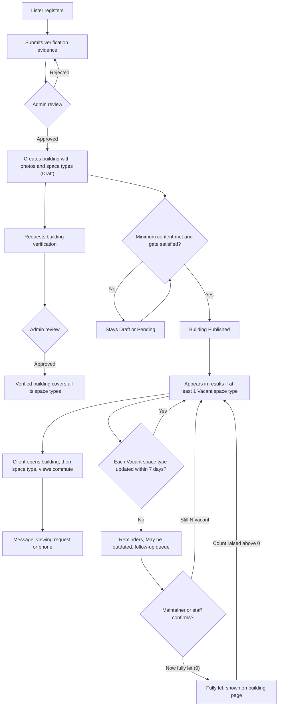
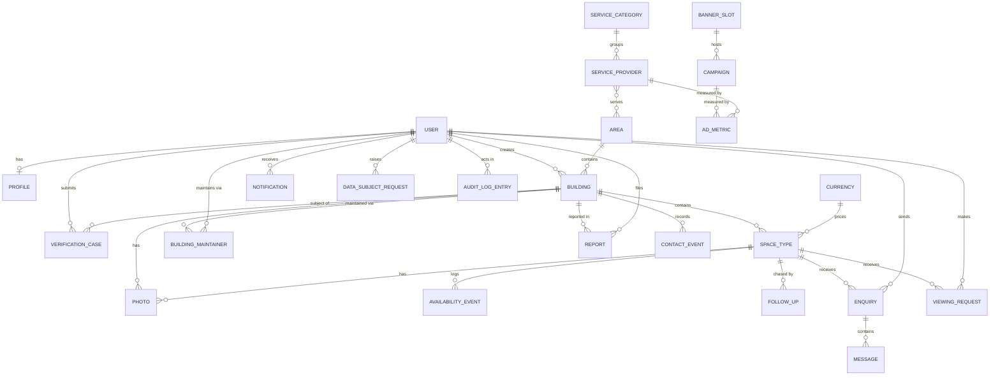

# SRS: Vacant-Space Search Platform (working title)

> **Document status:** consolidated v0.3 draft. All sections reflect the building-first model (Building → Space type). Individual units are out of scope. Open questions OQ-37 to OQ-53 are in §15.

## 1. Document control

| Item | Value |
|---|---|
| Title | Software Requirements Specification: vacant-space search platform (name TBD; branding pending) |
| Version | 0.3 |
| Date | 2026-11-25 |
| Status | Draft for stakeholder review |
| Owner | TBD (OQ-29) |

**Change log**

| Version | Date | Change |
|---|---|---|
| 0.1 | 2026-11-17 | Initial draft from messages 1 and 2 |
| 0.2 | 2026-11-23 | Commercial units included (D-11, OQ-01 closed); advertising revenue model added (D-12); Part 2 added; review fixes |
| 0.3 | 2026-11-25 | Building-first model (Building → Space type), D-18 to D-30; two-level verification; per-space-type freshness; OQ-37 to OQ-53 |

**Status tags**
- [C] confirmed in the sources (source named).
- [P] proposed by the analyst, needs stakeholder approval.
- [TBD] not enough information (linked to an open question).
- [D] confirmed, deferred to a named later release.
- [OUT] explicitly out of scope.

Each requirement carries one tag. Where a requirement mixes a confirmed need with proposed detail, it is tagged [P] and the Source column names the confirmed need. MoSCoW priorities are proposals throughout.

**Source codes:** Brief = message 1; US-01/US-02 = user stories; Units = unit types and features paragraph; Problems = the three problems; A1–A10 = answers 1–10; Misc = other notes (photos, Data Protection Act, metrics, targets); Msg3-1 = decision to include commercial units; Rev-i = banner spaces; Rev-ii = promoted service providers; B3 §n = v0.3 brief section n; B3-Qn = inline answer to v0.3 brief question n.

**Open-question index** (full detail in §15):
- Closed: OQ-01, 38, 39, 41, 42, 44, 45, 46.
- Open and re-scoped to building level: OQ-02, 03, 04, 05, 07, 09, 12, 27, 28, 33.
- New and open: OQ-37, 40, 43, 47, 48, 49, 50, 51, 52, 53.
- Other open: OQ-06, 08, 10, 11, 13, 14, 15, 16, 17, 18, 19, 20, 21, 22, 23, 24, 25, 26, 29, 30, 31, 32, 34, 35, 36.

## 2. Purpose, audience and scope

**Purpose:** specify a web application where people search for vacant rental space and see reliable, current information. The differentiator is an efficient, enforced way of keeping availability current, at least weekly (Brief).

**Audience:** stakeholders confirming needs, developers, designers, QA, and project managers.

| Scope class | Items |
|---|---|
| **In scope [C]** | A web app. Launch area: Ngong, Kenya. Guest search. Accounts and profiles for clients, landlords and agents/caretakers. **Building-first catalogue: Building → Space type, with a vacant count per space type (D-18).** Residential and commercial space types, including mixed buildings (D-27, D-30). Multi-currency rent, "Rent on interest" and a deposit. Photos at building, grounds, surroundings and space-type level. Commute times and routes via Google Maps. "Last updated" and "May be outdated" after 7 days, per space type, with at least weekly updates. Two-level verification (lister and building). In-app messaging, viewing requests (meaning: OQ-08) and phone numbers. Staff editing. Admin reporting. English and Kiswahili. Data Protection Act compliance. Advertising as the revenue model (release timing: OQ-30). |
| **In scope [P]** | Reminders, staff follow-up queue, lister dashboard ("My buildings"), building-level bulk import, audit trail, photo viewer, size (m²) on space types, advertising management and measurement. |
| **Deferred [D]** | None confirmed with a named release. |
| **Awaiting scope decision [TBD]** | Which release carries advertising (OQ-30). |
| **Out of scope [OUT]** | Property sales (A10). Fees charged to Clients, Landlords or Agents in the first release (A9). **Individual unit records (D-19).** |
| **Assumed out [P]** | Native mobile apps. Online payments, deposits and rent collection. Tenancy management. Scraping or importing competitor listings. Third-party ad networks, and in-app payment or billing for adverts. |

## 3. Business context

### 3.1 Current state (as far as the sources describe it)

1. Vacant space is advertised when its owner or caretaker marks it vacant (Misc).
2. Listings are supplied by a mix of agents, caretakers, landlords and our own staff (A2).
3. Update interfaces already exist, but users don't use them. There is no incentive to keep information current (A3).
4. Follow-up and updating are to be captured in the business SOP (A3). The SOP was not supplied (OQ-26).
5. Six competing portals exist (named in the sources, not reviewed).
6. The intended revenue model is advertising: banner spaces (Rev-i) and promoted service providers (Rev-ii).

### 3.2 Pain points
- **P1 Data quantity:** too few listings (Problems).
- **P2 Data freshness:** listings go stale (Problems).
- **P3 Trust:** users cannot rely on listings or listers (Problems).
- **Root cause of P2 [C, A3]:** users have no incentive to update and don't use existing interfaces.

### 3.3 Problem statement

| Element | Statement |
|---|---|
| Situation | People looking for a rental in the Ngong area use listing portals. Listing supply comes from agents, caretakers, landlords and staff. |
| Core problem | Listings are too few (P1), go out of date (P2), and cannot be trusted (P3). Listers have no incentive to keep them current. |
| Consequence [P] | Searchers cannot rely on what they see, so they stop using the platform. Listers see no return from updating. |
| Desired outcome | A free platform where searchers find enough current, verified listings with local context (photos, commute). Keeping a listing current takes seconds, and staff can see and chase anything that has gone stale. The platform has a sustainable revenue stream from advertising. |

### 3.4 Business objectives
All targets are [P]. The sources give no baselines (OQ-14). Metric IDs (RPT-M01 etc.) are defined in §10.3.

| ID | Objective | Success measure [P] |
|---|---|---|
| BO-01 | Increase data quantity (P1) | At least 150 Vacant space types within 90 days of public launch (RPT-M01); building count reported alongside |
| BO-02 | Improve freshness (P2) | At least 80% of Vacant space types updated within the BR-001 threshold, measured weekly (RPT-M02) |
| BO-03 | Build trust (P3) | At least 90% of Vacant space types belong to a Verified building (RPT-M04); "unavailable" reports at or below 10% of Vacant space types per month (RPT-M08) |
| BO-04 | Drive engagement | At least 0.5 enquiries (in-app plus phone taps) per Vacant space type per month (RPT-M06); median first response within 24 hours (RPT-M07) |
| BO-05 | Sustain the platform through advertising | At least 5 Active promoted providers and 1 Active banner campaign within 6 months of the advertising release (RPT-M13). Revenue target TBD (OQ-32). |

### 3.5 User stories

| ID | Story | Tag | Notes |
|---|---|---|---|
| US-01 | As a client, I want to be able to log on to the system, search for houses around a certain area and get reliable information about the houses there. | [C] US-01 | Too broad; "reliable" is untestable as written. Decomposed into US-06, US-07, US-09 and the search, verification and freshness requirements. A7: guests can search without logging in. Renters now browse buildings, open a building, then open a space type (D-18). |
| US-02 | As a house agent/caretaker, I want to be able to list a unit and update its information. | [C] US-02 | Compound (list plus update). "Unit" is read as building and space type (D-18, D-19). "Agent (aka caretaker)": OQ-17. |
| US-03 | As a landlord or agent, I want to confirm each space type's vacant count in seconds ("Still N vacant", −/+, or "Now fully let"), so my buildings stay current. | [P] | Derived from the Brief differentiator. |
| US-04 | As staff, I want to see space types with overdue vacant counts, follow them up, and capture or update buildings on a lister's behalf. | [P] | Derived from A2, A3, Problems. |
| US-05 | As staff, I want to verify listers and buildings, so clients can trust what they see. | [P] | Derived from A5 and P3. |
| US-06 | As a client, I want to message the lister about a space type, request a viewing, or phone them. | [P] | Derived from A8. |
| US-07 | As a client, I want to see commute times and routes from a building to my destination. | [P] | Derived from the Brief and A6. |
| US-08 | As management, I want metrics on supply, freshness, trust and engagement. | [P] | Derived from Misc. |
| US-09 | As a client, I want to report a space type or building as unavailable or suspicious, with a comment. | [P] | Derived from P2, P3 and B3-Q10. |
| US-10 | As a service provider (wifi, water refill, gas refill…), I want my business promoted to tenants in my service area, so that I get customers. | [P] | Providers are Admin-managed records, not system users, by default (OQ-31). |
| US-11 | As a client, I want to see relevant, clearly labelled local services near a building. | [P] | |
| US-12 | As staff, I want to manage banner campaigns and promoted providers and report results to advertisers. | [P] | |

## 4. Roles and permissions

**Roles and access attributes**

| Role | Definition |
|---|---|
| Guest | Unauthenticated visitor. |
| Client | Registered searcher. |
| Landlord | Registered owner who lists and maintains buildings. |
| Agent | Registered agent or caretaker. One role with a type attribute (OQ-17). |
| Admin | Our staff: verifier, moderator, support and reporting. One role for now (OQ-23). |

Attributes per account: verification status (§5.3), account status (Active or Suspended), language preference, and the buildings the account maintains.

A **maintainer** is a relationship, not a role: a user authorised to update a building and all its space types. Maintainers are assigned **per building** (D-21, B3-Q2). Assignment rules: OQ-04.

Service providers and advertisers are not system users in this version (default, OQ-31). Admin manages their records.

**Permission matrix.** All cells are [P] except the confirmed ones (Guest browsing, Landlord/Agent create and edit, Admin edit on behalf).

| Role | View | Create | Edit | Submit | Approve | Reject | Delete | Export | Administer |
|---|---|---|---|---|---|---|---|---|---|
| Guest | Published buildings, their space types and vacancy, lister profiles [C]; labelled ads and promoted services | — | — | — | — | — | — | — | — |
| Client | Guest scope, plus own enquiries and viewing requests | Enquiries, viewing requests, reports with comments | Own profile | Enquiry, viewing request, report | — | — | Own personal data (FR-PRV-002) | Own personal data (FR-PRV-002) | — |
| Landlord | Client scope, plus maintained buildings, received enquiries, own dashboard | Buildings, space types, photos [C] | Maintained buildings, space types and photos [C] | Building for publication; verification evidence (lister, building); vacant-count confirmation | Viewing requests on maintained buildings | Viewing requests on maintained buildings | Withdraw maintained buildings; remove photos | Own personal data (FR-PRV-002) | — (assigning maintainers: OQ-04) |
| Agent | Same as Landlord | Same as Landlord [C] | Same as Landlord [C] | Same as Landlord | Same as Landlord | Same as Landlord | Same as Landlord | Same as Landlord | — (OQ-04) |
| Admin | All buildings, users, queues, reports, audit log, dashboards, ad campaigns, providers | Buildings and space types on behalf, staff accounts, reference data, ad campaigns, provider records | Any building, space type or photo on behalf [C]; reference data; ad campaigns; provider records; user data per FR-PRV-002 | Buildings on behalf | Account and building verifications | Verifications; reports (dismiss) | Suspend, hide, remove (reversible), pause or end ads. Permanent deletion only for FR-PRV-002 | Reports and data CSV, including ad reports | Users, roles, reference data, thresholds |

**Least privilege and separation of duties**
- Clients see only their own data.
- Landlords and Agents see only clients who contacted them about buildings they maintain (NFR-PRV-02).
- Admin access to personal data is logged (NFR-AUD-01).
- A staff member may not verify an account or building they themselves submitted or edited (BR-014).
- Admin accounts are created only by an Admin (FR-ADM-006).

## 5. Process and lifecycle

### 5.1 Stages

| # | Stage | Actor | Output |
|---|---|---|---|
| 1 | Register and verify lister | Landlord/Agent, Admin | Verified account |
| 2 | Create building (details, building photos, surroundings); add space types (rent, deposit, vacant count, photos) | Maintainer or staff | Draft building |
| 3 | Verify building (evidence per building; covers all its space types) | Maintainer, Admin | Verified building |
| 4 | Publish building (gate per OQ-03) | Maintainer | Published building |
| 5 | Discover: results (buildings) → building page → space-type page; commute | Guest/Client | Shortlist |
| 6 | Contact: message, viewing request, phone | Client, maintainer | Enquiry or viewing |
| 7 | Keep fresh: confirm each space type's vacant count weekly | Maintainer, system | Updated counts |
| 8 | Follow up and moderate | Admin (per SOP, OQ-26) | Confirmed, fully let, or suspended |
| 9 | Close: space type reaches count 0 (Fully let) | Maintainer, Admin | Shown as Fully let |

### 5.2 Main workflow



### 5.3 Status models

**Building status**

| From | To | Trigger and actor |
|---|---|---|
| Draft | Published | Maintainer publishes; BR-018 met; BR-005 satisfied |
| Draft | Pending | Only if BR-005 applies (OQ-03): lister not Verified. *Not in the designs.* |
| Pending | Published | Lister becomes Verified and a maintainer confirms vacant counts (FR-VER-008) |
| Draft, Pending, Published | Suspended | Admin (FR-ADM-003) |
| Suspended | Previous status | Admin reinstates |
| Draft, Pending, Published | Withdrawn | Maintainer (FR-UNT-008). *Proposed, OQ-52.* |
| Withdrawn | Draft | Maintainer reopens |

**Space-type availability** is derived from the vacant count (BR-028). It is Vacant above 0 and Fully let at 0. It changes only by changing the count (FR-AVL-001, FR-AVL-003).

**Verification status** (accounts and buildings): Unverified → Pending → Verified or Rejected. Rejected → Pending on resubmission. Verified → Revoked (Admin), or Verified → Pending (material change, FR-VER-007). Revoked → Pending on resubmission. A Verified building covers all its space types.

**Account status:** Active ⇄ Suspended (Admin).

**Enquiry:** New → Responded → Closed. New → Closed when the space type becomes Fully let or is removed.

**Viewing request:** Requested → Accepted, Declined, or Counter-proposed. Counter-proposed → Accepted, or Cancelled if the client declines. Accepted → Cancelled (either party, or the space type becomes Fully let).

**Freshness** (derived, not stored): per Vacant space type (BR-001), with a building-level Outdated variant (BR-030).

**Campaign and provider promotion status:** Draft → Active (Admin). Active ⇄ Paused (Admin). Active or Paused → Ended (Admin, or the system when the end date passes). A banner or provider is displayed only when Active and the current date is within its start and end dates.

### 5.4 Deadlines and operating rhythm
- The 7-day expectation and badge threshold are defined once in BR-001. Reminder timing is BR-010.
- Weekly cycle [P]:
  1. A maintainer confirms each space type's count (day 0).
  2. A reminder goes out before the threshold.
  3. The label appears and the space type enters the staff follow-up queue (FR-ADM-002).
  4. Staff follow up per the SOP (OQ-26).
  5. Management reviews RPT-M02 weekly.
- Verification turnaround target: TBD (OQ-02).

## 6. Functional requirements

**Terminology map.** Read "unit" as "space type" for availability, price, photos and enquiries. Read it as "building" for location, verification, management, maintainers and status. "Property" became "building". "Vacant/Let" status became the vacant count (BR-028). The module code UNT is kept so IDs stay stable.

Columns: Dep. = dependencies; Story = linked user story; AC = acceptance criteria.

**Design-only additions** (in the designs, not requirements; OQ-51):

| ID | Item | Status |
|---|---|---|
| DO-01 | Amenities (gated compound, 24-hour guard, borehole, backup water tank, covered parking, CCTV, waste collection, fibre ready, play area) | Not a requirement |
| DO-02 | Building floors | Not a requirement |
| DO-03 | Space-type floors | Not a requirement |
| DO-04 | Space-type features | Not a requirement |
| DO-05 | "What's included" | Not a requirement |
| DO-06 | "More buildings in Ngong" | Not a requirement |
| DO-07 | Live preview in the editor | Not a requirement |
| DO-08 | Services near the building | Already FR-ADV-005 [P], Release 2, on the building page |
| DO-09 | Update-compliance metric | Already RPT-M05 [P] |

### 6.1 Accounts (ACC)

| ID | Title | The system shall… | Actor | Pri | Tag | Source | Dep. | Story | AC |
|---|---|---|---|---|---|---|---|---|---|
| FR-ACC-001 | Register and log in | …let a person register as Client, Landlord or Agent and log in and out using email and password (default, OQ-16). | Guest | Must | [P] | Need: US-01 | FR-PRV-001 | US-01 | Given a valid form and accepted privacy notice, when submitted, then the account exists and can log in. Given an email already registered, then registration is refused without revealing account details. Given wrong credentials, then login fails with a generic message. |
| FR-ACC-002 | Guest search | …let a Guest search and view Published buildings, their space types and vacancy without logging in. | Guest | Must | [C] | A7, B3 §4 | FR-SRC-001 | US-01 | Given a Guest, when opening search, then building cards show. Given a Guest opens a building editor URL, then redirected to login (FR-ACC-003). |
| FR-ACC-003 | Login required to upload | …require a logged-in user before any building, space type or photo is created or changed. | Guest | Must | [C] | A7 | FR-ACC-001 | US-02 | Given a Guest calls an upload action, then it is refused and nothing is saved. |
| FR-ACC-004 | Lister profile | …give each Landlord and Agent a profile page showing name, photo, type, verification status, count of Published buildings, and contact phone as permitted by BR-009. (SCR-04 not yet redesigned.) | Landlord, Agent | Must | [P] | Need: Units | FR-VER-005 | US-02 | Given a verified agent with 3 Published buildings, then name, indicator and the 3 buildings show. Given the agent is Suspended, then the profile and buildings they alone maintain are hidden. |
| FR-ACC-005 | Edit own profile | …let a user edit their own profile fields and credentials. | Any logged-in user | Should | [P] | Need: Units | FR-ACC-001 | US-02 | Given an edited display name, when saved, then the profile shows it. Given an edit to a verified identity field, then verification returns to Pending (FR-VER-007). |

### 6.2 Verification (VER)

| ID | Title | The system shall… | Actor | Pri | Tag | Source | Dep. | Story | AC |
|---|---|---|---|---|---|---|---|---|---|
| FR-VER-001 | Submit account verification | …let a Landlord or Agent submit the evidence required by OQ-02 (default: phone confirmation and national ID) and set their verification status to Pending. | Landlord, Agent | Must | [P] | Need: A5 | FR-ACC-001 | US-05 | Given complete evidence, when submitted, then Pending and in the Admin queue. Given a required item missing, then refused naming the item. |
| FR-VER-002 | Review account verification | …give Admin a queue of Pending account verifications, oldest first, and let Admin approve or reject each; rejection requires a reason shown to the applicant. | Admin | Must | [P] | Need: A5 | FR-VER-001, BR-014 | US-05 | Given Pending, when approved, then Verified and the applicant notified. Given rejection without a reason, then refused. Given rejected, then the applicant can resubmit. |
| FR-VER-003 | Submit building verification | …let a maintainer request verification of a building with the evidence required by OQ-02 (default: proof of authority to let or manage it), setting building verification to Pending. | Landlord, Agent | Must | [P] | Need: A5, B3 §3 | FR-UNT-001 | US-05 | Given complete evidence, then Pending and in the Admin queue. Given evidence missing, then refused naming the item. |
| FR-VER-004 | Review building verification | …let Admin approve or reject a building verification (reason required on rejection) and record the approver and date. | Admin | Must | [P] | Need: A5, B3 §3 | FR-VER-003, BR-014 | US-05 | Given the Admin who last edited the building on behalf attempts approval, then refused (BR-014). Given approval, then Verified, approver and date recorded. |
| FR-VER-005 | Verification indicators | …show the lister's account status and the building's verification status as separate labelled indicators on building cards and pages, space-type pages and profiles; a Verified building covers all its space types. | All | Must | [P] | Need: Problems (trust), B3 §3 | FR-VER-002, FR-VER-004 | US-01 | Given a verified agent with an unverified building, then only the account indicator is Verified. Given a Verified building, then all its space types show it. Given Revoked, then gone on next page load. |
| FR-VER-006 | Revoke verification | …let Admin revoke an account or building verification with a recorded reason, remove the indicator, and notify the user. | Admin | Should | [P] | Need: Problems (trust) | FR-VER-005 | US-05 | Given a Verified building, when revoked, then the indicator is removed for all its space types and the maintainer notified. Given no reason, then refused. |
| FR-VER-007 | Re-verify after material change | …return a Verified status to Pending and notify Admin when a building's area or map pin, or an account's verified identity field, changes. Changes to space types do not affect building verification. | System | Should | [P] | Need: Problems (trust) | FR-VER-004 | US-05 | Given a Verified building, when its map pin moves, then Pending and the indicator is removed. Given a rent edit on a space type, then Verified remains. |
| FR-VER-008 | Publication gate | …allow a building to be Published only when BR-018 is met and, where BR-005 applies (OQ-03), its lister's account is Verified; otherwise the building stays Pending. | System | Must | [P] | Need: A5; the designs show no gate | FR-VER-002, FR-AVL-001 | US-05 | Given an unverified agent submits a complete building, then Pending and not in search. Given the agent later becomes Verified, when a maintainer confirms vacant counts, then Published. Given BR-018 not met, then refused. |

### 6.3 Buildings and space types (UNT)

| ID | Title | The system shall… | Actor | Pri | Tag | Source | Dep. | Story | AC |
|---|---|---|---|---|---|---|---|---|---|
| FR-UNT-001 | Create building | …let a Landlord, Agent or Admin create a building with name, area from the area list, map pin, management designation and description, saved as Draft. | Landlord, Agent | Must | [C] | B3 §2, US-02 | FR-ADM-004 | US-02 | Given no map pin, then refused. Given an area not in the list, then the user must choose a listed area. |
| FR-UNT-002 | Create space type | …let a maintainer add space types to a building, each with name (e.g. "Bedsitter · Type A"), category, rent mode, currency, deposit, vacant count and photos. | Landlord, Agent | Must | [C] | B3 §1–2 | FR-UNT-001, FR-UNT-003, FR-UNT-004, FR-UNT-011 | US-02 | Given all mandatory fields, then the space type saves in the building. Given a missing field, then the error names it. Given a vacant count that is negative or not a whole number, then refused. |
| FR-UNT-003 | Categories | …support the space-type categories Bedsitter, 1 bedroom, 2 bedroom, 3 bedroom, Townhouse, Villa, Office, Shop and Warehouse, and allow residential and commercial space types in one building. | Landlord, Agent | Must | [C] | B3 §2, B3-Q8, Msg3-1 | FR-UNT-002 | US-02 | Given a building, when an Office and a Bedsitter are added, then both are accepted. Given a category not in the list, then not selectable. (Completeness: OQ-47.) |
| FR-UNT-004 | Rent mode and rent | …let a maintainer set, per space type, either a rent per month in one currency (FR-LOC-002) or the rent mode "Rent on interest" with no amount. | Landlord, Agent | Must | [C] | B3 §2, B3-Q6 | FR-LOC-002 | US-02 | Given Rent on interest, then no amount shows. Given an amount that is zero, negative or non-numeric, then refused. |
| FR-UNT-005 | Management designation | …require each building to state whether it is managed by an agent (linked to an Agent profile) or directly by the landlord (linked profile or named landlord), and show it on building cards, building pages and space-type pages. | Landlord, Agent | Must | [C] | Brief, B3 §2 | FR-ACC-004 | US-01, US-02 | Given "managed by agent" with no agent linked, then refused. Given landlord direct, then labelled "Landlord". |
| FR-UNT-006 | Maintainer authorisation | …record which users may maintain each building (covering all its space types) and allow only them, and Admin, to edit it, confirm vacant counts or add photos. | System | Must | [P] | Need: B3-Q2 (per building); rules OQ-04 | FR-ACC-003 | US-02 | Given an agent not recorded as maintainer, when editing, then refused. Given a maintainer removed, then access ends at once. Given a Client, when creating a building, then refused. |
| FR-UNT-007 | Edit building and space types | …let maintainers edit a building and its space types, including adding and removing space types, recording each change with actor and time. | Landlord, Agent | Must | [C] | US-02 | FR-UNT-006 | US-02 | Given a rent edit, then the new rent shows. Given two maintainers editing, when the second saves a stale version, then warned of the conflict. Given a space type removed, then its open enquiries are closed and clients notified. |
| FR-UNT-008 | Withdraw building | …let a maintainer withdraw a building, removing it from search and retaining its history (BR-021). | Landlord, Agent | Should | [P] | Need: US-02; OQ-52 | FR-UNT-006 | US-02 | Given withdrawal, then not searchable, and a Guest opening its link sees "no longer available". Given Withdrawn, then a maintainer can reopen it as Draft. |
| FR-UNT-009 | Bulk import | …let Admin import buildings with their space types from a structured file for nominated listers, report errors per row, and create valid buildings as Draft. | Admin | Should | [P] | Need: Problems (quantity), B3-Q9 (building level); OQ-12 | FR-UNT-002 | US-04 | Given 100 building rows with 5 invalid, then 95 Drafts are created and the error report lists the 5 rows. |
| FR-UNT-010 | Space size | …let a maintainer record the size (m²) of a space type, for any category, and show it on the space-type page. | Landlord, Agent | Should | [P] | Need: B3 §2 (residential size in the designs); OQ-33 | FR-UNT-002 | US-02 | Given an Office of 120, then "120 m²" shows. Given zero or non-numeric, then refused. Given no size, then the page shows without it. |
| FR-UNT-011 | Deposit | …require each space type to carry a deposit amount in the space type's currency and always show it with the rent mode. | Landlord, Agent | Must | [C] | B3-Q5 | FR-UNT-002, FR-LOC-002 | US-02 | Given no deposit, then saving is refused. Given a negative or non-numeric deposit, then refused. Given Rent on interest, then the deposit still shows (OQ-49). |

### 6.4 Photos (MED)

| ID | Title | The system shall… | Actor | Pri | Tag | Source | Dep. | Story | AC |
|---|---|---|---|---|---|---|---|---|---|
| FR-MED-001 | Space-type photos | …let maintainers upload photos of a typical space of a space type, in accepted formats and sizes (OQ-20); photos belong to the type, not to individual spaces. | Landlord, Agent, Admin | Must | [C] | B3 §2, Misc | FR-UNT-006 | US-02 | Given an accepted image, then it appears in the space type's gallery. Given an unsupported or oversize file, then rejected with the reason and other files unaffected. |
| FR-MED-002 | Surroundings photos | …let maintainers add surroundings photos at building level, shown on every space type of that building. | Landlord, Agent, Admin | Must | [P] | Need: Brief, B3 §2 | FR-UNT-001 | US-02 | Given 3 surroundings photos and 2 space types, then both show them. Given one is removed, then removed from both. |
| FR-MED-003 | Minimum photos | …prevent a building being Published unless it meets the photo minimums in BR-018. | System | Must | [P] | Need: B3-Q4; scope OQ-40 | FR-MED-001, FR-MED-002, FR-MED-005 | US-02 | Given a space type with 2 photos, then publishing is refused naming it and how many more are needed. Given no Cover photo, then refused. |
| FR-MED-004 | Remove photo | …let a maintainer remove a photo of a building or space type they maintain, and refuse a removal that would take a Published building below the BR-018 minimums. | Landlord, Agent | Should | [P] | Need: US-02 | FR-MED-001 | US-02 | Given a space type with 4 photos, when one is removed, then removed. Given exactly 3, then refused stating the minimum. |
| FR-MED-005 | Building photos | …let maintainers upload building photos labelled Cover or Grounds, with one designated Cover photo used on the building card. | Landlord, Agent, Admin | Must | [C] | B3 §2 | FR-UNT-001 | US-02 | Given a Cover photo set, then the building card uses it. Given none designated, then publishing is refused (BR-018). |
| FR-MED-006 | Photo viewer | …let a user open any building or space-type photo in a viewer and move between photos of the same set. | Guest, Client | Should | [P] | Need: B3 §4 (modal in designs) | FR-MED-001, FR-MED-005 | US-01 | Given a tap on a photo, then the viewer opens and next/previous work. Given a photo fails to load, then a placeholder shows and the viewer stays usable. |

### 6.5 Availability and freshness (AVL)

| ID | Title | The system shall… | Actor | Pri | Tag | Source | Dep. | Story | AC |
|---|---|---|---|---|---|---|---|---|---|
| FR-AVL-001 | Set vacant count | …let maintainers and Admin set the vacant count (a whole number, zero or more) of each space type; a space type is Vacant above 0 and Fully let at 0 (BR-028). | Landlord, Agent, Admin | Must | [C] | B3 §1–2, A2 | FR-UNT-006 | US-02, US-03 | Given count 3 set to 0, then Fully let on the building page. Given a non-integer or negative, then refused. Given a non-maintainer, then refused. |
| FR-AVL-002 | Show last updated | …show the last update (BR-004) on each space type, and on each building card and page the latest last update among its space types. | All | Must | [C] | Brief, B3 §3 | — | US-01 | Given space types updated 2026-03-01 and 2026-03-04, then the building shows 2026-03-04. Given a space type never confirmed since publication, then publication time shows. |
| FR-AVL-003 | Confirm vacant count | …let a maintainer confirm "Still N vacant" for a space type in one action, adjusting N first with a −/+ stepper if needed, or tap "Now fully let" to set the count to 0, without opening the editor; each sets the last update to now. | Landlord, Agent | Must | [C] | B3 §3 | FR-AVL-001 | US-03 | Given count 3, when "Still 3 vacant", then last update is now and the label is removed. Given stepper to 2 then confirm, then count 2. Given "Now fully let", then count 0. Given a Fully let space type, then the stepper can raise the count above 0. |
| FR-AVL-004 | Bulk confirm | …let a maintainer confirm all their Vacant space types, or those of selected buildings, at their displayed counts with one "Confirm vacant counts as shown" action. | Landlord, Agent | Must | [C] | B3 §3 | FR-AVL-003 | US-03 | Given 10 Vacant space types, when confirmed, then all 10 are updated. Given a count changed by another maintainer since the screen loaded, then skipped and listed. Fully let space types are excluded. |
| FR-AVL-005 | May be outdated label | …label a Vacant space type "May be outdated" when time since its last update exceeds BR-001, and show the Outdated variant on the building card per BR-030. | System | Must | [C] | A4, B3 §3 | FR-AVL-002 | US-01 | Given a last update 8 days ago, then labelled. Given exactly 7 days, then not labelled. Given a confirmation, then removed at once. |
| FR-AVL-006 | Update reminders | …send maintainers reminders per BR-010 containing a link to the FR-AVL-003 action. | System | Must | [P] | Need: Brief, Problems | FR-NTF-001 | US-03 | Given a Vacant space type reaches the reminder point, then maintainers are notified once. Given two space types due the same day for one lister, then one combined notification. Given it was confirmed earlier, then none. Given no channel is deliverable, then it is flagged in the follow-up queue. |
| FR-AVL-007 | Stale treatment | …apply the treatment in BR-011 to space types still unconfirmed beyond the threshold. | System | Should | [TBD] | OQ-09 | FR-AVL-005 | US-01 | To be written when OQ-09 closes. |
| FR-AVL-008 | Availability history | …record every vacant-count change, confirmation and status change with actor (user or staff on behalf) and time, and prevent alteration of entries. | System | Must | [P] | Technical necessity; OQ-43 | — | US-04 | Given an Admin confirmation, then the entry shows a staff actor. Given any role tries to alter an entry, then not possible. |
| FR-AVL-009 | Notify on fully let | …when a space type becomes Fully let or is removed, close its open enquiries, cancel its pending or future viewing requests, and notify the clients. | System | Should | [P] | Need: A8 | FR-ENQ-001 | US-06 | Given 2 open enquiries and 1 accepted future viewing, when the count reaches 0, then enquiries closed, viewing cancelled, 3 clients notified. |
| FR-AVL-010 | Report unavailable or inaccurate | …let a logged-in Client report a building or space type as unavailable (button), inaccurate or suspicious with a comment, notifying maintainers and queueing it for Admin. | Client | Should | [P] | Need: B3-Q10; comment visibility OQ-50 | FR-ADM-005 | US-09 | Given an "unavailable" report, then the maintainer is notified and the report queued. Given a Guest, then prompted to log in. Given a repeat report by the same client on the same target, then counted once. |

### 6.6 Search and discovery (SRC)

| ID | Title | The system shall… | Actor | Pri | Tag | Source | Dep. | Story | AC |
|---|---|---|---|---|---|---|---|---|---|
| FR-SRC-001 | Search by area | …let any user search Published buildings by area from the area list, or by map location and radius, listing buildings that satisfy BR-002. | Guest, Client | Must | [C] | US-01, B3 §3 | FR-ADM-004 | US-01 | Given an area with 12 matching buildings, then 12 cards. Given none, then an empty state suggests widening. Given a building with no Vacant space type, then not listed (OQ-48). |
| FR-SRC-002 | Filter by category | …let users filter by space-type category; a building matches when at least one of its Vacant space types is in the category. | Guest, Client | Must | [P] | Need: US-01, B3 §2 | FR-SRC-001 | US-01 | Given Office, then buildings with at least 1 Vacant Office show. Given a building whose only 2 bedroom space type is Fully let, then not matched. |
| FR-SRC-003 | Filter by rent and currency | …let users filter by rent range in a chosen currency, matching buildings with at least one Vacant space type priced in that currency within the range; Rent on interest space types match only when the user opts to include them. | Guest, Client | Must | [P] | Need: Units, B3 §3; OQ-05 | FR-LOC-002 | US-01 | Given 7,000–9,500 KES, then matching buildings show. Given "include Rent on interest" unticked, then buildings with only Rent on interest space types are excluded. |
| FR-SRC-004 | Filter by management and verification | …let users filter by managed by agent or landlord, and by Verified building only. | Guest, Client | Should | [P] | Need: Brief, Problems | FR-VER-005 | US-01 | Given "verified only", then only Verified buildings show. |
| FR-SRC-005 | Building card | …show per building: cover photo, name, area, rent range of its Vacant space types with currency and "/ mo" (e.g. "KES 7,000 – 9,500 / mo"), or "Rent on interest" where none shows a rent, management designation, verification indicators, latest update and the Outdated variant (BR-030). | Guest, Client | Must | [C] | B3 §3, Brief | FR-AVL-002 | US-01 | Given Vacant space types at 7,000 and 9,500 KES, then "KES 7,000 – 9,500 / mo". Given all Rent on interest, then "Rent on interest". Given mixed currencies, then one range per currency (OQ-53). Given the cover fails to load, then a placeholder shows. |
| FR-SRC-006 | Sorting | …sort by most recently updated building first by default, and offer rent ascending or descending (by lowest rent) when one currency is selected. | Guest, Client | Should | [P] | Need: US-01; OQ-09 | FR-AVL-002 | US-01 | Given no sort, then newest update first. Given rent sort with no currency selected, then the option is unavailable. |
| FR-SRC-007 | Space-type page | …provide a space-type page showing photos of a typical space, category, size when recorded, rent or "Rent on interest", deposit, "N vacant now" with "Confirmed N days ago", the May be outdated label where applicable, the building with a link, management designation, verification indicators and contact actions. | Guest, Client | Must | [C] | B3 §3–4 | FR-AVL-002, FR-ENQ-001, FR-ENQ-003 | US-01 | Given 3 Vacant confirmed 2 days ago, then "3 vacant now · Confirmed 2 days ago". Given Fully let, then "Fully let" with no contact actions. Given a Suspended or Withdrawn building, then an unavailable notice. |
| FR-SRC-008 | Building page | …provide a building page showing cover and grounds photos, surroundings photos, description, management designation, verification indicators, latest update, all its space types (name, category, rent or "Rent on interest", deposit, "N vacant now" and "Confirmed N days ago", or "Fully let"), the commute panel, contact actions and, in Release 2, promoted services (FR-ADV-005). | Guest, Client | Must | [C] | B3 §4 (SCR-02B) | FR-CMT-002, FR-SRC-007, FR-MED-005 | US-01, US-07 | Given 2 Vacant and 1 Fully let space type, then all 3 are listed with Fully let labelled. Given a Suspended or Withdrawn building, then an unavailable notice. Given maps failure, then the panel notice shows (FR-CMT-005). |

### 6.7 Commute (CMT)

| ID | Title | The system shall… | Actor | Pri | Tag | Source | Dep. | Story | AC |
|---|---|---|---|---|---|---|---|---|---|
| FR-CMT-001 | Commute destination | …let any user enter a destination (place or address) for commute estimates and keep it for the session. | Guest, Client | Must | [P] | Need: A6 | — | US-07 | Given a valid destination, then the commute panel updates. Given an unrecognised one, then a message asks the user to refine it and no estimates show. |
| FR-CMT-002 | Commute by mode | …show estimated travel time from the building to the destination for driving, public transport and walking, using Google Maps. | Guest, Client | Must | [P] | Need: A6 (modes proposed) | FR-CMT-001 | US-07 | Given a destination, then 3 estimates show. Given no route for one mode, then "Not available" shows for that mode only. |
| FR-CMT-003 | Commute at chosen time | …let the user choose a day and a departure or arrival time and show estimates for its next occurrence; default to departing now. | Guest, Client | Must | [C] | A6 | FR-CMT-002 | US-07 | Given Monday 07:30, then estimates reflect that time. Given no time chosen, then estimates are for departing now. Given the maps service returns no estimate for that time, then "Not available" shows (FR-CMT-005). |
| FR-CMT-004 | Route display | …draw the route for the selected mode on a map from the building map pin to the destination, with the start point per BR-019. | Guest, Client | Must | [C] | Brief | FR-CMT-002 | US-07 | Given driving selected, then the driving route is drawn. Given a mode with no route, then nothing is drawn and a message shows. |
| FR-CMT-005 | Commute failure handling | …when the maps service is unavailable, over quota or returns nothing, show a notice in the commute panel while the rest of the page works. | System | Must | [P] | Technical necessity | FR-CMT-002 | US-07 | Given a timeout, then the page loads with "Commute information unavailable". Given quota exhausted, then the same notice shows and Admin is alerted (NFR-MON-01). |

### 6.8 Enquiries and contact (ENQ) and notifications (NTF)

| ID | Title | The system shall… | Actor | Pri | Tag | Source | Dep. | Story | AC |
|---|---|---|---|---|---|---|---|---|---|
| FR-ENQ-001 | In-app enquiry | …let a logged-in Client message a building's maintainers about a space type, creating a conversation both can reply in. | Client | Must | [C] | A8, B3-Q1 | FR-ACC-001 | US-06 | Given a message, then maintainers notified. Given a Fully let space type, then a new enquiry is refused with a notice. Given a Guest, then prompted to log in (BR-008). |
| FR-ENQ-002 | Viewing request | …let a logged-in Client request a viewing date and time for a Vacant space type; the maintainer accepts, declines or proposes another time. The request names the building and space type, not an individual space (BR-032). | Client, Landlord, Agent | Should | [P] | Need: A8; OQ-08, OQ-37 | FR-ENQ-001 | US-06 | Given a request, then the maintainer is notified. Given acceptance, then both see the time. Given a counter-proposal the client declines, then Cancelled. |
| FR-ENQ-003 | Phone contact | …display the building's designated contact phone number to the audience set by BR-009, on the building and space-type pages, with a tap-to-call action. | Client | Must | [P] | Need: A8; OQ-06 | FR-ACC-004 | US-06 | Given a logged-in-only audience and a Guest, then the number is masked with a login prompt. Given no designated contact phone, then publishing is refused (BR-018). |
| FR-ENQ-004 | Phone contact events | …record each use of tap-to-call (building, space type if open, time, and user if logged in). | System | Should | [P] | Need: A8 | FR-ENQ-003 | US-08 | Given a logged-in tap, then stored with the user. Given a Guest tap, then no personal identifiers. |
| FR-ENQ-005 | Enquiry status | …track each enquiry as New, Responded or Closed and record time to first response. | System | Should | [P] | Need: Problems (trust) | FR-ENQ-001 | US-08 | Given a reply, then Responded and time recorded. Given the space type becomes Fully let, then Closed. |
| FR-NTF-001 | Event notifications | …notify recipients of the events in §10.2 in-app and through the channels confirmed under OQ-10. | System | Must | [P] | Technical necessity | — | All | Given an event, then the recipient sees an in-app notification. Given external delivery fails, then the in-app notification remains and the failure is logged. |

### 6.9 Admin and staff operations (ADM)

| ID | Title | The system shall… | Actor | Pri | Tag | Source | Dep. | Story | AC |
|---|---|---|---|---|---|---|---|---|---|
| FR-ADM-001 | Staff update on behalf | …let Admin edit any building or space type, confirm vacant counts and upload photos on behalf of maintainers, recording the action as staff. | Admin | Must | [C] | A2 | FR-UNT-006 | US-04 | Given an Admin confirmation, then last update changes and history shows staff. Given an Admin change to a Verified building's map pin, then FR-VER-007 applies. |
| FR-ADM-002 | Follow-up queue | …give Admin a queue of Vacant space types past the BR-001 threshold, grouped by building and ordered by days since last update, with lister contacts and last follow-up note, and let staff record an outcome (confirmed count, now fully let, unreachable). | Admin | Must | [P] | Need: A3, Problems | FR-AVL-005 | US-04 | Given a space type past the threshold, then queued. Given "now fully let", then count 0 and it leaves the queue. Given "unreachable", then logged and flagged. |
| FR-ADM-003 | Moderation | …let Admin suspend or reinstate a user, suspend or reinstate a building, and remove a photo, each with a mandatory reason and notice to the affected user. | Admin | Must | [P] | Need: Problems (trust) | — | US-05 | Given a user suspended, then buildings they alone maintain become Suspended. Given no reason, then refused. |
| FR-ADM-004 | Reference data | …let Admin maintain the area list (OQ-21), supported currencies (OQ-05), service categories (OQ-35), banner slots (OQ-34) and the thresholds in BR-001 and BR-010 without a software release, with changes audited. | Admin | Should | [P] | Technical necessity | — | US-04, US-12 | Given an area added, then it is selectable in search. Given a threshold set to zero or less, then refused. |
| FR-ADM-005 | Report handling | …let Admin list reports on buildings or space types (FR-AVL-010) and record a resolution (actioned or dismissed) for each. | Admin | Should | [P] | Need: Problems (trust) | FR-AVL-010 | US-09 | Given an open report, when resolved, then the resolution and Admin are recorded. Given a report on a Suspended building, then it is still listed. |
| FR-ADM-006 | Staff accounts | …allow only an Admin to create Admin accounts; staff roles are never selectable at registration. | Admin | Must | [P] | Technical necessity | — | US-04 | Given the registration form, then no Admin option exists. Given an Admin creates an account, then the invitee must set credentials. |
| FR-ADM-007 | Audit log search | …let Admin search the audit trail (NFR-AUD-01) by user, building and date range. | Admin | Should | [P] | Need: NFR-AUD-01 | FR-AVL-008 | US-04 | Given a building and date range, then matching entries show. Given no match, then an empty result. |

### 6.10 Reporting (RPT), localisation (LOC) and privacy (PRV)

| ID | Title | The system shall… | Actor | Pri | Tag | Source | Dep. | Story | AC |
|---|---|---|---|---|---|---|---|---|---|
| FR-RPT-001 | Admin dashboard | …present metrics RPT-M01 to RPT-M10, RPT-M12 and RPT-M13 (§10.3), filterable by area, space-type category, management type, lister and date range. | Admin | Must | [P] | Need: Misc | FR-AVL-008 | US-08 | Given 100 Vacant space types of which 60 were updated within 7 days, then RPT-M02 shows 60%. Given a filter with no data, then empty, not an error. |
| FR-RPT-002 | Export | …let Admin export report tables as CSV, with each export logged. | Admin | Should | [P] | Need: Misc | FR-RPT-001 | US-08 | Given an export, then a CSV downloads and is logged. Given zero rows, then a headers-only file. |
| FR-RPT-003 | Lister dashboard ("My buildings") | …show Landlords and Agents their buildings with each space type's vacant count, days since last update, freshness state, and enquiries awaiting reply. | Landlord, Agent | Should | [P] | Need: Problems (freshness); B3 §4; OQ-13 | FR-AVL-002, FR-ENQ-005 | US-03 | Given 3 space types, then each shows count and days since update. Given an enquiry unanswered, then counted as awaiting. |
| FR-LOC-001 | Language | …provide the UI and notifications in English and Kiswahili, let the user switch at any time, and remember the choice. | All | Must | [C] | A10 | — | US-01 | Given a switch to Kiswahili, then all UI text shows in Kiswahili. Given a missing translation, then English shows, never a raw key. |
| FR-LOC-002 | Currency per space type | …let a maintainer choose one currency per space type from the supported list (applies to its rent and deposit) and display amounts with the currency code. | Landlord, Agent | Must | [C] | Units, B3 §2 | FR-ADM-004 | US-02 | Given USD, then rent and deposit show in USD. Given a currency not in the list, then not selectable. |
| FR-PRV-001 | Privacy notice and consent | …present the privacy notice at registration and record acceptance (user, notice version, time) before account creation completes. | Guest | Must | [P] | Need: Misc (Data Protection Act); OQ-15 | FR-ACC-001 | US-01 | Given the notice not accepted, then registration is refused. Given a new notice version, then users re-accept at next login. |
| FR-PRV-002 | Data subject requests | …let a user view and correct their personal data and request export or deletion, and let Admin action each request with the request and outcome recorded. | Any user, Admin | Must | [P] | Need: Misc; OQ-15, OQ-24 | FR-ACC-005 | US-01 | Given a deletion request, then personal data is erased or anonymised except where retention is required, and the requester notified. Given the user maintains Published buildings, then those are withdrawn first. |

### 6.11 Advertising (ADV)

| ID | Title | The system shall… | Actor | Pri | Tag | Source | Dep. | Story | AC |
|---|---|---|---|---|---|---|---|---|---|
| FR-ADV-001 | Banner campaigns | …let Admin create and manage banner campaigns (image, destination link, language, slot, start and end dates) and set their status per §5.3. | Admin | Should | [P] | Need: Rev-i; slots OQ-34 | FR-ADM-004 | US-12 | Given a complete campaign, when set Active, then it is eligible for display within its dates. Given a missing image or link, then it cannot be set Active. Given an end date earlier than the start date, then refused. |
| FR-ADV-002 | Banner display | …show the banner of an Active campaign, within its dates, in its slot. | System | Should | [P] | Need: Rev-i | FR-ADV-001, FR-ADV-003 | US-12 | Given an Active campaign in its dates, when the page loads, then the banner shows. Given the end date has passed, then it is not shown and status is Ended. Given no Active campaign for a slot, then the slot is not rendered. Given the image fails to load, then the page layout and content are unaffected. |
| FR-ADV-003 | Ad labelling | …label every banner and promoted provider "Ad" or "Promoted" in the user's language, visually distinct from listings, never inside listing results and never with a Verified indicator (BR-023). | System | Should | [P] | Need: Problems (trust); Rev-i, Rev-ii | FR-ADV-002, FR-ADV-005 | US-01, US-12 | Given a banner, then it carries the label. Given a promoted provider, then it carries "Promoted" and no verification indicator. Given a search results page, then no ad appears as a listing card. |
| FR-ADV-004 | Service provider records | …let Admin create and manage service provider records: name, category, description, phone number, service areas, language(s), promotion start and end dates and status. | Admin | Should | [P] | Need: Rev-ii; categories OQ-35 | FR-ADM-004 | US-10, US-12 | Given a complete record set Active within its dates, then it is eligible for display. Given name, category, phone or service area missing, then refused. Given a category not in the list, then it is not selectable. |
| FR-ADV-005 | Promoted services display | …show on a building page a "Promoted services" section of Active promoted providers whose service areas include the building's area, ordered per BR-025, hidden when there are none. | Guest, Client | Should | [P] | Need: Rev-ii, B3 §4 | FR-ADV-003, FR-ADV-004, FR-SRC-008 | US-10, US-11 | Given 3 Active providers serve the area, then 3 show. Given none, then hidden. Given a provider Paused or Ended, then not shown. |
| FR-ADV-006 | Services directory | …provide a bilingual page listing Active promoted providers by category and area. | Guest, Client | Could | [P] | Need: Rev-ii (promotion surface unspecified) | FR-ADV-004 | US-11 | Given category wifi and an area, then matching Active providers show, labelled Promoted. Given none, then an empty state shows. |
| FR-ADV-007 | Pause or end ads | …let Admin pause, resume or end any campaign or provider promotion immediately, with a recorded reason. | Admin | Should | [P] | Need: Problems (trust) | FR-ADV-001, FR-ADV-004 | US-12 | Given an Active campaign paused, then it is not shown from the next page load. Given no reason, then refused. |
| FR-ADV-008 | Ad measurement | …count daily impressions of each banner and promoted provider and taps or clicks on their links and phone numbers, without storing personal identifiers (BR-024). | System | Should | [P] | Need: Rev-i, Rev-ii | FR-ADV-002, FR-ADV-005 | US-12 | Given a banner shown 100 times and clicked 4, then the daily counts are 100 and 4. Given a click by a logged-in user, then no user identifier is stored. |
| FR-ADV-009 | Advertiser report | …let Admin produce a per-campaign or per-provider report (period, impressions, clicks, taps) and export it as CSV. | Admin | Should | [P] | Need: Rev-i, Rev-ii | FR-ADV-008, FR-RPT-002 | US-12 | Given a campaign and a period, then the report shows totals for that period. Given no activity, then zeros. |

## 7. Business rules

| ID | Rule | Rationale | Source | Tag | Affects |
|---|---|---|---|---|---|
| BR-001 | Maintainers are expected to update the vacant count of each Vacant space type at least once every 7 days. A Vacant space type whose last update is more than 7 days old is labelled "May be outdated". | Freshness (P2) | Brief, A4, B3 §3 | [C] | FR-AVL-005, FR-AVL-006, FR-ADM-002, RPT-M02 |
| BR-002 | Only Published buildings with at least one Vacant space type appear in search results. The building page lists all its space types, with Fully let ones labelled (BR-028). | Vacancies are advertised when marked vacant | Misc, B3-Q3; OQ-48 | [P] | FR-SRC-001, FR-AVL-001 |
| BR-003 | Only a building's maintainers, and Admin on their behalf, may change the vacant counts of its space types. | Accountability | Misc, A2 | [C] | FR-AVL-001, FR-ADM-001 |
| BR-004 | "Last update" for a space type is the time of its latest vacant-count confirmation or change. Editing other details does not by itself refresh it. | Prevents a typo fix looking like a vacancy check | Analyst; OQ-28 | [P] | FR-AVL-002, FR-AVL-003, FR-AVL-005 |
| BR-005 | A building may be Published only when its lister's account is Verified. Applies at building level; the designs show no gate (OQ-03). | Trust vs quantity trade-off | Analyst | [P] | FR-VER-008 |
| BR-006 | Verified indicators for lister accounts and buildings are granted only by Admin decision. A Verified building covers all its space types. | Trust | B3 §3 | [P] | FR-VER-002, FR-VER-004, FR-VER-005 |
| BR-007 | Guests may search and view listings. Login is required to create or change buildings, space types or photos. | Access scope | A7 | [C] | FR-ACC-002, FR-ACC-003 |
| BR-008 | Messaging, viewing requests and reports require login. | Limit abuse; identify enquirers | Analyst; OQ-22 | [P] | FR-ENQ-001, FR-ENQ-002, FR-AVL-010 |
| BR-009 | The building's designated contact phone number is shown only to logged-in users. | Reduce scraping and personal-data exposure | Analyst; OQ-06 | [TBD] | FR-ACC-004, FR-ENQ-003 |
| BR-010 | Reminders go to maintainers for each Vacant space type 1 day before it reaches the BR-001 threshold, again when its label first appears, then every 7 days while unconfirmed. Reminders due the same day for one lister may be combined. | Make weekly updating routine | Analyst | [P] | FR-AVL-006 |
| BR-011 | Space types unconfirmed beyond the threshold are ranked lower and hidden after 14 days. The effect on building ranking is TBD. | Protect searchers from dead listings | OQ-09 | [TBD] | FR-AVL-007 |
| BR-012 | Every building shows whether it is managed by an agent or directly by the landlord. | Transparency | Brief, B3 §2 | [C] | FR-UNT-005 |
| BR-013 | Each space type has one rent mode: a rent per month in one currency, or "Rent on interest". A deposit applies in both cases (BR-029). | Multi-currency and no-rent support | Units, B3 §2, B3-Q6 | [C] | FR-UNT-004, FR-LOC-002 |
| BR-014 | A staff member may not approve a verification for an account or a building they submitted or edited. | Separation of duties | Analyst | [P] | FR-VER-002, FR-VER-004 |
| BR-015 | The platform lists rentals only; sales are not listed. | Scope | A10 | [C] | §2 |
| BR-016 | **Withdrawn** (resolved by D-11; see BR-022). | | | | |
| BR-017 | No fees are charged to Clients, Landlords or Agents in the first release. | Free initially | A9 | [C] | §2 |
| BR-018 | To be Published, a building needs: at least 3 building photos including one designated Cover; at least 1 surroundings photo; a designated contact phone number; a management designation; and at least one space type. Each space type needs at least 3 photos, a rent mode, a deposit and a vacant count. | Minimum quality for trust | B3-Q4; other items from v0.2; OQ-40 | [P] | FR-MED-003, FR-ENQ-003, FR-VER-008 |
| BR-019 | Public display of a building's location (including the route start point) is at area level; the exact map pin is shown to logged-in users only. | Safety and privacy | Analyst; OQ-07 | [TBD] | FR-CMT-004 |
| BR-020 | Personal data shall be handled in compliance with the Data Protection Act of Kenya. | Legal | Misc | [C] | FR-PRV-001, FR-PRV-002, NFR-PRV-01 |
| BR-021 | Withdrawn buildings and their history are retained; listers cannot permanently delete them. | Audit | Analyst; OQ-24 | [P] | FR-UNT-008, FR-AVL-008 |
| BR-022 | Residential (bedsitter, 1/2/3 bedroom, townhouse, villa) and commercial (office, shop, warehouse) space types may be listed in the same building. Supersedes the residential-only wording in A10. | Stakeholder decision | Msg3-1, B3-Q8 | [C] | FR-UNT-003, FR-SRC-002, FR-SRC-005 |
| BR-023 | Every banner and promoted provider is labelled "Ad" or "Promoted", is visually distinct from listings, is never shown within search results as a listing, and never carries a Verified indicator. | Protects trust (P3) | Analyst | [P] | FR-ADV-003, FR-ADV-005 |
| BR-024 | Ad selection uses only the building's area and the service category. No personal data of users is used for targeting or shared with advertisers, who receive aggregate counts only. | Data Protection Act and trust | Analyst; OQ-15 | [P] | FR-ADV-005, FR-ADV-008, FR-ADV-009 |
| BR-025 | Order, rotation and maximum number of promoted providers shown per building: TBD (suggested: rotate evenly among eligible providers, maximum 5). | Fairness to advertisers | OQ-36 | [TBD] | FR-ADV-005 |
| BR-026 | Ad sales, invoicing and payment are handled outside the system. The system records campaign periods and delivery metrics only. | Keeps payments out of scope | Analyst; OQ-31, OQ-32 | [P] | FR-ADV-001, FR-ADV-004, FR-ADV-009 |
| BR-027 | The catalogue holds buildings and space types only. Individual units are not recorded; price and photos belong to the space type. | Building-first model | B3 §1, D-19 | [C] | All |
| BR-028 | A space type's vacant count is a whole number of zero or more. It is Vacant above 0 and Fully let at 0. A Fully let space type stays visible on its building page, labelled "Fully let". | Availability model | B3 §2, B3-Q3 | [C] | FR-AVL-001, FR-SRC-008 |
| BR-029 | Every space type shows a deposit amount wherever its rent mode is shown. | Deposit is part of the moving-in cost | B3-Q5; OQ-49 | [C] | FR-UNT-011 |
| BR-030 | Freshness applies to Vacant space types only; Fully let ones are neither labelled nor reminded. A building shows the latest update among its space types and shows the Outdated variant when that latest update is more than the BR-001 threshold old. | Building-level freshness | B3 §3 | [P] (OQ-53) | FR-AVL-002, FR-AVL-005, FR-SRC-005 |
| BR-031 | Maintainers are assigned per building and apply to all its space types. | Simpler access model | B3-Q2 | [C] | FR-UNT-006 |
| BR-032 | Enquiries and viewing requests name a building and a space type; no individual space is identified. | Individual units are out of scope | B3-Q1 (as read); OQ-37 | [P] | FR-ENQ-001, FR-ENQ-002 |

## 8. Non-functional requirements

| ID | Statement | Verification | Pri | Tag | Source |
|---|---|---|---|---|---|
| NFR-SEC-01 | The system shall enforce the §4 role permissions on every action, server-side. | Role-based penetration and access tests | Must | [P] | Technical necessity |
| NFR-SEC-02 | The system shall encrypt data in transit and store credentials so they cannot be read back. | Security review | Must | [P] | Technical necessity |
| NFR-SEC-03 | The system shall validate uploaded files by type and size and reject others. | Upload tests | Should | [P] | Technical necessity |
| NFR-PRV-01 | The system shall meet the Data Protection Act of Kenya; specific duties (controller role, registration, retention, consent wording, cross-border transfers such as Google Maps) are TBD pending legal review. | Legal sign-off before launch | Must | [TBD] | Misc; OQ-15 |
| NFR-PRV-02 | A Client's personal data shall be visible only to maintainers of buildings they contacted, and to Admin. | Access tests | Must | [P] | Misc (Data Protection Act) |
| NFR-PRF-01 | 95% of search result pages shall render within 3 seconds on a mid-range phone over a 4G connection under expected launch load (load TBD, OQ-25). | Performance test | Should | [P] | Analyst |
| NFR-PRF-02 | Photos shall be delivered in sizes suited to the viewing device. | Page-weight test | Should | [P] | Analyst |
| NFR-PRF-03 | Banners and promoted content shall load without delaying the display of listing content, and a failure to load them shall not affect the page. | Performance and failure test | Should | [P] | Rev-i, Rev-ii |
| NFR-USE-01 | The UI shall be responsive and usable on phone-sized screens and on current versions of major browsers (list TBD). | Cross-device test | Must | [P] | Analyst (A1 context) |
| NFR-USE-02 | A maintainer shall confirm "Still N vacant" for a space type from a reminder link in no more than 2 interactions after login. | Usability test with at least 5 maintainers | Must | [P] | Need: Brief differentiator |
| NFR-USE-03 | The UI shall meet WCAG 2.1 AA (target to be confirmed). | Accessibility audit | Should | [P] | Analyst |
| NFR-AVL-01 | Service availability target: TBD. | TBD | Should | [TBD] | OQ-25 |
| NFR-AUD-01 | The system shall keep an audit trail of changes to buildings, space types, vacant counts, verification, moderation, data-subject requests and Admin access to personal data. Retention TBD. | Audit-log test | Must | [P] | Technical necessity; OQ-24 |
| NFR-DAT-01 | Timestamps shall be recorded server-side, and times shown in East Africa Time. | Data test | Must | [P] | A1 context |
| NFR-BKP-01 | Backup frequency and recovery targets: TBD. | TBD | Should | [TBD] | OQ-25 |
| NFR-SCL-01 | Expected volumes of listings and users: TBD. | TBD | Should | [TBD] | OQ-25 |
| NFR-MON-01 | The system shall monitor Google Maps usage and errors and alert Admin before and when the cost limit (OQ-18) is reached. | Monitoring test | Must | [P] | Risk: no budget |

### Counts (v0.3)

| Measure | Value |
|---|---|
| Functional requirements | 82 |
| Must / Should / Could | 52 / 29 / 1 |
| Tags [C] / [P] / [TBD] | 26 / 55 / 1 |
| Non-functional requirements (Must / Should) | 17 (9 / 8) |
| Business rules (IDs / active) | 32 / 31 |

## 9. Data requirements

Retention periods are not stated in the sources for any entity (OQ-24). BR-021 applies to withdrawn buildings in the meantime. Design-only attributes (amenities, floors, features, "what's included") are not in the model until OQ-51 is answered.

| Entity | Purpose | Key attributes | Relationships | Owner | Creation and modification | Retention |
|---|---|---|---|---|---|---|
| User and Profile | Account and public lister profile | Role, display name, email, phone, language, account status, verification status, lister type (Landlord, Agent, Caretaker), photo, consent records | Creates Buildings; has Verification cases, Enquiries | The user; Admin for status | Created at registration; edited by owner; status by Admin | TBD |
| Verification case | Evidence and decision for a lister account or a building | Subject (account or building), evidence references, status, reviewer, decision date, reason | Belongs to a User or a Building | Admin | Submitted by lister; decided by Admin; never edited after decision | TBD (sensitive) |
| Area | Reference list for search | Name, centre point | Contains Buildings; served by providers | Admin | Admin only | n/a |
| Building | The catalogue entry renters browse | Name, area, map pin, management designation (agent link or landlord), description, status, verification status | Has Space types, Maintainers, Photos; belongs to an Area | Maintainers | Maintainers or Admin; status per §5.3 | BR-021 |
| Space type | A group of identical spaces in a building | Name, category, size (m²), rent mode, currency, rent per month, deposit, vacant count, last update | Belongs to a Building; has Photos, Availability events, Enquiries | Maintainers of the building | Maintainers or Admin; count per BR-028 | TBD |
| Building maintainer | Who may maintain a building and all its space types | Building, user, added by, date | Links Building and User | Lister or Admin | Per OQ-04 | TBD |
| Photo | Building or space-type image | Owner (Building or Space type), category (Cover, Grounds, Surroundings, Space type), file, uploader, uploaded at | Belongs to a Building or a Space type | Maintainer | Maintainers or Admin | TBD |
| Availability event | History of vacant-count changes, confirmations and status changes | Space type, actor, staff-on-behalf flag, type, old and new count, time | Belongs to a Space type | System | Append-only (FR-AVL-008) | TBD |
| Follow-up | Staff chasing record | Space type, staff, outcome, note, time | Belongs to a Space type | Admin | Admin | TBD |
| Enquiry and Message | In-app conversation | Building, space type, client, status, messages, first-response time | Between a Client and maintainers | Participants | Participants | TBD |
| Viewing request | Viewing slot | Building, space type, client, proposed time, status | Belongs to a Space type and a Client | Participants | Per §5.3 | TBD |
| Report | Client report of a problem | Target (building or space type), client, reason, comment, resolution | Belongs to a Building or a Space type | Admin | Client creates; Admin resolves | TBD |
| Contact event | Tap-to-call count | Building, space type if open, time, user if logged in | Belongs to a Building | System | System | TBD |
| Notification | Message to a user | Recipient, event, channel, status | Belongs to a User | System | System | TBD |
| Data subject request | Access, correction, export, deletion | User, type, outcome | Belongs to a User | Admin | User raises; Admin closes | TBD |
| Audit log entry | Who changed what and when | Actor, action, object, time | References any entity | System | Append-only | TBD |
| Currency and Service category | Reference lists | Code or name | Used by Space type, Provider | Admin | Admin only | n/a |
| Service provider | Promoted business | Name, category, description, phone, service areas, languages, promotion dates, status | Serves Areas; has Ad metrics | Admin | Admin only | TBD |
| Banner slot and Campaign | Ad position and its creative | Slot location and size; campaign image, link, language, dates, status | Slot hosts Campaigns | Admin | Admin only | TBD |
| Ad metric | Daily ad counts | Subject (campaign or provider), date, impressions, clicks | Belongs to a Campaign or a Provider | System | System; no personal identifiers | TBD |



A report may also target a single space type; the diagram shows the building link only. A detailed logical or physical data model is not produced at this stage.

## 10. Interfaces, notifications and reporting

### 10.1 Integrations

| Integration | Purpose | Direction | Trigger | Data | Failure handling |
|---|---|---|---|---|---|
| Google Maps (A6) | Commute times, routes, place search for the destination, map display | Outbound requests | User sets a destination or time, or opens a listing | Building coordinates, destination, mode, time | FR-CMT-005; cost and quota limit under OQ-18; a user's destination is sent to Google, which is a Data Protection Act point (OQ-15) |
| Notification channels | Deliver the events in §10.2 | Outbound | Event occurs | Message text, recipient contact | FR-NTF-001; channels are TBD (OQ-10) |
| Existing update interfaces | Unknown | TBD | TBD | TBD | OQ-11 |
| Ad networks, payment or billing | None assumed | n/a | n/a | n/a | BR-026; third-party ad networks are assumed out of scope |

### 10.2 Notification events
Channels are in-app plus those confirmed under OQ-10. Content follows the recipient's language (FR-LOC-001).

| Event | Trigger | Recipients |
|---|---|---|
| N-01 Account verification decision | FR-VER-002 | Applicant |
| N-02 Building verification decision | FR-VER-004 | Maintainers |
| N-03 Verification revoked or reopened | FR-VER-006, FR-VER-007 | Maintainers; Admin for FR-VER-007 |
| N-04 Update reminder | BR-010 | Maintainers |
| N-05 New enquiry message | FR-ENQ-001 | Maintainers |
| N-06 Reply to an enquiry | FR-ENQ-001 | Client |
| N-07 Viewing request or response | FR-ENQ-002 | Maintainer or client |
| N-08 Space type becomes Fully let or is removed | FR-AVL-009 | Clients with open enquiries or viewings |
| N-09 Report received | FR-AVL-010 | Maintainers; Admin queue |
| N-10 Suspension, hiding or photo removal | FR-ADM-003 | Affected user |
| N-11 Maps usage near or over limit | NFR-MON-01 | Admin |
| N-12 Data subject request received or completed | FR-PRV-002 | Admin; requester |
| N-13 Lister verified, building awaiting confirmation | FR-VER-008 | Maintainers |
| N-14 Campaign or promotion ending soon, or ended | End date approaching or passed | Admin |

### 10.3 Reports and dashboards
**Audience:** Admin sees all metrics. Landlords and Agents see their own buildings (FR-RPT-003). **Filters:** area, space-type category, management type, lister, date range. **Export:** CSV (FR-RPT-002). Ad report: FR-ADV-009.

| ID | Metric | Definition |
|---|---|---|
| RPT-M01 | Active listings | Count of Published buildings with at least one Vacant space type, and count and total vacant count of Vacant space types. |
| RPT-M02 | Freshness rate | Vacant space types updated within the BR-001 threshold ÷ Vacant space types, at a point in time; weekly snapshot. |
| RPT-M03 | Median days since last update | Median of days since last update across Vacant space types. |
| RPT-M04 | Verified share | Two figures: Vacant space types in a Verified building ÷ Vacant space types, and Vacant space types whose lister is Verified ÷ Vacant space types. |
| RPT-M05 | Update compliance per lister | For each lister, Vacant space types updated within the threshold ÷ their Vacant space types. |
| RPT-M06 | Engagement | (In-app enquiries + tap-to-call events) in the month ÷ average Vacant space types in that month. |
| RPT-M07 | Response time | Median time from enquiry creation to first maintainer reply. |
| RPT-M08 | Unavailable-report rate | Reports with reason "unavailable" in the month ÷ average Vacant space types in that month. |
| RPT-M09 | Users | New registrations and active users (logged in during the period), by role. |
| RPT-M10 | Verification turnaround | Median time from Pending to decision, for accounts and for buildings. |
| RPT-M11 | **Withdrawn** | Time to let is not applicable without individual units (D-26). |
| RPT-M12 | Ad delivery | Impressions, clicks and taps per campaign and per promoted provider, per period. |
| RPT-M13 | Active ads | Count of Active campaigns and Active promoted providers, by category and area. |

## 11. UI/UX

### 11.1 Screen inventory

| ID | Screen | Users | Purpose and key actions | Linked FRs | Permission-dependent behaviour |
|---|---|---|---|---|---|
| SCR-01 | Home and search | Guest, Client | Search by area, filter, enter commute destination | FR-SRC-001 to FR-SRC-004, FR-CMT-001, FR-ADV-002 | Same for all |
| SCR-02 | Search results (buildings) | Guest, Client | Building cards, sort, labels | FR-SRC-004 to FR-SRC-006, FR-AVL-005, FR-ADV-003 | Same for all |
| SCR-02B | Building page (new in v0.3) | Guest, Client | Building photos, space types, commute, contact, promoted services | FR-SRC-008, FR-CMT-001 to FR-CMT-005, FR-ENQ-003, FR-ADV-005 | Phone masked for Guests (BR-009) |
| SCR-03 | Space-type page | Guest, Client | Photos, rent, deposit, vacant count, contact, report | FR-SRC-007, FR-ENQ-001, FR-ENQ-003, FR-AVL-010, FR-VER-005 | Message, viewing and report need login |
| SCR-04 | Lister profile | All | View lister and their buildings (design not yet updated) | FR-ACC-004, FR-VER-005 | Suspended listers hidden |
| SCR-05 | Register, log in, privacy notice | Guest | Create account, accept notice, choose language | FR-ACC-001, FR-PRV-001, FR-LOC-001 | n/a |
| SCR-06 | My account | Any user | Edit profile, data requests (design not yet updated) | FR-ACC-005, FR-PRV-002 | Own data only |
| SCR-07 | My buildings | Landlord, Agent | Freshness status, confirm counts, bulk confirm | FR-AVL-003, FR-AVL-004, FR-RPT-003, FR-UNT-008 | Maintained buildings only |
| SCR-08 | Building editor | Landlord, Agent, Admin | Building, space types, photos | FR-UNT-001 to FR-UNT-011, FR-MED-001 to FR-MED-005, FR-AVL-001 | Maintainers and Admin only |
| SCR-09 | Verification | Landlord, Agent | Submit evidence for lister and building, see status | FR-VER-001, FR-VER-003 | Own cases |
| SCR-10 | Messages and viewings | Client, Landlord, Agent | Conversations, viewing requests (design not yet updated) | FR-ENQ-001, FR-ENQ-002, FR-ENQ-005 | Participants only |
| SCR-11 | Reminder landing | Landlord, Agent | "Still N vacant" with −/+, "Now fully let", bulk confirm | FR-AVL-003, FR-AVL-004, FR-AVL-006, NFR-USE-02 | Login first, then return; a non-maintainer is refused |
| SCR-12 | Verification queue | Admin | Review, approve, reject, revoke | FR-VER-002, FR-VER-004, FR-VER-006 | Not the submitter's own case (BR-014) |
| SCR-13 | Follow-up queue | Admin | Overdue space types, outcomes, update on behalf | FR-ADM-001, FR-ADM-002 | Admin |
| SCR-14 | Moderation and reports | Admin | Suspend, hide, remove, resolve | FR-ADM-003, FR-ADM-005 | Admin |
| SCR-15 | Dashboard and exports | Admin | Metrics, CSV | FR-RPT-001, FR-RPT-002 | Admin |
| SCR-16 | Reference data, staff, audit | Admin | Areas, currencies, categories, slots, thresholds, staff, audit, data requests | FR-ADM-004, FR-ADM-006, FR-ADM-007, FR-PRV-002 | Admin |
| SCR-17 | Ads and providers | Admin | Campaigns, providers, pause, reports | FR-ADV-001, FR-ADV-004, FR-ADV-007, FR-ADV-009 | Admin |
| SCR-18 | Services directory | Guest, Client | Browse promoted providers (design not yet updated) | FR-ADV-006 | Same for all |
| SCR-19 | Photo viewer (modal, new in v0.3) | Guest, Client | Full-screen photo browsing | FR-MED-006 | Same for all |

### 11.2 Low-fidelity layouts (two screens where the order removes ambiguity)

```
SCR-02B Building page                          SCR-11 Reminder landing
+--------------------------------------+       +--------------------------------+
| [Cover photo]   Building name  [Verified]    | Your buildings                 |
| Area · Managed by: Agent <name>              | Building A                     |
| Updated: <date>  [Outdated variant?]         |  Bedsitter · Type A  last      |
| Description                                  |   updated 6 days               |
| [Grounds photos] [Surroundings photos]       |   Still 3 vacant [-] 3 [+]     |
| -- Available spaces ---------------          |   [Now fully let]              |
| Bedsitter · Type A   KES 7,000 / mo          |  1 bedroom · Type B  ...       |
|   Deposit KES 7,000                          | [Confirm vacant counts as      |
|   3 vacant now · Confirmed 2 days ago        |  shown]                        |
| 2 bedroom · Type B   Rent on interest        +--------------------------------+
|   Deposit KES 20,000    Fully let            |
| -- Commute: dest [__] day/time [__] ---      |
|   Drive / Transit / Walk + route             |
| Contact: [Message] [Book viewing]            |
|   phone (log in to view)  [Report]           |
| -- Promoted services (Ad) --------           |
+--------------------------------------+
```

### 11.3 UX principles
**Confirmed needs [C]**
- Search that is easy (Brief).
- Photos of both the building and its surroundings (Brief).
- Commute times and routes (Brief, A6).
- A visible "last updated" (Brief).
- A visible indicator of agent or landlord management (Brief).
- Guest search without login (A7).
- English and Kiswahili (A10).

**Design suggestions [P], not requirements**
- Mobile-first, one-hand confirm flow.
- Ads always visually separate from listings.
- Show the freshness state on the lister's own dashboard.
- Possible later additions: duplicate-building warning, saved listings, map view of results, commute time on building cards, photo-upload date, indicative currency conversion.

## 12. Error handling and exceptions

| Scenario | Expected behaviour |
|---|---|
| Maps service down or over quota | Commute panel shows a notice; the page stays usable; Admin alerted (FR-CMT-005) |
| Destination not recognised | Message asks to refine; no estimates shown |
| Photo upload rejected | Reason shown; other files in the batch unaffected (FR-MED-001) |
| Notification delivery fails | In-app notification remains; failure logged (FR-NTF-001) |
| Two maintainers edit the same building | Second save warned of conflict; no silent overwrite (FR-UNT-007) |
| Space type reaches count 0 with open enquiries or viewings | Enquiries closed, viewings cancelled, clients notified (FR-AVL-009) |
| Reminder link opened when logged out | Login, then return to the action; a non-maintainer is refused |
| User lacks permission | Action refused with a clear message; nothing saved |
| Verification rejected | Reason shown; applicant can resubmit (FR-VER-002) |
| Lister unreachable during follow-up | Attempt logged; space type stays in the queue flagged (FR-ADM-002) |
| Session expires while editing | Unsaved form values preserved after login [P] |
| Bulk import has invalid rows | Valid buildings created as Draft; error report by row (FR-UNT-009) |
| Duplicate registration | Refused without revealing account details (FR-ACC-001) |
| Unsupported currency or invalid amount | Rejected with a message (FR-LOC-002, FR-UNT-004) |
| Invalid vacant count (negative or not a whole number) | Rejected with a message (FR-AVL-001) |
| Publishing without the minimum photos | Refused, naming what is missing (FR-MED-003) |
| Bulk confirm hits a count changed meanwhile | That space type skipped and listed (FR-AVL-004) |
| Banner image fails to load | Page layout unaffected (FR-ADV-002) |
| Campaign past end date or provider paused during display | Removed at the next page load (FR-ADV-002, FR-ADV-007) |
| Deletion request while the user maintains Published buildings | Buildings withdrawn first (FR-PRV-002) |
| Suspended user tries to log in | Refused with a notice; buildings they alone maintain stay hidden (FR-ADM-003) |
| Link to a Fully let space type or a Withdrawn or Suspended building | Unavailable notice; no contact actions (FR-SRC-007, FR-SRC-008) |

## 13. Assumptions, constraints, dependencies, risks

### Assumptions

| ID | Assumption | Impact if wrong | How to validate |
|---|---|---|---|
| A-01 | Rents are quoted per month, residential and commercial | Price display and filters change | OQ-33 |
| A-02 | Landlord and Agent accounts also have Client abilities | Roles and matrix change | Stakeholder review |
| A-03 | Maintainers read in-app or email reminders and use phones with internet | Freshness fails | Pilot with 5 or more listers; OQ-10 |
| A-04 | Google Maps gives usable public-transport estimates in the Ngong area | FR-CMT-002 loses value | Sample routes before build |
| A-05 | Staff capacity exists for verification and follow-up | BO-02 and BO-03 are missed | Confirm with the SOP owner; OQ-26 |
| A-06 | Listers will supply verification evidence | Supply stays low | Pilot |
| A-07 | Adverts are sold offline and no ad network is needed | Revenue model changes | OQ-30, OQ-31 |
| A-08 | The Ngong area list is small enough for staff to maintain | Search quality suffers | OQ-21 |
| A-09 | No competitor analysis informs this SRS | Missed market features | Review the six competitor sites |
| A-10 | "Booking" means a viewing request | Payments and reservations enter scope | OQ-08 |
| A-11 | Phone is the main off-app contact channel | Other channels needed | A8 follow-up |
| A-12 | Staff do all ad and content moderation | Backlog | OQ-26 |
| A-13 | All spaces of one space type share price, photos and deposit; where they differ, the lister creates separate space types | Count-based vacancy misleads renters | Pilot with listers |
| A-14 | A building has one designated contact and one management designation | Contact rules change | Stakeholder review |
| A-15 | The Figma designs are indicative; SCR-04, 06, 10 and 18 are not yet updated | Screens diverge from requirements | Design review |

**Constraints:**
- Data Protection Act of Kenya (BR-020).
- No budget stated.
- No timeline stated.
- Branding pending.
- Web app (Brief).
- English and Kiswahili (A10).
- Google Maps (A6).

**Dependencies:**
- Google Maps Platform.
- A notification provider (OQ-10).
- Hosting (undecided).
- The SOP (OQ-26).
- Legal review (OQ-15).
- Staff time for verification and follow-up.
- Advertiser sales.
- Updated designs for four screens.

### Risks
Owners are roles because no names were supplied (OQ-29).

| ID | Risk | L | I | Mitigation | Owner |
|---|---|---|---|---|---|
| R-01 | Freshness fails despite tooling because users have no incentive (A3) | High | High | One-action and bulk confirm, reminders, staff queue, lister dashboard; incentives under OQ-13 | Product owner |
| R-02 | Maps and messaging costs with no budget | High | High | Usage cap and alerts (NFR-MON-01); compute commute only on the detail page (OQ-18) | Product owner |
| R-03 | Too few listings at launch | High | High | Staff capture, bulk import, agent onboarding (OQ-12) | Admin lead |
| R-04 | Verification becomes a bottleneck and throttles supply | Medium | High | Turnaround metric RPT-M10; revisit the gate (OQ-03) | Admin lead |
| R-05 | Fake or bait listings | Medium | High | Verification, reports, moderation | Admin lead |
| R-06 | Data Protection Act non-compliance (ID documents, phones, ad analytics) | Medium | High | Legal review before launch; data minimisation (OQ-15) | Legal |
| R-07 | Ads erode trust or are mistaken for listings | Medium | High | BR-023 labelling; staff approve creatives (OQ-34) | Product owner |
| R-08 | Ad revenue is low or ad sales are unresourced | Medium | High | Build an advertiser pipeline before the ad release (OQ-30 to OQ-32) | Business owner |
| R-09 | Scope pressure: 52 Must requirements with no budget or timeline | High | Medium | Proposed MVP and later releases (§14) | Product owner |
| R-10 | Poor transit data in the area | Medium | Medium | Sample test (A-04); "Not available" fallback | Product owner |
| R-11 | Contact details scraped, or listers bypass the platform | Medium | Medium | BR-009 login gate | Product owner |
| R-12 | Staff follow-up capacity is unknown (SOP not supplied) | Medium | High | OQ-26 | Admin lead |
| R-13 | Mixed residential and commercial buildings need data we have not specified | Medium | Medium | OQ-33, OQ-47 | Product owner |
| R-14 | Design-only features (amenities, floors, features, "what's included") creep into the build, or four screens stay unit-first | Medium | Medium | Keep them out of the catalogue until OQ-51 is answered; update the four screens | Product owner |
| R-15 | Count-based vacancy is less precise: a space type may show vacant when specific spaces are taken | Medium | Medium | Weekly confirmation, reports (FR-AVL-010), A-13 | Product owner |

## 14. Release plan

MoSCoW priorities are proposals. Counts match §6.

| Priority | Functional requirements | Non-functional requirements |
|---|---|---|
| Must | 52 | 9 |
| Should | 29 | 8 |
| Could | 1 (FR-ADV-006) | 0 |
| Won't (this SRS) | 0 | 0 |
| **Total** | **82** | **17** |

Tag distribution of the 82 functional requirements: [C] 26, [P] 55, [TBD] 1, [D] 0, [OUT] 0.

**Proposed MVP (Release 1) [P]:** all Must requirements: the building and space-type catalogue, vacant-count confirmation and freshness, verification of listers and buildings, search and building pages, commute, messaging and phone contact, staff follow-up and moderation, admin metrics, both languages and privacy.

*Rationale:* this directly attacks the three problems (data quantity, data freshness, trust). The category rules apply to both residential and commercial space types (D-27, D-30).

**Release 2 [P]:** advertising (FR-ADV-001 to FR-ADV-005, FR-ADV-007 to FR-ADV-009, NFR-PRF-03, RPT-M12, RPT-M13), plus the remaining Should items. Release timing is the stakeholder's call (OQ-30). If adverts must launch with the platform, promote FR-ADV-001 to FR-ADV-005 and FR-ADV-007 to Must. MVP page designs should still reserve banner positions.

**Later:** FR-ADV-006 (Could) and the design suggestions in §11.2.

**If the MVP must shrink further [P]:** defer bulk confirm (FR-AVL-004), simplify the dashboard (FR-RPT-001), or drop FR-CMT-003. FR-AVL-004 and FR-CMT-003 are confirmed, so dropping either needs a stakeholder decision.

## 15. Decisions and open questions

### (a) Decision log

| ID | Decision | Date | Decider | Affects |
|---|---|---|---|---|
| D-01 | Launch in Kenya, Ngong area | 2026-11-17 | Requester (name TBD, OQ-29) | Scope, OQ-21 |
| D-02 | Listings maintained by a mix of agents, caretakers, landlords and staff | 2026-11-17 | Requester | FR-UNT-006, FR-ADM-001 |
| D-03 | Follow-up governed by the business SOP; no existing incentive | 2026-11-17 | Requester | FR-ADM-002 |
| D-04 | "May be outdated" badge after 7 days | 2026-11-17 | Requester | BR-001, FR-AVL-005 |
| D-05 | In-app verification of landlords, agents and listings | 2026-11-17 | Requester | §6.2 |
| D-06 | Google Maps for commute by mode and time | 2026-11-17 | Requester | §6.7 |
| D-07 | Guests can search; login needed to upload | 2026-11-17 | Requester | BR-007 |
| D-08 | In-app booking and messaging, plus phone number displayed | 2026-11-17 | Requester | §6.8 |
| D-09 | Free to use initially | 2026-11-17 | Requester | BR-017 |
| D-10 | Rentals only, no sales; English and Kiswahili | 2026-11-17 | Requester | BR-015, FR-LOC-001 |
| D-11 | Commercial units included. Supersedes the "residential only" part of A10. Closes OQ-01. | 2026-11-23 | Requester | FR-UNT-003, BR-022 |
| D-12 | Revenue model is adverts: banner spaces and promoted service providers | 2026-11-23 | Requester | §6.11, BR-023 to BR-026 |
| D-13 | Photos are uploaded by the maintainer (admin, agent, caretaker or landlord) | 2026-11-17 | Requester | FR-MED-001 |
| D-14 | Comply with the Data Protection Act of Kenya | 2026-11-17 | Requester | BR-020 |
| D-15 | Admin metrics and success targets left to the analyst to propose (all [P]) | 2026-11-17 | Requester | §3.4, §10.3 |
| D-16 | Agents (aka caretakers) are full users with profiles | 2026-11-17 | Requester | FR-ACC-004 |
| D-17 | Multi-currency support and "rent on interest" | 2026-11-17 | Requester | BR-013 |
| D-18 | Building-first model: Building → Space type replaces Property → Unit | 2026-11-25 | Requester | All |
| D-19 | No individual unit records; individual units are out of scope | 2026-11-25 | Requester | BR-027 |
| D-20 | Verify the lister and the building; confirm availability per space type | 2026-11-25 | Requester | FR-VER-003 to FR-VER-005, FR-AVL-003 |
| D-21 | Maintainers are per building (closes OQ-38) | 2026-11-25 | Requester | BR-031, FR-UNT-006 |
| D-22 | Vacant count 0 shows the space type as "Fully let" (closes OQ-39) | 2026-11-25 | Requester | BR-028 |
| D-23 | Photos are mandatory, at least 3 (scope of the minimum under OQ-40) | 2026-11-25 | Requester | BR-018 |
| D-24 | Deposit is always shown (closes OQ-41; see OQ-49) | 2026-11-25 | Requester | BR-029, FR-UNT-011 |
| D-25 | "Rent on interest" is an option on a space type's rent input; some landlords may choose not to show rent (closes OQ-42) | 2026-11-25 | Requester | FR-UNT-004 |
| D-26 | Time-to-let is not applicable; RPT-M11 withdrawn (part of OQ-43; history question stays open) | 2026-11-25 | Requester | §10.3 |
| D-27 | A building may mix residential and commercial space types (closes OQ-44) | 2026-11-25 | Requester | BR-022 |
| D-28 | Bulk import works at building level (closes OQ-45) | 2026-11-25 | Requester | FR-UNT-009 |
| D-29 | A "report unavailable" button and a client feedback comment are added (closes OQ-46; visibility OQ-50) | 2026-11-25 | Requester | FR-AVL-010 |
| D-30 | Space-type categories adopted: Bedsitter, 1/2/3 bedroom, Townhouse, Villa, Office, Shop, Warehouse (completeness OQ-47) | 2026-11-25 | Requester | FR-UNT-003 |

### (b) Open questions
**Blocking: 0.** Open: 45 (High 11, Medium 25, Low 9). Closed: 8 (OQ-01, 38, 39, 41, 42, 44, 45, 46). Total IDs: 53.

| ID | Question | Why it matters | Affected | If unanswered | Pri | Suggested default |
|---|---|---|---|---|---|---|
| OQ-01 | **Closed (D-11):** commercial units are included. | | | | | |
| OQ-02 | What evidence verifies a landlord, an agent or caretaker, and a building? Who reviews, and what turnaround? (building level in v0.3) | Needed to build the forms and size the staff workload | FR-VER-001 to FR-VER-004 | Verification cannot be built | High | Phone confirmation plus national ID for accounts; proof of authority to let for buildings; staff review; set turnaround after the pilot |
| OQ-03 | Can unverified listers publish a building? The designs show no gate. | Trades supply against trust | BR-005, FR-VER-008 | Gate stays unsettled | High | No: unverified listers cannot publish |
| OQ-04 | Must an agent prove the landlord's consent, and who assigns building maintainers? Can landlords stay unregistered? | Trust and access control | FR-UNT-006, BR-003, BR-031 | Access rules unclear | High | Agent supplies proof of authority at building verification; landlord need not register; staff can assign maintainers |
| OQ-05 | Which currencies, and how should rent filters and conversion work (currency per space type)? | Search correctness | FR-LOC-002, FR-SRC-003, FR-ADM-004 | Mixed-currency search is ambiguous | Medium | KES and USD; filter in the space type's currency; no conversion |
| OQ-06 | Who sees the phone number: Guests or logged-in users only? | Privacy, scraping and Data Protection Act exposure | BR-009, FR-ENQ-003, FR-ACC-004 | Number may be over-exposed | High | Logged-in users only |
| OQ-07 | How precise is the public location of a building? | Safety, privacy and the route display | BR-019, FR-CMT-004 | Exact addresses may leak | Medium | Area-level publicly; exact map pin to logged-in users |
| OQ-08 | Does "booking" mean a viewing request, or a reservation or deposit? | Payments would enter scope | FR-ENQ-002 | Scope risk | Medium | Viewing request only; no payments |
| OQ-09 | What happens to space types beyond the 7-day label, and to building ranking? | Protects searchers from dead listings | BR-011, FR-AVL-007, FR-SRC-006 | Stale listings stay visible | Medium | Rank lower after the label; hide after 14 days |
| OQ-10 | Which notification channels (email, SMS, WhatsApp), and at what cost? Is the reminder timing right? | Reminders drive freshness | FR-NTF-001, FR-AVL-006, BR-010 | Reminders may not reach listers | High | In-app plus email; SMS or WhatsApp only if funded |
| OQ-11 | What are the existing update interfaces, and why aren't they used? | They may be reusable or the cause of the problem | Scope, §10.1 | Risk of rebuilding the same unused tool | High | No integration; interview 3 to 5 listers |
| OQ-12 | How will the initial buildings be acquired? | Data quantity (P1) | FR-UNT-009, BO-01 | Empty platform at launch | High | Staff capture, building-level CSV import, agent onboarding; no scraping |
| OQ-13 | Which incentives for keeping counts fresh are acceptable? | Root cause of P2 | FR-RPT-003, BR-011 | Tooling alone may not work | Medium | Lister freshness indicator and a ranking benefit; no financial incentives |
| OQ-14 | Do you approve the success targets (BO-01 to BO-05)? | They are proposals without baselines | §3.4 | Unmeasurable success | Medium | Accept as pilot targets; recalibrate after 3 months of data |
| OQ-15 | What are the Data Protection Act specifics (controller role, registration, consent wording, retention, cross-border transfer, ID documents, ad analytics)? | Legal exposure | FR-PRV-001, FR-PRV-002, FR-VER-001, FR-ADV-008, NFR-PRV-01 | Compliance gaps | High | Legal review before launch; collect minimal data |
| OQ-16 | How do users log in: email, phone, or social? | Core flow and SMS cost | FR-ACC-001 | Login not specified | Medium | Email and password |
| OQ-17 | Are agent and caretaker different roles? | Permissions and profile | FR-ACC-004 | Roles unclear | Medium | One Agent role with a type attribute |
| OQ-18 | What is the monthly cost ceiling for maps, messaging and hosting? | No budget is stated | NFR-MON-01, FR-CMT-002 | Unexpected bills | High | Hard usage cap; compute commute only on the building page |
| OQ-19 | In what language is free-text content written? | Translation scope | FR-LOC-001 | Mixed-language listings | Low | Free text stored as entered; fixed labels bilingual; no machine translation |
| OQ-20 | What are the photo limits (formats, sizes, counts, retention)? | Storage and bandwidth | FR-MED-001 | Upload rules unclear | Low | JPEG and PNG; set limits at design time |
| OQ-21 | What is the area list for "Ngong area"? | Search structure | FR-SRC-001, FR-UNT-001, FR-ADM-004 | Search has no structure | Medium | Staff-maintained neighbourhood list with a centre point each |
| OQ-22 | Is login required to message, request a viewing or report? | Abuse control | BR-008 | Spam risk | Low | Required |
| OQ-23 | Should Admin be split into roles (verifier, support, super admin)? | Least privilege | §4 | Over-broad access | Low | Single Admin role |
| OQ-24 | What are the retention periods? | Data Protection Act and storage | BR-021, FR-PRV-002, NFR-AUD-01 | Data kept without basis | Medium | Set by legal review; keep history meanwhile |
| OQ-25 | What are the availability, backup and volume targets? | Sizing and operations | NFR-AVL-01, NFR-BKP-01, NFR-SCL-01, NFR-PRF-01 | Unmeasurable NFRs | Medium | Best effort; daily backup; volumes after the pilot |
| OQ-26 | What does the SOP say about follow-up (who, when, how)? | The staff queue must fit it | FR-ADM-002 | Queue may not match practice | Medium | Queue as specified; staff log outcomes |
| OQ-27 | When rent is "Rent on interest", how does a renter obtain the price? (the option itself is confirmed, D-25) | Search and contact flow | FR-UNT-004, FR-SRC-003 | Behaviour unclear | Medium | Price hidden; the client sends an enquiry to obtain it; no auto-reveal |
| OQ-28 | What counts as an "update" for a space type, and does a staff confirmation count? | Defines freshness | BR-004 | Freshness metric disputed | Low | As BR-004; staff confirmation counts |
| OQ-29 | Who owns this document, and who approves it? | Governance | §1 | No sign-off route | Low | Requester names them |
| OQ-30 | In which release do adverts launch? | Sets the MVP and revenue timing | FR-ADV-001 to FR-ADV-009, §14 | MVP scope unclear | High | Release 2; MVP reserves banner positions |
| OQ-31 | Are ads admin-managed or self-service for advertisers, and who invoices? | Roles, billing and the privacy surface | FR-ADV-*, BR-026 | A new role and payments could creep in | High | Admin-managed; no advertiser logins; invoicing outside the system |
| OQ-32 | How are ads priced, and what are the revenue targets? | BO-05 measure | BO-05, BR-026 | Revenue unmeasurable | Medium | Flat fee per period sold offline; targets after the first campaign |
| OQ-33 | What other attributes and rent basis do commercial space types need (parking, loading, power; per month or per m²)? Is size mandatory for any category? | Data model and search | FR-UNT-003, FR-UNT-010 | Commercial listings are thin | Medium | Size optional for all categories; rent per month |
| OQ-34 | What are the banner slots, sizes and creative rules? | Layout and trust | FR-ADV-001, FR-ADM-004 | Slots and rules undefined | Medium | One slot on home or results, one on the building page; staff approve each creative; rules to be written |
| OQ-35 | Which provider categories beyond wifi, water refill and gas refill? Who may be promoted? | Scope and trust | FR-ADV-004, FR-ADM-004 | Category list unclear | Medium | Those three, expandable by Admin; staff vet before activation; no public "Verified" label |
| OQ-36 | How are promoted providers ordered or rotated, and how many show per building? | Fairness | BR-025, FR-ADV-005 | Display order undefined | Low | Rotate evenly among eligible providers; maximum 5 |
| OQ-37 | "Enquiries go to unit" (B3-Q1): is this a space type? Individual units are out of scope. | Enquiry and viewing target | BR-032, FR-ENQ-001, FR-ENQ-002 | Enquiries target the wrong thing | Medium | Enquiries and viewings name a building and a space type |
| OQ-38 | **Closed (D-21):** maintainers are per building. | | | | | |
| OQ-39 | **Closed (D-22):** vacant count 0 shows "Fully let". | | | | | |
| OQ-40 | Photos are mandatory, at least 3 (B3-Q4): does 3 apply to each space type and to the building? Are surroundings photos required? | Publishing rule | BR-018, FR-MED-003 | Minimums unclear | Medium | At least 3 per space type, at least 3 building photos including a Cover, at least 1 surroundings photo |
| OQ-41 | **Closed (D-24):** deposit is always shown. | | | | | |
| OQ-42 | **Closed (D-25):** "Rent on interest" is an option on the rent input. | | | | | |
| OQ-43 | "Not applicable" (B3-Q7): does the history still record vacant-count changes? | Audit and reporting | FR-AVL-008 | History incomplete | Low | Yes, count changes are recorded for audit; RPT-M11 withdrawn (D-26) |
| OQ-44 | **Closed (D-27):** a building may mix residential and commercial space types. | | | | | |
| OQ-45 | **Closed (D-28):** bulk import works at building level. | | | | | |
| OQ-46 | **Closed (D-29):** "report unavailable" button and client feedback comment added. | | | | | |
| OQ-47 | Are the nine categories complete? Apartments with 4 or more bedrooms and studios can no longer be expressed. | Coverage of real stock | FR-UNT-003, FR-SRC-002 | Some stock cannot be listed | Medium | Keep the nine; Admin-extensible list later |
| OQ-48 | Do Published buildings with no Vacant space type appear in search results? | Search quality vs completeness | BR-002, FR-SRC-001 | Behaviour unclear | Medium | Excluded from results; the building page stays reachable by link |
| OQ-49 | When rent is "Rent on interest", is the deposit still shown? A shown deposit may reveal the rent. | Landlord privacy | BR-029, FR-UNT-011 | Rent may be inferred | Medium | Follow the brief: deposit always shown; confirm landlords accept it |
| OQ-50 | Is the client feedback comment public or visible only to maintainers and Admin? | Moderation and Data Protection Act | FR-AVL-010 | Moderation load or legal exposure | Medium | Private: maintainers and Admin only |
| OQ-51 | Should the design-only additions (amenities, floors, features, "what's included", "More buildings in Ngong", live preview) become requirements? | Scope control | DO-01 to DO-09 | They creep in unspecified | Medium | Exclude until approved |
| OQ-52 | Confirm building statuses (Draft, Published, Suspended). Add Withdrawn, and Pending only if the gate stays? | Lifecycle | §5.3, FR-UNT-008, FR-VER-008 | Status model incomplete | Medium | Add Withdrawn; add Pending only if OQ-03 keeps the gate |
| OQ-53 | Confirm the building-level Outdated rule (BR-030) and the mixed-currency rent range (one range per currency). | Card behaviour | BR-030, FR-SRC-005 | Cards behave inconsistently | Low | As BR-030 and FR-SRC-005 |

## 16. Traceability matrix

| BO | Stories | Requirements | Key acceptance criteria | Verification |
|---|---|---|---|---|
| BO-01 Quantity | US-02, US-03, US-04 | FR-ACC-003, FR-UNT-001 to FR-UNT-011, FR-MED-001 to FR-MED-006, FR-AVL-001 | FR-UNT-002 (space type saved; missing field refused), FR-UNT-009 (95 created, 5 reported) | Test; metric RPT-M01 |
| BO-02 Freshness | US-01, US-03, US-04 | FR-AVL-002 to FR-AVL-006, FR-AVL-008, FR-ADM-001, FR-ADM-002, FR-RPT-003, NFR-USE-02 | FR-AVL-005 (8 days labelled; exactly 7 not), FR-AVL-004 (changed count skipped) | Test; usability test; RPT-M02 |
| BO-03 Trust | US-01, US-05, US-09 | FR-VER-001 to FR-VER-008, FR-AVL-010, FR-ADM-003, FR-ADM-005, FR-MED-003, FR-UNT-005, FR-UNT-006, BR-014, BR-023 | FR-VER-004 (self-approval refused), FR-VER-007 (map pin change returns to Pending) | Test; RPT-M04, RPT-M08 |
| BO-04 Engagement | US-01, US-06, US-07 | FR-SRC-001 to FR-SRC-008, FR-CMT-001 to FR-CMT-005, FR-ENQ-001 to FR-ENQ-005, FR-LOC-001, FR-LOC-002, FR-NTF-001 | FR-CMT-005 (maps outage, page still works), FR-ENQ-003 (phone masked for Guests) | Test; RPT-M06, RPT-M07 |
| BO-05 Revenue | US-10, US-11, US-12 | FR-ADV-001 to FR-ADV-009, NFR-PRF-03 | FR-ADV-002 (past end date not shown), FR-ADV-008 (no personal identifiers stored) | Test; RPT-M12, RPT-M13 |
| Measurement (all BOs) | US-08 | FR-RPT-001, FR-RPT-002 | FR-RPT-001 (60% shown for 60 of 100) | Test |
| Cross-cutting (BR-020; technical necessity) | US-01, US-04 | FR-ACC-001, FR-ACC-002, FR-ACC-004, FR-ACC-005, FR-PRV-001, FR-PRV-002, FR-ADM-004, FR-ADM-006, FR-ADM-007, NFR-SEC-01 to NFR-SEC-03, NFR-PRV-01, NFR-PRV-02, NFR-AUD-01 | FR-ACC-001 (duplicate email refused), FR-PRV-002 (deletion with Published buildings) | Test; security review; legal sign-off |

## 17. Glossary and appendices

| Term | Meaning |
|---|---|
| Admin | Our staff user who verifies, moderates, supports and reports. |
| Agent / Caretaker | A user who lists and maintains buildings for landlords. One role with a type attribute (OQ-17). |
| Banner / Campaign | An advertising image with a link, shown in a slot between start and end dates. |
| Building | A building, estate or plot with a map pin, containing one or more space types. Replaces "Property". |
| Client | A registered searcher. |
| Commercial space type | An Office, Shop or Warehouse space type (D-11, D-30). |
| Cover photo | The designated building photo shown on the building card. |
| Deposit | The amount a renter pays up front for a space type, always shown with its rent mode. |
| Freshness | How recently a space type was updated, compared with the BR-001 threshold. |
| Fully let | A space type whose vacant count is 0. |
| Landlord | A registered owner who lists and maintains buildings. |
| Last update | The time defined in BR-004. |
| Lister | The account that created a building. |
| Maintainer | A user authorised, per building, to update it and its space types (FR-UNT-006). |
| Managed by | Whether a building is run by an agent or directly by the landlord (BR-012). |
| May be outdated | The label shown when a Vacant space type is older than the BR-001 threshold; buildings have an Outdated variant (BR-030). |
| Promoted service provider | A business (wifi, water refill, gas refill, etc.) paying to be shown to tenants. |
| Rent on interest | A rent mode with no displayed rent, where the landlord chooses not to show it online. |
| Space type | A group of identical spaces in a building, named like "Bedsitter · Type A", with one price, deposit, photos and a vacant count. |
| Surroundings photos | Photos of the environment of a building, shared by all its space types. |
| Unit | Retired term. It appears only in stakeholder quotes (US-02, earlier answers), where it is read as a space type. Individual units are not recorded (D-19). |
| Vacant | A space type whose vacant count is above 0. |
| Verified | An Admin-granted indicator for an account or a building; a Verified building covers all its space types. |
| Viewing request | A client's request to view a space type of a building at a given time. |

**Appendix A: source materials.** Message 1; message 2 (stories, units paragraph, problems, answers A1–A10, other notes); message 3 (commercial units, revenue model); the v0.3 brief (building-first model, with answers to its 12 questions). Competitor sites named, not reviewed: buyrentkenya.com, houseforrentkenya.com, propertypro.co.ke, pamgolding.co.ke, propertyduka.com, knightfrank.co.ke. The Figma file was not inspected; the SRS follows the brief's description of it.

**Appendix B:** detailed logical or physical data model not produced at this stage.
