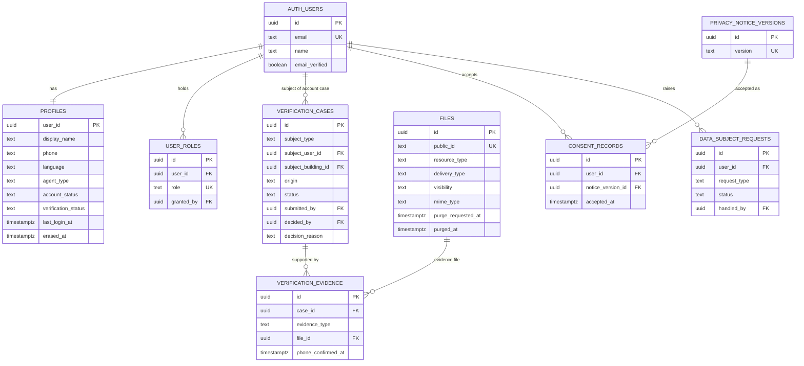
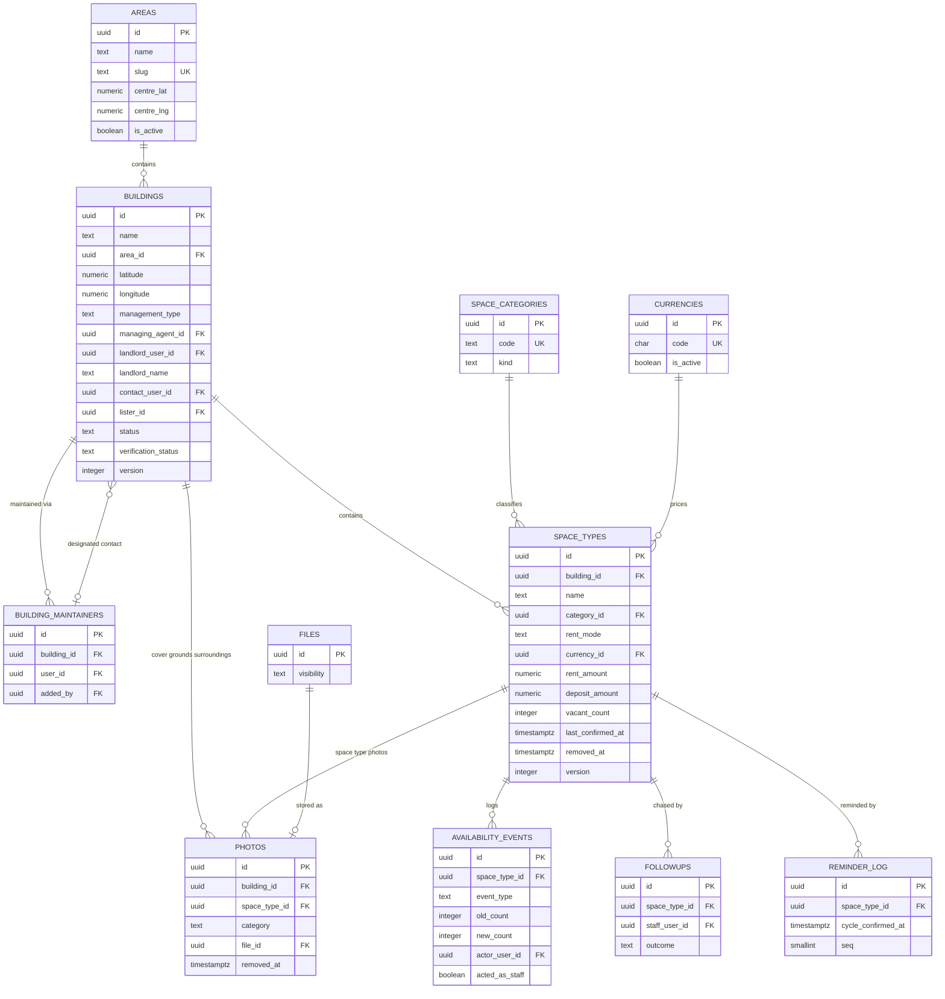
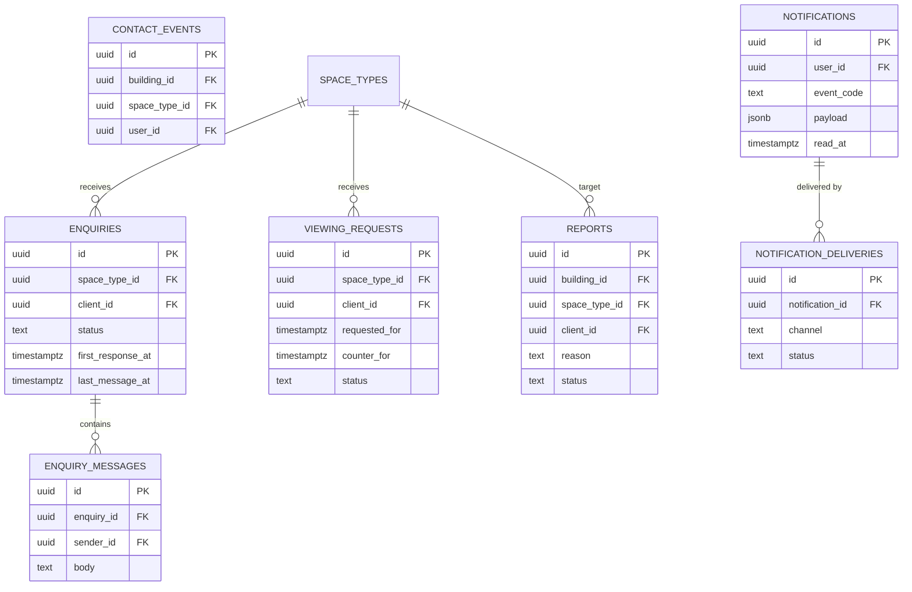
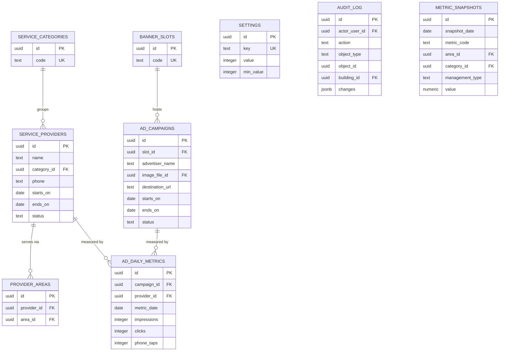

# Database Design Specification: Vacant-Space Search Platform

| Item | Value |
|---|---|
| Document | `Documentation/architecture/DATABASE_DESIGN.md` |
| Source of requirements | `Documentation/Requirements/SRS-v0.3.md` (SRS v0.3, 2026-11-25) |
| Target DBMS | PostgreSQL 14 or later, accessed only through Knex (`pg` client already configured in `backend/knexfile.ts`) |
| Status | **Draft for review and approval. Nothing in this document has been implemented.** No tables, migrations or application code were created or changed. |
| Date | 2026-11-25 |
| Revision | v1.4: UUIDv7 surrogate keys on every table, including reference and junction tables (§15.5). v1.3 applied the re-review of v1.2 (§15.6); v1.2 applied your answers to Q-D1, Q-D2, Q-D3, Q-D5, Q-D11; v1.1 applied the first independent review (§15) |

**Tags used throughout**

| Tag | Meaning |
|---|---|
| **[REQ]** | Taken from the SRS (the SRS requirement or business-rule ID is given). |
| **[REC]** | A recommendation by this design, with the reason given. |
| **[ASM]** | An assumption made so the design is complete. It is listed in §13 and can be reversed cheaply unless stated. |
| **[Q]** | An unresolved question for the business (§13.2). The design states a default and how costly it is to change. |

---

## 1. Executive summary

### 1.1 What this design delivers

A relational model of **38 tables** in five groups, designed from the SRS business needs and not copied from the SRS's §9 table. The SRS lists 20 entity groups; this design keeps all of them, splits four that mix concerns (user and profile, verification case, enquiry and message, notification), and adds 14 tables that the SRS requirements imply but §9 does not list (for example `files`, `reminder_log`, `consent_records`, `settings`, and three further Better Auth tables). §14 gives the reason for every change.

| Group | Tables |
|---|---|
| Identity and access | `auth_users`, `auth_sessions`, `auth_accounts`, `auth_verifications` (owned by Better Auth), `profiles`, `user_roles`, `privacy_notice_versions`, `consent_records`, `data_subject_requests` |
| Reference data | `areas`, `currencies`, `space_categories`, `service_categories`, `banner_slots`, `settings` |
| Catalogue and freshness | `buildings`, `building_maintainers`, `space_types`, `photos`, `files`, `availability_events`, `followups`, `reminder_log`, `verification_cases`, `verification_evidence` |
| Engagement | `enquiries`, `enquiry_messages`, `viewing_requests`, `reports`, `contact_events`, `notifications`, `notification_deliveries` |
| Advertising, audit, metrics | `service_providers`, `provider_areas`, `ad_campaigns`, `ad_daily_metrics`, `audit_log`, `metric_snapshots` |

### 1.2 Headline design decisions

| # | Decision | Why |
|---|---|---|
| DD-01 | **Building → Space type** is the catalogue. There is no table for individual units (SRS D-18, D-19, BR-027). Availability is a single integer, `space_types.vacant_count`. "Vacant" and "Fully let" are **derived**, never stored (BR-028). | One source of truth. A stored status would drift from the count. |
| DD-02 | Status fields are `text` with `CHECK` constraints, not PostgreSQL `ENUM` types. | Knex migrations can alter a `CHECK` in one statement; changing an `ENUM` is awkward. Same semantic strictness. |
| DD-03 | Every table has a **UUIDv7** primary key (`uuid`, time-ordered, default `app_uuidv7()`), your decision, including reference tables and junction tables. Natural keys (`currencies.code`, `settings.key`, the user/role, building/user and provider/area pairs) are `UNIQUE` columns. Money is `numeric(14,2)`. Times are `timestamptz`. Free text is `text` with length `CHECK`s. | UUIDv7 keeps B-tree inserts sequential, which avoids the fragmentation that random UUIDv4 causes (the reason `postgres-patterns` warns against random UUIDs); keys are 16 bytes instead of 8, which is irrelevant at this volume. `float` is never used for money; `timestamptz` avoids timezone bugs (NFR-DAT-01). |
| DD-04 | History is kept by **append-only tables** (`availability_events`, `audit_log`, `consent_records`) with database-level protection against update and delete. | FR-AVL-008, NFR-AUD-01, BR-021. |
| DD-05 | Nothing in the catalogue is physically deleted. Buildings end as `withdrawn`, space types and photos get `removed_at`, users are **anonymised in place**, reference data gets `is_active`. | BR-021, FR-PRV-002 (confirmed by you, see §1.3). |
| DD-06 | Cross-table business rules that must never be broken are enforced in the database by a few small triggers (§8, L2). Everything else uses declarative constraints (L1) or the service layer inside a transaction (L3). | Avoids heavy trigger logic while protecting the rules that matter most (publish gate, immutable history, verification state). |
| DD-07 | **No row-level security in Release 1.** Authorisation is enforced in the Express service layer; the database adds guard triggers (§10.2). An RLS option for the enquiry tables is documented in §10.4. | One pooled connection serves all users; RLS would need a per-request `SET LOCAL` and adds risk without a second line of defence being asked for in the SRS. Confirmed by you (Q-D1). |
| DD-08 | **No multi-tenancy.** `areas` are search geography, not tenants. | Single organisation, single country (SRS §2). |

### 1.3 Decisions you already made (from the clarifying questions)

| Question | Your answer | Effect on the design |
|---|---|---|
| Geo search | Plain latitude/longitude (no PostGIS) | `buildings.latitude`, `longitude` as `numeric(9,6)`; radius search by bounding box plus haversine; PostGIS is a later upgrade path (§11.3). |
| User roles | **Multiple roles per user** | `user_roles` junction table instead of a single role column. A person can be Landlord and Agent, or Admin sub-roles can be added later (OQ-23). |
| Enquiry scope | One thread per client and space type | `enquiries` is keyed by `(client, space_type)` with a partial unique index while open (BR-032). |
| Erasure | Anonymise in place | Rows and foreign keys survive; personal fields are blanked and `erased_at` is set (§10.6). |

### 1.4 What needs your decision before implementation

Twelve items are in §13.2. **Five are answered (v1.2):** Q-D1 (no RLS), Q-D2 (UUIDv7 ids), Q-D3 (contact is a maintainer's phone), Q-D5 (registered lister required) and Q-D11 (single database user). The other seven have defaults and none blocks implementation; the most consequential are Q-D4 (Vacant-only freshness for the building's latest update) and Q-D10 (what happens to an erased user's messages).

---

## 2. Phase 1: Requirements extraction

### 2.1 Business entities and their data

| # | Entity | SRS source | Key data requirements | Owner | Lifecycle |
|---|---|---|---|---|---|
| E01 | User | §4, §9, FR-ACC-* | Email, password (Better Auth), display name, phone, language, agent type, photo | The user; Admin for status | Active ⇄ Suspended; anonymised on erasure |
| E02 | Role assignment | §4, OQ-17, OQ-23 | Client, Landlord, Agent, Admin; Admin only grantable by Admin (FR-ADM-006) | Admin | Granted / revoked |
| E03 | Verification case | §5.3, FR-VER-* | Subject (account or building), evidence, status, reviewer, reason | Admin | Pending → Approved / Rejected → Revoked |
| E04 | Area | §9, OQ-21, FR-ADM-004 | Name, centre point | Admin | Active / inactive |
| E05 | Building | FR-UNT-001, §5.3 | Name, area, map pin, description, management designation, designated contact (a maintainer), status, verification status | Maintainers | Draft → Pending → Published → Suspended / Withdrawn |
| E06 | Building maintainer | BR-031, FR-UNT-006 | Building, user, who added, when | Lister or Admin | Added / removed |
| E07 | Space type | BR-027, BR-028 | Name, category, size, rent mode, currency, rent, deposit, vacant count, last update | Maintainers | Created, edited, removed |
| E08 | Space category | FR-UNT-003, D-30 | Nine categories; residential or commercial; bilingual label | Admin | Active / inactive |
| E09 | Photo and file | FR-MED-* | Owner (building or space type), category, stored file reference, uploader | Maintainer | Added, removed |
| E10 | Availability event | FR-AVL-008 | Space type, actor, staff flag, type, old and new count, time | System | Append-only |
| E11 | Follow-up | FR-ADM-002 | Space type, staff, outcome, note | Admin | Created |
| E12 | Reminder | BR-010, FR-AVL-006 | Which reminder was sent for which freshness cycle | System | Created |
| E13 | Enquiry and message | FR-ENQ-001, -005 | Space type, client, status, messages, first response time | Participants | New → Responded → Closed |
| E14 | Viewing request | FR-ENQ-002 | Space type, client, requested time, counter time, status | Participants | Requested → Accepted / Declined / Counter-proposed → Cancelled |
| E15 | Report | FR-AVL-010, FR-ADM-005 | Target (building or space type), client, reason, comment, resolution | Client; Admin resolves | Open → Actioned / Dismissed |
| E16 | Contact event | FR-ENQ-004 | Building, space type, time, user if logged in | System | Created |
| E17 | Notification and delivery | FR-NTF-001, §10.2 | Recipient, event N-01 to N-14, channel, status | System | Created, delivered, read |
| E18 | Consent and privacy notice | FR-PRV-001 | Notice version, user, accepted time | System | Append-only |
| E19 | Data subject request | FR-PRV-002 | User, type, status, outcome | User raises; Admin closes | Open → Completed / Rejected |
| E20 | Audit log entry | NFR-AUD-01, FR-ADM-007 | Actor, action, object, time, changes | System | Append-only |
| E21 | Currency | FR-LOC-002, OQ-05 | ISO code | Admin | Active / inactive |
| E22 | Service category and provider | FR-ADV-004, OQ-35 | Name, category, phone, languages, areas served, promotion dates, status | Admin | Draft → Active ⇄ Paused → Ended |
| E23 | Banner slot and campaign | FR-ADV-001, OQ-34 | Slot size; image, link, language, dates, status | Admin | Draft → Active ⇄ Paused → Ended |
| E24 | Ad metric | FR-ADV-008 | Campaign or provider, date, impressions, clicks, phone taps | System | Daily counters |
| E25 | Setting (threshold) | FR-ADM-004, BR-001, BR-010 | Key, integer value, allowed range | Admin | Edited, audited |
| E26 | Metric snapshot | RPT-M02 "weekly snapshot" | Date, metric, numerator, denominator | System | Append-only |

Excluded by decision: individual units (D-19), amenities, floors, features, "what's included" (DO-01 to DO-06, OQ-51), payments and billing (BR-026), saved listings and duplicate-building detection (SRS §11.3 "possible later additions").

### 2.2 Relationships (summary; cardinalities in §6)

- User 1:N Buildings as lister; M:N Users ↔ Buildings through maintainers.
- Area 1:N Buildings; M:N Providers ↔ Areas.
- Building 1:N Space types; Space type 1:N Photos, Availability events, Follow-ups, Enquiries, Viewing requests.
- Building 1:N Photos (cover, grounds, surroundings), Contact events.
- Enquiry 1:N Messages. Notification 1:N Deliveries.
- Verification case N:1 Account **or** Building (exclusive). Report N:1 Building **or** Space type (exclusive).
- Campaign N:1 Banner slot. Ad metric N:1 Campaign **or** Provider (exclusive).

### 2.3 Business rules that impose database constraints

All 32 SRS business rules were reviewed. Those that become database constraints are mapped one by one in **§8**. The most structural:

| Rule | Database consequence |
|---|---|
| BR-013, FR-UNT-004 | Exactly one of: positive `rent_amount` with `rent_mode='fixed'`, or `NULL` rent with `rent_mode='on_interest'`. `CHECK`. |
| BR-028 | `vacant_count integer NOT NULL CHECK (vacant_count >= 0)`. No status column. |
| BR-029, FR-UNT-011 | `deposit_amount NOT NULL CHECK (>= 0)` and `currency_id NOT NULL`, for both rent modes. |
| BR-012, FR-UNT-005 | Management designation `CHECK` ties `management_type` to its agent or landlord reference. |
| BR-018 | Publish gate (trigger), plus `CHECK` that a Published building has a designated contact. |
| BR-014 | `CHECK (decided_by <> submitted_by)` on verification cases. |
| BR-021 | No physical delete: buildings end as `withdrawn`; `ON DELETE RESTRICT` on all foreign keys to history. |
| FR-AVL-008 | Append-only `availability_events`, enforced by trigger T2. |
| FR-AVL-010 | Partial unique index: one open report per client per target. |
| FR-ADV-001, FR-ADV-004 | `CHECK (status <> 'active' OR image/link/dates present)`; `CHECK (ends_on >= starts_on)`. |
| FR-ADV-008, BR-024 | `ad_daily_metrics` has no user column at all. |
| FR-ADM-004 | `settings` table with `CHECK (value >= min_value)` (threshold ≤ 0 refused). |

### 2.4 Workflows and the data they touch

C = create, R = read, U = update, D = delete (logical, never physical unless stated).

| Workflow | Tables touched | C | R | U | D |
|---|---|---|---|---|---|
| Register and log in (FR-ACC-001, FR-PRV-001) | `auth_users`, `auth_accounts`, `auth_sessions`, `profiles`, `user_roles`, `consent_records` | users, profile, roles, consent, session | users | session | session expiry |
| Verify account (FR-VER-001/002) | `verification_cases`, `verification_evidence`, `files`, `profiles`, `notifications`, `audit_log` | case, evidence, files, notification, audit | queue | case decision, profile status (trigger) | none |
| Create and edit building (FR-UNT-001/007) | `buildings`, `building_maintainers`, `space_types`, `photos`, `files`, `audit_log` | all | building | with `version` check | space type and photo `removed_at` |
| Verify building (FR-VER-003/004/007) | `verification_cases`, `verification_evidence`, `buildings` | case, evidence | queue | case, building status (trigger) | none |
| Publish (FR-VER-008, BR-018) | `buildings`, `space_types`, `photos`, `settings`, `profiles` | audit | counts for gate | status, `published_at`, `last_confirmed_at` | none |
| Search and view (FR-SRC-*) | `buildings`, `space_types`, `photos`, `files`, `areas`, `profiles`, `service_providers`, `ad_campaigns` | `ad_daily_metrics` upsert | all | none | none |
| Confirm or change count (FR-AVL-001/003/004) | `space_types`, `availability_events`, `enquiries`, `viewing_requests`, `notifications` | event, notifications | space type | count, `last_confirmed_at`, closes enquiries and viewings at 0 | none |
| Reminders (FR-AVL-006, BR-010) | `space_types`, `reminder_log`, `notifications`, `notification_deliveries` | log, notification, deliveries | stale space types | delivery status | none |
| Follow-up (FR-ADM-002) | `space_types`, `followups`, `availability_events` | follow-up, event | queue | count | none |
| Enquire and message (FR-ENQ-001/005) | `enquiries`, `enquiry_messages`, `notifications` | enquiry, message, notification | thread | status, `first_response_at` | none |
| Viewing request (FR-ENQ-002) | `viewing_requests`, `notifications` | request | request | status transitions | none |
| Phone contact (FR-ENQ-003/004) | `buildings`, `profiles`, `contact_events` | event | phone (gated) | none | none |
| Report (FR-AVL-010, FR-ADM-005) | `reports`, `notifications` | report | queue | resolution | none |
| Moderate (FR-ADM-003) | `profiles`, `buildings`, `photos`, `audit_log`, `notifications` | audit | targets | suspension fields, `removed_at` | none |
| Advertising (FR-ADV-*) | `ad_campaigns`, `service_providers`, `provider_areas`, `banner_slots`, `ad_daily_metrics`, `files` | all | eligible ads | status, dates | none |
| Reporting (FR-RPT-*) | all of the above read-only; `metric_snapshots` | snapshot | aggregates | none | none |
| Data subject request (FR-PRV-002) | `data_subject_requests`, `profiles`, `auth_*`, `files`, `contact_events` | request | user data | anonymise | `auth_sessions`, `auth_accounts` rows (credentials) |

### 2.5 Missing or ambiguous requirements

Numbered G-xx. Each is carried to §13 with a default if it affects the schema.

| ID | Gap or ambiguity | Where | Design treatment |
|---|---|---|---|
| G-01 | Can a deposit be **zero**? "No deposit refused" (FR-UNT-011) versus "negative refused". | FR-UNT-011, BR-029 | `CHECK (deposit_amount >= 0)`. [Q-D6] |
| G-02 | Building "latest update" uses **all** space types (FR-AVL-002, BR-030 literal) or only **Vacant** ones (freshness is Vacant-only). | BR-030, OQ-53 | Computed per query from `space_types`; no cached column (review R-20). Default: **Vacant** space types only (review R-21). [Q-D4] |
| G-03 | After a client messages again once an enquiry is `responded`, does it return to "awaiting reply"? | FR-ENQ-005, FR-RPT-003 | "Awaiting reply" = `status='new'` (no maintainer reply yet). Follow-ups after a first reply are not tracked. [Q-D7] |
| G-04 | The building's **designated contact phone**: a standalone number or a person's? | A-14, FR-ENQ-003, FR-ACC-004 | **Resolved (Q-D3):** the designated contact is one maintainer of the building (`buildings.contact_user_id`); the number shown is that user's `profiles.phone`. |
| G-05 | Unregistered landlords (OQ-04): who is the accountable lister for BR-005 and RPT-M05? | OQ-04, FR-UNT-009 | `buildings.lister_id NOT NULL` (an agent or landlord account); unregistered landlord captured as `landlord_name`. [Q-D5] |
| G-06 | Public map pin precision (BR-019 [TBD]). | BR-019, OQ-07 | Exact pin stored. Area-level display is an API concern. If area-level public display is approved, no schema change. |
| G-07 | Does "at least 3 building photos including one Cover" count Cover + Grounds, with Surroundings separate? | BR-018, OQ-40 | Counted as Cover + Grounds ≥ 3 and Surroundings ≥ 1. Minimums live in `settings`. [ASM] |
| G-08 | Which evidence items verify an account or building? | OQ-02 | `verification_evidence.evidence_type` is free text validated by the service, not a `CHECK`, until OQ-02 closes. |
| G-09 | What event types does "status change" in `availability_events` cover? Space-type availability is derived. | FR-AVL-008 | Event types: `created`, `confirmed`, `count_changed`, `published`, `removed`, `restored`. |
| G-10 | Where are search-radius centre and the commute destination stored? | FR-SRC-001, FR-CMT-001 | Not in the database. Request parameters and session only (FR-CMT-001 says "keep for the session"). |
| G-11 | Retention periods are unspecified for every entity. | OQ-24 | Not enforced by schema. Proposed defaults in §10.7, to be confirmed by legal review. |
| G-12 | Does a suspended user's reinstatement restore the buildings that were suspended because of that user? | FR-ADM-003 | `buildings.suspension_cause` distinguishes `owner_suspended` from `admin`, so only cascade-suspended buildings are restored. [ASM] |
| G-13 | Uniqueness of space-type names within a building. | FR-UNT-002 | Unique per building among non-removed rows, case-insensitive. [ASM] |
| G-14 | Is the bulk-import error report stored or only returned? | FR-UNT-009 | Not modelled (no import-batch table). Add `import_batches` only if the report must be re-downloadable. |
| G-15 | Are Admin-created buildings attributable to both the Admin and the lister? | FR-UNT-001, FR-ADM-001 | Both: `created_by` and `lister_id`. |
| G-16 | Does a message from a user who was later erased remain readable to the other party? | FR-PRV-002, NFR-PRV-02 | Messages are retained with the sender anonymised. Legal confirmation needed. [Q-D10] |

---

## 3. Design conventions

### 3.1 Naming

Tables: plural `snake_case`. Columns: `snake_case`. Primary key: `id`. Foreign key: `<referenced_singular>_id`, or a role name where there are several users on a row (`lister_id`, `created_by`, `decided_by`). Timestamps: `created_at`, `updated_at`; events use `<verb>_at`. Booleans: `is_`/`has_` prefix. Indexes: `ix_<table>_<columns>`; unique: `ux_<table>_<columns>`; checks: `ck_<table>_<rule>`.

### 3.2 Types

| Use | Type |
|---|---|
| Surrogate keys | `uuid`, **UUIDv7**, `DEFAULT app_uuidv7()` on every table (§7.4). Natural keys are `UNIQUE` columns; junction pairs are `UNIQUE` pairs. |
| Strings | `text` with `CHECK (length(...))`, never `varchar(255)`. The one deliberate exception is `char(3)` for ISO currency codes. |
| Money | `numeric(14,2)`; currency as a foreign key `currency_id` to `currencies` (ISO code `char(3)`) |
| Coordinates | `numeric(9,6)` (about 0.1 m resolution) |
| Instants | `timestamptz`, stored in UTC, shown in East Africa Time (NFR-DAT-01) |
| Business dates (ad campaigns) | `date`, interpreted in `Africa/Nairobi` |
| Flags | `boolean` |
| Small sets (status, role, language) | `text` + `CHECK ... IN (...)` (DD-02) |
| Flexible payloads | `jsonb`, used only in `notifications.payload` and `audit_log.changes` |

### 3.3 Common columns and rules

- Every mutable table has `created_at timestamptz NOT NULL DEFAULT now()` and `updated_at timestamptz NOT NULL DEFAULT now()`, kept current by one shared trigger function `set_updated_at()` (L2).
- Buildings and space types also carry `version integer NOT NULL DEFAULT 1`, incremented on **detail edits only** (name, rent, category, description, ...), for the stale-save warning in FR-UNT-007. Count confirmations do not change `version`, so confirming a count never causes a false edit conflict. Bulk confirm detects concurrent changes by comparing `last_confirmed_at` (§9.2 TX-02).
- Foreign keys use `ON DELETE RESTRICT` throughout. The only `CASCADE` is `provider_areas.provider_id` (a pure junction) and the Better Auth session and account tables. [REC] History must survive; deleting a parent must be a deliberate act.
- **Every foreign key column is covered by an index**, its own or the leading column of a composite or partial one. The unindexed-foreign-key query from `postgres-patterns` counts only non-partial indexes; a column whose only index is partial (for example `photos.building_id`) is an accepted exception because parent rows are never removed (the data-access layer has no delete for them, §10.2), so no `RESTRICT` check scans it. `profiles.user_id` is `ON DELETE RESTRICT` like every other foreign key.

### 3.4 Authentication tables (Better Auth) [REC] [ASM]

Better Auth owns `user`, `session`, `account` and `verification`. This design:

1. Remaps them to `auth_users`, `auth_sessions`, `auth_accounts`, `auth_verifications`. `user` is a reserved word in PostgreSQL and needs quoting everywhere; a prefix also groups them in tooling.
2. Does **not** add application columns to `auth_users`. Application attributes live in `profiles` (1:1). This keeps Better Auth upgrades and its generated schema independent of ours.
3. Makes every application user foreign key point to `auth_users(id)` (one target, no dependency on profile creation order), except the composite `buildings.contact_user_id` key, which points to `building_maintainers`.
4. Uses **UUIDv7** ids (your decision, Q-D2). Better Auth's built-in `uuid` option generates random v4 ids, so configure a custom `advanced.database.generateId` that returns a UUIDv7 (on Bun: `Bun.randomUUIDv7()`) and verify it against the installed version (V-4). If that is not possible, the four `auth_*` tables keep v4 ids; every application table still uses v7.
5. The Better Auth CLI generates the DDL for these four tables; it is committed as a Knex migration like any other, not hand-designed here.

`auth_sessions` holds IP address and user agent (personal data under the Data Protection Act); erasure removes these rows (§10.6).

**Atomicity gap [REC, review R-25].** Better Auth writes `auth_users` through its own adapter and pool, so Knex and Better Auth cannot share one transaction. A user can therefore exist briefly without a `profiles` row, `user_roles` rows or a consent record. Create these from Better Auth's `databaseHooks.user.create.after` hook, written idempotently (`INSERT ... ON CONFLICT DO NOTHING`), and treat a missing profile at login as repairable (recreate it, then continue). FR-PRV-001 ("before account creation completes") is met by refusing to issue a session until the consent record exists. Better Auth's pool and Knex's pool each multiply by the number of PM2 instances (§10.3).

---

## 4. Entity Relationship Diagrams

Mermaid. `||--o{` means one-to-many; `|o--o{` optional one-to-many. Many-to-many relationships appear through junction tables. Where a table has an exclusive "either A or B" relationship (photos, reports, verification cases, ad metrics), both relationships exist and the `CHECK` is described in §5.

### 4.1 Overview (relationships only)

```mermaid
erDiagram
  AUTH_USERS ||--|| PROFILES : "has"
  AUTH_USERS ||--o{ USER_ROLES : "holds"
  AUTH_USERS ||--o{ BUILDING_MAINTAINERS : "maintains via"
  AUTH_USERS ||--o{ BUILDINGS : "lister of"
  AREAS ||--o{ BUILDINGS : "contains"
  BUILDINGS ||--o{ BUILDING_MAINTAINERS : "maintained via"
  BUILDINGS ||--o{ SPACE_TYPES : "contains"
  BUILDINGS ||--o{ PHOTOS : "has"
  SPACE_TYPES ||--o{ PHOTOS : "has"
  FILES ||--o| PHOTOS : "stored as"
  SPACE_CATEGORIES ||--o{ SPACE_TYPES : "classifies"
  CURRENCIES ||--o{ SPACE_TYPES : "prices"
  SPACE_TYPES ||--o{ AVAILABILITY_EVENTS : "logs"
  SPACE_TYPES ||--o{ FOLLOWUPS : "chased by"
  SPACE_TYPES ||--o{ REMINDER_LOG : "reminded by"
  AUTH_USERS ||--o{ VERIFICATION_CASES : "subject or submitter"
  BUILDINGS ||--o{ VERIFICATION_CASES : "subject of"
  VERIFICATION_CASES ||--o{ VERIFICATION_EVIDENCE : "supported by"
  SPACE_TYPES ||--o{ ENQUIRIES : "receives"
  AUTH_USERS ||--o{ ENQUIRIES : "sends"
  ENQUIRIES ||--o{ ENQUIRY_MESSAGES : "contains"
  SPACE_TYPES ||--o{ VIEWING_REQUESTS : "receives"
  AUTH_USERS ||--o{ VIEWING_REQUESTS : "makes"
  BUILDINGS ||--o{ REPORTS : "reported in"
  SPACE_TYPES ||--o{ REPORTS : "reported in"
  AUTH_USERS ||--o{ REPORTS : "files"
  BUILDINGS ||--o{ CONTACT_EVENTS : "records"
  AUTH_USERS ||--o{ NOTIFICATIONS : "receives"
  NOTIFICATIONS ||--o{ NOTIFICATION_DELIVERIES : "delivered by"
  AUTH_USERS ||--o{ DATA_SUBJECT_REQUESTS : "raises"
  AUTH_USERS ||--o{ CONSENT_RECORDS : "accepts"
  PRIVACY_NOTICE_VERSIONS ||--o{ CONSENT_RECORDS : "accepted as"
  AUTH_USERS ||--o{ AUDIT_LOG : "acts in"
  AUTH_USERS ||--o{ BUILDINGS : "created, managing agent, landlord"
  AUTH_USERS ||--o{ AVAILABILITY_EVENTS : "acts in"
  AUTH_USERS ||--o{ FOLLOWUPS : "records"
  AUTH_USERS |o--o{ CONTACT_EVENTS : "taps by"
  BUILDINGS ||--o{ AUDIT_LOG : "searched by"
  SPACE_TYPES |o--o{ CONTACT_EVENTS : "opened from"
  FILES |o--o{ PROFILES : "photo"
  FILES |o--o{ VERIFICATION_EVIDENCE : "evidence file"
  FILES |o--o{ AD_CAMPAIGNS : "image"
  BUILDING_MAINTAINERS |o--o{ BUILDINGS : "designated contact"
  NOTIFICATIONS |o--o{ REMINDER_LOG : "covers"
  AREAS |o--o{ METRIC_SNAPSHOTS : "scoped by"
  SPACE_CATEGORIES |o--o{ METRIC_SNAPSHOTS : "scoped by"
  SERVICE_CATEGORIES ||--o{ SERVICE_PROVIDERS : "groups"
  SERVICE_PROVIDERS ||--o{ PROVIDER_AREAS : "serves via"
  AREAS ||--o{ PROVIDER_AREAS : "served via"
  BANNER_SLOTS ||--o{ AD_CAMPAIGNS : "hosts"
  AD_CAMPAIGNS ||--o{ AD_DAILY_METRICS : "measured by"
  SERVICE_PROVIDERS ||--o{ AD_DAILY_METRICS : "measured by"
```



### 4.2 Identity, access and verification



### 4.3 Catalogue, photos and freshness



### 4.4 Engagement and notifications



### 4.5 Advertising, reference data, audit and metrics



---

## 5. Table specifications and data dictionary

Reading guide. `Null` is `N` (NOT NULL) or `Y` (nullable). **PK**, **FK**, **UQ**. Every table lists its columns, then **Constraints** (named `ck_`/`ux_`) and **Indexes** (named `ix_`). Foreign keys are `ON DELETE RESTRICT` unless stated. Every `uuid` key is a UUIDv7 with default `app_uuidv7()` (§3.4, §7.4); user-id columns reference `auth_users(id)` (except `buildings.contact_user_id`, which references `building_maintainers`). The SQL fragments are specification text for review, not executable migrations.

### 5.1 Identity and access

#### `auth_users`, `auth_sessions`, `auth_accounts`, `auth_verifications`
Owned by Better Auth (§3.4). Not specified column by column here. Requirements on them: email is unique (stored lower-case), password hash is never returned by any API, `auth_sessions` and `auth_accounts` cascade on user delete (they are deleted during erasure, §10.6), `auth_sessions.user_id` is indexed.

#### `profiles` [REQ FR-ACC-004, FR-ACC-005, §9 "User and Profile"]
One row per user. Application attributes of the account.

| Column | Type | Null | Default | Rules / notes |
|---|---|---|---|---|
| user_id | uuid | N | | **PK**, FK → `auth_users(id)` |
| display_name | text | N | | 1 to 120 characters. Replaced by `'Deleted user'` on erasure. |
| phone | text | Y | | E.164, e.g. `+254712345678`. Required for any user who is a building's designated contact (T5 at publication, T8 afterwards). Cleared on erasure. Personal data. |
| language | text | N | `'en'` | `'en'` or `'sw'` (FR-LOC-001) |
| agent_type | text | Y | | `'agent'` or `'caretaker'` (OQ-17). Meaningful only if the user holds the `agent` role; checked by the service. |
| photo_file_id | uuid | Y | | FK → `files(id)` |
| account_status | text | N | `'active'` | `'active'` or `'suspended'` (SRS §5.3 account status) |
| suspended_reason | text | Y | | Required when suspended |
| suspended_at | timestamptz | Y | | Required when suspended |
| suspended_by | uuid | Y | | FK → `auth_users(id)` |
| verification_status | text | N | `'unverified'` | `'unverified'`, `'pending'`, `'verified'`, `'rejected'`, `'revoked'`. **Cache maintained by trigger T3 from `verification_cases`** (§8). Never set by application code. |
| last_login_at | timestamptz | Y | | Set at each login by a Better Auth hook. Gives RPT-M09 "active users" a data source now that expired sessions are purged (review R-19). |
| erased_at | timestamptz | Y | | Set when personal data was anonymised. **`erased_at IS NOT NULL` is the erased-account marker.** |
| created_at, updated_at | timestamptz | N | `now()` | |

Constraints: `ck_profiles_phone` (`phone IS NULL OR phone ~ '^\+[1-9][0-9]{7,14}$'`); `ck_profiles_suspended` (`account_status = 'active' OR (suspended_reason IS NOT NULL AND suspended_at IS NOT NULL)`); value sets `ck_profiles_language`, `ck_profiles_agent_type`, `ck_profiles_account_status`, `ck_profiles_verification_status`.
Indexes: PK only, plus `ix_profiles_photo_file_id`, `ix_profiles_suspended_by` (FK indexes). [REC] No index on `verification_status` (low selectivity, used only with other filters).

#### `user_roles` [REQ §4, FR-ADM-006; multi-role per your decision]
| Column | Type | Null | Default | Rules / notes |
|---|---|---|---|---|
| id | uuid | N | `app_uuidv7()` | **PK** |
| user_id | uuid | N | | **UQ part 1**, FK → `auth_users(id)` |
| role | text | N | | **UQ part 2**. `'client'`, `'landlord'`, `'agent'`, `'admin'` |
| granted_by | uuid | Y | | FK → `auth_users(id)`. Required for `admin`. |
| granted_at | timestamptz | N | `now()` | |

Constraints: `ck_user_roles_role` (role IN list); `ck_user_roles_admin_granted` (`role <> 'admin' OR (granted_by IS NOT NULL AND granted_by <> user_id)`, so an `admin` row can never be self-granted). **Limits of this check (review R-11):** it cannot prove the grantor is an Admin, and registration code could still insert an `admin` row naming another user, so "Admin only from an Admin" (FR-ADM-006) is also enforced in the service and tested. The first Admin is created out of band by a one-off script run once by the maintainer, never by registration. Registration inserts `client` plus the chosen lister role (A-02). Role revocation removes the row with an `audit_log` row (`role.grant`, `role.revoke`).
Indexes: `ux_user_roles_user_role` `UNIQUE (user_id, role)` (one row per role per user; serves per-user lookups); `ix_user_roles_role_user` `(role, user_id)` (list admins, count landlords); `ix_user_roles_granted_by`.

#### `privacy_notice_versions` [REQ FR-PRV-001]
| Column | Type | Null | Default | Rules / notes |
|---|---|---|---|---|
| id | uuid | N | `app_uuidv7()` | **PK** |
| version | text | N | | **UQ**, e.g. `2026-12-01` |
| effective_at | timestamptz | N | | |
| created_at | timestamptz | N | `now()` | |

The notice text itself is not stored here (it is content, not data). [ASM]

#### `consent_records` [REQ FR-PRV-001] append-only
| Column | Type | Null | Default | Rules / notes |
|---|---|---|---|---|
| id | uuid | N | `app_uuidv7()` | **PK** |
| user_id | uuid | N | | FK → `auth_users(id)` |
| notice_version_id | uuid | N | | FK → `privacy_notice_versions(id)` |
| accepted_at | timestamptz | N | `now()` | |

Constraints: `ux_consent_user_version` `UNIQUE (user_id, notice_version_id)`. Update and delete forbidden (trigger T2).
Indexes: unique index above covers `user_id` lookups ("has this user accepted the latest version?"); `ix_consent_notice_version_id`.

#### `data_subject_requests` [REQ FR-PRV-002, N-12]
| Column | Type | Null | Default | Rules / notes |
|---|---|---|---|---|
| id | uuid | N | `app_uuidv7()` | **PK** |
| user_id | uuid | N | | FK → `auth_users(id)`. Survives anonymisation. |
| request_type | text | N | | `'access'`, `'correction'`, `'export'`, `'deletion'` |
| status | text | N | `'open'` | `'open'`, `'in_progress'`, `'completed'`, `'rejected'` |
| requested_at | timestamptz | N | `now()` | |
| handled_by | uuid | Y | | FK → `auth_users(id)` |
| completed_at | timestamptz | Y | | |
| outcome | text | Y | | What was done or why rejected |
| note | text | Y | | The requester's optional free text (at most 1000 characters). Blanked on erasure. *(Phase 11, migration `20261126120017_data_subject_requests_privacy`.)* |
| completion_email_claimed_at | timestamptz | Y | | Deletion requests only: lease taken before the completion e-mail is sent (a claim older than 10 minutes is abandoned), so two concurrent completions cannot both send it. Cleared again when the send fails. *(Phase 11)* |
| completion_email_sent_at | timestamptz | Y | | Deletion requests only: set once the completion e-mail (event N-12) has been sent. A retry that finds it set never sends the e-mail again (§10.6 step 10). *(Phase 11)* |
| created_at, updated_at | timestamptz | N | `now()` | |

Constraints: `ck_dsr_closed` (`(status IN ('completed','rejected')) = (completed_at IS NOT NULL)`); `ck_dsr_note_len` (`note IS NULL OR length(note) <= 1000`).
Indexes: `ix_dsr_open` `(requested_at) WHERE status IN ('open','in_progress')` (Admin queue); `ix_dsr_user_id`; `ix_dsr_handled_by`; `ux_dsr_one_open_per_type` UNIQUE `(user_id, request_type) WHERE status IN ('open','in_progress')` (a second open request of the same type by the same user is refused, HTTP 409).
*As built (Phase 11, `modules/data-requests`).* Transitions are compare-and-swap updates with their audit row in the same transaction: Admin `start` (open to in_progress, sets `handled_by`), `complete` (in_progress to completed) and `reject` (open or in_progress to rejected), each with a mandatory outcome text. An Admin cannot action a request for their own account. Completing a `deletion` request runs the erasure of §10.6.

### 5.2 Reference data

#### `areas` [REQ OQ-21, FR-ADM-004]
| Column | Type | Null | Default | Rules / notes |
|---|---|---|---|---|
| id | uuid | N | `app_uuidv7()` | **PK** |
| name | text | N | | 1 to 100 characters |
| slug | text | N | | **UQ**, lower-case URL key |
| centre_lat | numeric(9,6) | N | | −90 to 90 |
| centre_lng | numeric(9,6) | N | | −180 to 180 |
| is_active | boolean | N | `true` | Areas are deactivated, never deleted |
| created_at, updated_at | timestamptz | N | `now()` | |

Constraints: `ux_areas_name_lower` `UNIQUE (lower(name))`; coordinate range `CHECK`s.

#### `currencies` [REQ FR-LOC-002, OQ-05]
| Column | Type | Null | Default | Rules / notes |
|---|---|---|---|---|
| id | uuid | N | `app_uuidv7()` | **PK** |
| code | char(3) | N | | **UQ**, ISO 4217, `CHECK (code ~ '^[A-Z]{3}$')` (`ck_currencies_code`) |
| name | text | N | | |
| is_active | boolean | N | `true` | Inactive currencies cannot be chosen for new space types but remain valid on existing ones |
| sort_order | smallint | N | `0` | |

Seed: `KES`, `USD` (OQ-05 default). Seeds look rows up by `code`; other tables reference the `id`. [REC] The ISO code stays a readable `UNIQUE` column; a join supplies it for display and exports.

#### `space_categories` [REQ FR-UNT-003, D-30, OQ-47]
| Column | Type | Null | Default | Rules / notes |
|---|---|---|---|---|
| id | uuid | N | `app_uuidv7()` | **PK** |
| code | text | N | | **UQ**. Stable machine key, e.g. `bedsitter`, `one_bedroom`, `two_bedroom`, `three_bedroom`, `townhouse`, `villa`, `office`, `shop`, `warehouse` |
| name_en, name_sw | text | N | | Bilingual labels (FR-LOC-001) |
| kind | text | N | | `'residential'` or `'commercial'` (BR-022) |
| sort_order | smallint | N | `0` | |
| is_active | boolean | N | `true` | |

[REC] A table, not a `CHECK` list: OQ-47 says the list may become Admin-extensible, labels are bilingual, and `kind` is needed for BR-022.

#### `service_categories` [REQ FR-ADV-004, OQ-35]
Same shape as `space_categories` without `kind`: `id`, `code` (**UQ**), `name_en`, `name_sw`, `sort_order`, `is_active`. Seed: `wifi`, `water_refill`, `gas_refill`.

#### `banner_slots` [REQ FR-ADV-001, OQ-34]
| Column | Type | Null | Default | Rules / notes |
|---|---|---|---|---|
| id | uuid | N | `app_uuidv7()` | **PK** |
| code | text | N | | **UQ**, e.g. `home_top`, `building_side` |
| name | text | N | | |
| width_px, height_px | integer | N | | `> 0` |
| is_active | boolean | N | `true` | |

#### `settings` [REQ FR-ADM-004, BR-001, BR-010, BR-018, BR-011, BR-025]
Admin-editable integer thresholds, audited through `audit_log`.

| Column | Type | Null | Default | Rules / notes |
|---|---|---|---|---|
| id | uuid | N | `app_uuidv7()` | **PK** |
| key | text | N | | **UQ**. Stable name such as `freshness_days`; the application reads settings by key. |
| value | integer | N | | |
| min_value | integer | N | `1` | Lower bound for this key |
| max_value | integer | Y | | Optional upper bound |
| description | text | N | | |
| updated_by | uuid | Y | | FK → `auth_users(id)` |
| updated_at | timestamptz | N | `now()` | |

Constraints: `ck_settings_range` (`value >= min_value AND (max_value IS NULL OR value <= max_value)`), which implements "a threshold of zero or less is refused" (FR-ADM-004).
Rows in `settings` and `currencies` are **required reference data** (T5 and the `NOT NULL` currency foreign key depend on them). Load them with **idempotent seed files that run on every deployment, including production**, consistent with the standard "seed data goes in seed files"; T5 **fails closed** (raises) if a key it needs is missing (review R-23). Index: `ix_settings_updated_by`.

Seed (values are the SRS defaults; [TBD] items marked):

| key | value | Source |
|---|---|---|
| `freshness_days` | 7 | BR-001 |
| `reminder_lead_days` | 1 | BR-010 |
| `reminder_repeat_days` | 7 | BR-010 |
| `hide_after_days` | 14 | BR-011 [TBD, OQ-09] |
| `max_promoted_per_building` | 5 | BR-025 [TBD, OQ-36] |
| `min_building_photos` | 3 | BR-018 [OQ-40] |
| `min_surroundings_photos` | 1 | BR-018 [OQ-40] |
| `min_space_type_photos` | 3 | BR-018 [OQ-40] |
| `require_verified_lister_to_publish` | 1 (`min_value` 0, `max_value` 1) | BR-005 [TBD, OQ-03] |

### 5.3 Catalogue

#### `files` [REC] (SRS §9 lists photos only; a shared file table removes duplication)
Metadata for every object stored in Cloudinary (photos, verification evidence, ad images, profile photos). The bytes are never in the database. *(v1.5: storage moved from SharePoint to Cloudinary, migration `20261125120015_files_cloudinary`.)*

| Column | Type | Null | Default | Rules / notes |
|---|---|---|---|---|
| id | uuid | N | `app_uuidv7()` | **PK** |
| public_id | text | N | | Cloudinary public id, e.g. `khunt/production/photos/<file id>`. Raw assets (PDFs) keep their `.pdf` extension. The folder prefix separates environments. |
| resource_type | text | N | | `'image'` or `'raw'` (`ck_files_resource_type`). PDFs are stored as `raw`. |
| delivery_type | text | N | | `'upload'` (publicly deliverable) or `'authenticated'` (reachable only through a signed request) (`ck_files_delivery_type`) |
| format | text | N | | `'jpg'`, `'png'` or `'pdf'` (`ck_files_format`), derived from the detected file type |
| original_name | text | N | | Display only; never a storage path. Blanked on erasure because file names can contain personal names. |
| mime_type | text | N | | `CHECK (mime_type IN ('image/jpeg','image/png','application/pdf'))` per OQ-20 default, evidence may be PDF [ASM] |
| size_bytes | bigint | N | | `> 0`. Upper bound is a service limit (OQ-20). |
| width_px, height_px | integer | Y | | Images only |
| visibility | text | N | | `'public'` (photos, ad images) or `'restricted'` (verification evidence, ID documents). Drives the Cloudinary delivery type: public files are `upload`, restricted files are `authenticated`. |
| uploaded_by | uuid | Y | | FK → `auth_users(id)` |
| purged_at | timestamptz | Y | | Set by `jobs/purge-files.ts` once the object was deleted from Cloudinary (orphans' rows are deleted instead; removed photos; evidence retention; erasure). Never set by a request handler: the job only destroys objects whose `purged_at` is still NULL. |
| purge_requested_at | timestamptz | Y | | "Delete this object" marker set by the erasure procedure (§10.6 step 6, Phase 11, migration `20261126120017_data_subject_requests_privacy`). The purge job destroys every file with a marker and no `purged_at`, then sets `purged_at`. Until then the file cannot be downloaded (410). |
| created_at | timestamptz | N | `now()` | |

Constraints: `ux_files_public_id` `UNIQUE (public_id)`; `ck_files_visibility_delivery` (`visibility = 'public'` only with `delivery_type = 'upload'`, and `'restricted'` only with `'authenticated'`, so evidence can never be stored as a publicly deliverable asset); `ck_files_visibility` (`visibility IN ('public','restricted')`); `ck_files_mime` (`mime_type IN ('image/jpeg','image/png','application/pdf')`); `ck_files_size` (`size_bytes > 0`); `ux_files_id_visibility` `UNIQUE (id, visibility)`, the target of the composite foreign keys that force photos to reference `public` files and verification evidence to reference `restricted` files (review R-15).
Indexes: `ix_files_uploaded_by`; `ix_files_purge_candidates` `(created_at) WHERE visibility = 'restricted' AND purged_at IS NULL` (retention job); `ix_files_purge_requested` `(purge_requested_at) WHERE purge_requested_at IS NOT NULL AND purged_at IS NULL` (erasure marker).

#### `buildings` [REQ FR-UNT-001, FR-UNT-005, BR-012, §5.3 building status]
| Column | Type | Null | Default | Rules / notes |
|---|---|---|---|---|
| id | uuid | N | `app_uuidv7()` | **PK** |
| name | text | N | | 1 to 150 characters |
| area_id | uuid | N | | FK → `areas(id)` |
| latitude | numeric(9,6) | N | | −90 to 90. Exact map pin (FR-UNT-001 "no pin, refused"). |
| longitude | numeric(9,6) | N | | −180 to 180 |
| description | text | Y | | Free text, stored as entered (OQ-19) |
| management_type | text | N | | `'agent'` or `'landlord'` (BR-012) |
| managing_agent_id | uuid | Y | | FK → `auth_users(id)`. Required when `management_type='agent'`. |
| landlord_user_id | uuid | Y | | FK → `auth_users(id)`. Registered landlord, if any. |
| landlord_name | text | Y | | Unregistered landlord's name (OQ-04) |
| contact_user_id | uuid | Y | | The designated contact (A-14, Q-D3): one **maintainer of this building**. The number shown is that user's `profiles.phone`, under the BR-009 gate. Required to publish. Composite foreign key `fk_buildings_contact_is_maintainer` `(id, contact_user_id) → building_maintainers (building_id, user_id)` (`MATCH SIMPLE`: not checked while NULL), so the contact must be a maintainer of this building and cannot be removed as a maintainer while assigned. The foreign key must stay **non-deferrable** (a deferrable one would open a way to insert a published building without the gate). |
| lister_id | uuid | N | | FK → `auth_users(id)`. The accountable Landlord or Agent account ("Lister" in the glossary). Gate BR-005 and RPT-M05 use it. [Q-D5] |
| created_by | uuid | N | | FK → `auth_users(id)`. May be an Admin acting on behalf (FR-UNT-001, FR-ADM-001). |
| status | text | N | `'draft'` | `'draft'`, `'pending'`, `'published'`, `'suspended'`, `'withdrawn'` |
| status_before_suspension | text | Y | | `'draft'`, `'pending'` or `'published'` only, never `suspended` or `withdrawn`. Restored on reinstatement (SRS §5.3). |
| suspension_cause | text | Y | | `'admin'` or `'owner_suspended'`; set only while suspended (G-12). A building already `admin`-suspended when its owner is suspended stays `admin` and is skipped by the cascade (TX-09). |
| suspended_reason | text | Y | | Required when suspended (FR-ADM-003) |
| suspended_at | timestamptz | Y | | |
| suspended_by | uuid | Y | | FK → `auth_users(id)` |
| verification_status | text | N | `'unverified'` | Same values and **trigger-maintained cache** as `profiles.verification_status` (T3) |
| published_at | timestamptz | Y | | First publication time |
| version | integer | N | `1` | Optimistic lock (FR-UNT-007) |
| created_at, updated_at | timestamptz | N | `now()` | |

Constraints:
- `ck_buildings_status` (status IN list).
- `ck_buildings_management` (BR-012, FR-UNT-005):
  `(management_type = 'agent' AND managing_agent_id IS NOT NULL) OR (management_type = 'landlord' AND managing_agent_id IS NULL AND (landlord_user_id IS NOT NULL OR landlord_name IS NOT NULL))`.
- `ck_buildings_published_contact` (BR-018): `status <> 'published' OR (published_at IS NOT NULL AND contact_user_id IS NOT NULL)`. That the contact's `profiles.phone` is present is a T5 blocker.
- `ck_buildings_suspension` (FR-ADM-003, review R-08/R-09): two-arm check. While `status = 'suspended'`: `status_before_suspension IN ('draft','pending','published')` and `suspended_reason`, `suspended_at`, `suspension_cause` all NOT NULL. Otherwise all four columns are NULL, so a half-filled state is rejected.
- Coordinate range checks and `ck_buildings_name_len`.
- Withdrawn buildings keep all rows and history (BR-021). There is **no** `deleted_at`: `status='withdrawn'` is the soft delete.

Indexes:
- `ix_buildings_area_published` `(area_id) WHERE status = 'published'`: search by area (FR-SRC-001). The default sort (most recently updated building first) is computed from `space_types` per query (§11.1 QP-01); there is no cached sort column (review R-20).
- `ix_buildings_published_latlng` `(latitude, longitude) WHERE status = 'published'`: radius search bounding box.
- `ix_buildings_lister_id`, `ix_buildings_managing_agent_id`, `ix_buildings_landlord_user_id`, `ix_buildings_contact_user_id` `(contact_user_id, id)` (also covers the composite foreign key), `ix_buildings_created_by`, `ix_buildings_suspended_by` (FK indexes).
- `ix_buildings_status_updated` `(status, updated_at DESC) WHERE status IN ('pending','suspended')` (moderation lists).

#### `building_maintainers` [REQ BR-031, FR-UNT-006]
| Column | Type | Null | Default | Rules / notes |
|---|---|---|---|---|
| id | uuid | N | `app_uuidv7()` | **PK** |
| building_id | uuid | N | | **UQ part 1**, FK → `buildings(id)` |
| user_id | uuid | N | | **UQ part 2**, FK → `auth_users(id)` |
| added_by | uuid | N | | FK → `auth_users(id)` |
| added_at | timestamptz | N | `now()` | |

Removal is a physical delete: "access ends at once" (FR-UNT-006). **A maintainer who is the building's designated contact cannot be removed** (the composite foreign key from `buildings` blocks it): assign another contact first. Creation order for a new building: insert the building with `contact_user_id` NULL, insert the lister as maintainer, then set the contact. The assignment and removal are recorded in `audit_log` (OQ-04 assigning rules pending). The user must hold the `landlord`, `agent` or `admin` role (service rule, L3).
Indexes: `ux_maintainers_building_user` `UNIQUE (building_id, user_id)` (also the target of the composite foreign key `fk_buildings_contact_is_maintainer`); `ix_maintainers_user_building` `(user_id, building_id)` ("My buildings", authorisation lookup on every edit); `ix_maintainers_added_by`.

#### `space_types` [REQ BR-027, BR-028, FR-UNT-002 to FR-UNT-011, FR-AVL-001]
| Column | Type | Null | Default | Rules / notes |
|---|---|---|---|---|
| id | uuid | N | `app_uuidv7()` | **PK** |
| building_id | uuid | N | | FK → `buildings(id)` |
| name | text | N | | 1 to 100 characters, e.g. `Bedsitter · Type A` |
| category_id | uuid | N | | FK → `space_categories(id)` |
| size_sqm | numeric(8,2) | Y | | `> 0` when present (FR-UNT-010) |
| rent_mode | text | N | | `'fixed'` or `'on_interest'` (BR-013) |
| currency_id | uuid | N | | FK → `currencies(id)`. Required even for `on_interest`, because the deposit needs a currency (BR-029). The ISO code is read by joining `currencies`. |
| rent_amount | numeric(14,2) | Y | | Per month. See constraint. |
| deposit_amount | numeric(14,2) | N | | `>= 0` (FR-UNT-011, G-01) |
| vacant_count | integer | N | `0` | `>= 0` (BR-028). Vacant above 0, Fully let at 0. **Derived, not stored.** |
| last_confirmed_at | timestamptz | N | `now()` | BR-004 "last update". Written with `clock_timestamp()` (not transaction-start `now()`, which can move backwards under lock waits) on every count confirmation or change, on publication and on restore. Editing other fields does **not** touch it. |
| created_by | uuid | N | | FK → `auth_users(id)` |
| removed_at | timestamptz | Y | | Soft delete (FR-UNT-007, FR-AVL-009) |
| removed_by | uuid | Y | | FK → `auth_users(id)` |
| version | integer | N | `1` | Optimistic lock for detail edits (FR-UNT-007). Not changed by count confirmations. |
| created_at, updated_at | timestamptz | N | `now()` | |

Constraints:
- `ck_space_types_rent` (BR-013, FR-UNT-004): `(rent_mode = 'fixed' AND rent_amount IS NOT NULL AND rent_amount > 0) OR (rent_mode = 'on_interest' AND rent_amount IS NULL)`.
- `ck_space_types_deposit` `deposit_amount >= 0`; `ck_space_types_count` `vacant_count >= 0`; `ck_space_types_size`.
- `ck_space_types_removed` `(removed_at IS NULL) = (removed_by IS NULL)`.
- `ux_space_types_building_name`: a unique **index** (expressions are not allowed in a table constraint) on `(building_id, lower(name)) WHERE removed_at IS NULL` (G-13).

Indexes ("vacant" means `vacant_count > 0 AND removed_at IS NULL`; queries must repeat these literal predicates to use a partial index):
- `ix_space_types_building_id` `(building_id)`: foreign-key index; building page lists live space types (about 4 per building); audit joins that include removed rows.
- `ix_space_types_building_vacant` `(building_id) INCLUDE (category_id, currency_id, rent_mode, rent_amount) WHERE vacant_count > 0 AND removed_at IS NULL`: the "at least one Vacant space type" test (BR-002), the category and rent filters (FR-SRC-002/003) and the card rent range with `min`, `max` and `bool_or(rent_mode = 'on_interest')` (QP-04) are all answered from this one covering index per building.
- `ix_space_types_category_id`, `ix_space_types_currency_id`, `ix_space_types_created_by`, `ix_space_types_removed_by`: foreign-key indexes.
- **Deferred until measured (review R-29):** a `(last_confirmed_at) WHERE vacant` index for the reminder and follow-up scans, and category- and rent-specific partial indexes. At the §11.2 ceiling (about 8,000 rows) a sequential scan of this table takes milliseconds, and each extra index slows every count confirmation.

#### `photos` [REQ FR-MED-001 to FR-MED-006, BR-018]
Exactly one owner: a building or a space type (exclusive arc, preserving referential integrity on both sides).

| Column | Type | Null | Default | Rules / notes |
|---|---|---|---|---|
| id | uuid | N | `app_uuidv7()` | **PK** |
| building_id | uuid | Y | | FK → `buildings(id)` |
| space_type_id | uuid | Y | | FK → `space_types(id)` |
| category | text | N | | `'cover'`, `'grounds'`, `'surroundings'` (building) or `'space_type'` |
| file_id | uuid | N | | **UQ**, FK → `files(id)` |
| file_visibility | text | N | generated | `GENERATED ALWAYS AS ('public') STORED`; part of the composite foreign key below |
| sort_order | smallint | N | `0` | Gallery order (FR-MED-006) |
| uploaded_by | uuid | N | | FK → `auth_users(id)` |
| created_at | timestamptz | N | `now()` | |
| removed_at | timestamptz | Y | | Soft delete |
| removed_by | uuid | Y | | FK → `auth_users(id)` |
| removal_reason | text | Y | | Required for Admin removal (FR-ADM-003) |

Constraints:
- `ck_photos_owner` `num_nonnulls(building_id, space_type_id) = 1`.
- `ck_photos_category` `(space_type_id IS NOT NULL AND category = 'space_type') OR (building_id IS NOT NULL AND category IN ('cover','grounds','surroundings'))`.
- `ck_photos_removed` `(removed_at IS NULL) = (removed_by IS NULL)`.
- `ux_photos_one_cover` `UNIQUE (building_id) WHERE category = 'cover' AND removed_at IS NULL` (FR-MED-005: one designated Cover).
- `fk_photos_public_file`: `FOREIGN KEY (file_id, file_visibility) REFERENCES files (id, visibility)`, so a photo can never point at a `restricted` file (review R-15). Generated-column foreign keys must be verified on the target PostgreSQL version at implementation; fallback is a check in the same trigger family.

Indexes: `ix_photos_building_gallery` `(building_id, category, sort_order) WHERE removed_at IS NULL AND building_id IS NOT NULL`; `ix_photos_space_type_gallery` `(space_type_id, sort_order) WHERE removed_at IS NULL AND space_type_id IS NOT NULL`; `ix_photos_uploaded_by`; `ix_photos_removed_by`.
Photos belong to the type, not to individual spaces (FR-MED-001).

#### `availability_events` [REQ FR-AVL-008, OQ-43] append-only
| Column | Type | Null | Default | Rules / notes |
|---|---|---|---|---|
| id | uuid | N | `app_uuidv7()` | **PK** |
| space_type_id | uuid | N | | FK → `space_types(id)` |
| event_type | text | N | | `'created'`, `'confirmed'`, `'count_changed'`, `'published'`, `'removed'`, `'restored'` |
| old_count | integer | Y | | `>= 0` |
| new_count | integer | Y | | `>= 0`. Required for `created`, `confirmed`, `count_changed`. |
| actor_user_id | uuid | Y | | FK → `auth_users(id)`. Null only when `source = 'system'` (scheduled jobs). |
| acted_as_staff | boolean | N | | Snapshot: actor was an Admin acting on behalf (FR-ADM-001). Stored because roles can change later. |
| source | text | N | | `'maintainer'`, `'admin'`, `'follow_up'`, `'bulk_confirm'`, `'import'`, `'system'` |
| created_at | timestamptz | N | `now()` | |

Constraints: `ck_avail_counts` (counts non-negative; `new_count IS NOT NULL` for `created`, `confirmed`, `count_changed`, `published`; `old_count IS NOT NULL` for `count_changed`); `ck_avail_actor` (`actor_user_id IS NOT NULL OR source = 'system'`). Update and delete forbidden (T2). A `published` event is written for every live space type each time its building is published or republished, and `restored` on restore, so BR-004 holds (review R-13).
Indexes: `ix_avail_space_type_time` `(space_type_id, created_at DESC)`; `ix_avail_created_at` `(created_at)` (date-range reports); `ix_avail_actor` `(actor_user_id)`.
[REC] This table is the authoritative history of counts. `audit_log` does not duplicate it; the audit search (FR-ADM-007) reads both through the view `audit_trail_v` (§7.2).

#### `followups` [REQ FR-ADM-002]
| Column | Type | Null | Default | Rules / notes |
|---|---|---|---|---|
| id | uuid | N | `app_uuidv7()` | **PK** |
| space_type_id | uuid | N | | FK → `space_types(id)` |
| staff_user_id | uuid | N | | FK → `auth_users(id)` |
| outcome | text | N | | `'confirmed'`, `'fully_let'`, `'unreachable'` |
| note | text | Y | | |
| created_at | timestamptz | N | `now()` | |

Indexes: `ix_followups_space_type_time` `(space_type_id, created_at DESC)` (latest note per queue row); `ix_followups_staff`. "Unreachable" flag = latest follow-up outcome (derived).

#### `reminder_log` [REC] (needed for FR-AVL-006 "notified once", not in SRS §9)
Makes the reminder job idempotent when run twice or by two PM2 instances.

| Column | Type | Null | Default | Rules / notes |
|---|---|---|---|---|
| id | uuid | N | `app_uuidv7()` | **PK** |
| space_type_id | uuid | N | | FK → `space_types(id)` |
| cycle_confirmed_at | timestamptz | N | | The `last_confirmed_at` value this reminder relates to (identifies the freshness cycle) |
| seq | smallint | N | | `0` = 1 day before threshold, `1` = label appeared, `2…` = weekly repeats (BR-010). `CHECK (seq >= 0)`. |
| notification_id | uuid | Y | | FK → `notifications(id)`. Every log row of a combined reminder points at the shared notification. Null only when the building has no maintainer (flagged, see below). |
| created_at | timestamptz | N | `now()` | |

Constraints: `ux_reminder_cycle` `UNIQUE (space_type_id, cycle_confirmed_at, seq)`. Job pattern: `INSERT ... ON CONFLICT DO NOTHING RETURNING id`; send only if a row came back. **`seq` derivation (review R-18):** `seq` is the number of reminders already logged for this cycle (`0` before the threshold, `1` when the label appears, then weekly). If the job was down, it logs only the latest due `seq` once (no catch-up burst). Reminders go to each maintainer and are combined per lister per day (BR-010): create the shared `notifications` row first, then insert one `reminder_log` row per covered space type pointing at it. A published building with no maintainer is flagged in the follow-up queue instead of being silently skipped, (this can only happen for non-published buildings: a published building's designated contact cannot be removed as a maintainer). Volume is about 1 million rows a year at the §11.2 ceiling; prune per §10.7.
Indexes: unique index above; `ix_reminder_notification_id`.

### 5.4 Verification

#### `verification_cases` [REQ FR-VER-001 to FR-VER-008, BR-006, BR-014, §9]
One row per submission. Decisions are written once; revocation is a second recorded decision on the same row. The **case is the source of truth**; `profiles.verification_status` and `buildings.verification_status` are caches maintained by trigger T3.

| Column | Type | Null | Default | Rules / notes |
|---|---|---|---|---|
| id | uuid | N | `app_uuidv7()` | **PK** |
| subject_type | text | N | | `'account'` or `'building'` |
| subject_user_id | uuid | Y | | FK → `auth_users(id)`. Set iff `account`. |
| subject_building_id | uuid | Y | | FK → `buildings(id)`. Set iff `building`. |
| origin | text | N | `'applicant'` | `'applicant'` or `'material_change'` (FR-VER-007, system-created) |
| status | text | N | `'pending'` | `'pending'`, `'approved'`, `'rejected'`, `'revoked'`, `'superseded'` (an approval replaced by a material-change case, review R-04) |
| submitted_by | uuid | Y | | FK → `auth_users(id)`. Required when `origin='applicant'`. |
| submitted_at | timestamptz | N | `now()` | |
| decided_by | uuid | Y | | FK → `auth_users(id)`. The Admin. |
| decided_at | timestamptz | Y | | |
| decision_reason | text | Y | | Required when rejected (FR-VER-002) |
| revoked_by | uuid | Y | | FK → `auth_users(id)` |
| revoked_at | timestamptz | Y | | |
| revoke_reason | text | Y | | Required when revoked (FR-VER-006) |

Constraints:
- `ck_vc_subject`: `(subject_type = 'account' AND subject_user_id IS NOT NULL AND subject_building_id IS NULL) OR (subject_type = 'building' AND subject_building_id IS NOT NULL AND subject_user_id IS NULL)`.
- `ck_vc_submitter`: `origin <> 'applicant' OR submitted_by IS NOT NULL`.
- `ck_vc_decision_shape` (two-arm, review R-09): `pending` ⇒ `decided_*`, `revoked_*` and `decision_reason` null; `approved` or `superseded` ⇒ `decided_by`, `decided_at` not null and `revoked_*` null; `rejected` ⇒ `decided_by`, `decided_at`, `decision_reason` not null and `revoked_*` null; `revoked` ⇒ `decided_*`, `revoked_by`, `revoked_at`, `revoke_reason` all not null.
- `ck_vc_separation` (**BR-014, submitter part**): `decided_by IS NULL OR (decided_by IS DISTINCT FROM submitted_by AND decided_by IS DISTINCT FROM subject_user_id)`. The "edited the building" part of BR-014 needs the audit log and is enforced in the service layer (L3). With multi-role users, an Admin who is also the building's `lister_id` or a maintainer must also be refused by the service (review R-32); T6 cases have no `submitted_by` and cannot identify the editor.
- `ux_vc_one_pending_account` `UNIQUE (subject_user_id) WHERE status = 'pending' AND subject_type = 'account'`; `ux_vc_one_pending_building` `UNIQUE (subject_building_id) WHERE status = 'pending' AND subject_type = 'building'`.
- `ux_vc_one_approved` `UNIQUE (subject_user_id) WHERE status = 'approved' AND subject_type = 'account'`, and the building equivalent: a subject has at most one live approval (review R-04).
- T3 guard: allowed transitions are `pending → approved | rejected` and `approved → revoked | superseded`; subject, submitter and evidence cannot change after the decision; only the **newest** case of a subject (by `(submitted_at, id)`) may change status. T6 marks the current `approved` case `superseded` and opens a new `pending` case. The service refuses a new `applicant` case for a subject that is currently `verified`.

Indexes: `ix_vc_queue` `(submitted_at) WHERE status = 'pending'` (oldest first, FR-VER-002); `ix_vc_subject_user` `(subject_user_id, submitted_at DESC)`; `ix_vc_subject_building` `(subject_building_id, submitted_at DESC)`; FK indexes on `submitted_by`, `decided_by`, `revoked_by`. RPT-M10 (turnaround) uses `submitted_at` and `decided_at`.

#### `verification_evidence` [REQ FR-VER-001, FR-VER-003, OQ-02]
| Column | Type | Null | Default | Rules / notes |
|---|---|---|---|---|
| id | uuid | N | `app_uuidv7()` | **PK** |
| case_id | uuid | N | | FK → `verification_cases(id)` |
| evidence_type | text | N | | e.g. `national_id`, `proof_of_authority`, `phone_confirmation`. Free text, validated by the service until OQ-02 closes (G-08). 1 to 50 characters. |
| file_id | uuid | Y | | FK → `files(id)`. Enforced `restricted`: `file_visibility text GENERATED ALWAYS AS ('restricted') STORED` plus `FOREIGN KEY (file_id, file_visibility) REFERENCES files (id, visibility)` (review R-15); with `MATCH SIMPLE` the pair is checked only when `file_id` is set. |
| phone_confirmed_at | timestamptz | Y | | For phone-confirmation evidence |
| created_at | timestamptz | N | `now()` | |

Constraints: `ck_ve_has_content` `file_id IS NOT NULL OR phone_confirmed_at IS NOT NULL`.
Indexes: `ix_ve_case_id`; `ix_ve_file_id`. [REC] The national ID **number** is not stored; only the document file reference (data minimisation, OQ-15).

### 5.5 Engagement

#### `enquiries` [REQ FR-ENQ-001, FR-ENQ-005, BR-032; thread per client and space type]
| Column | Type | Null | Default | Rules / notes |
|---|---|---|---|---|
| id | uuid | N | `app_uuidv7()` | **PK** |
| space_type_id | uuid | N | | FK → `space_types(id)`. The building is reached through it (not duplicated: 3NF). |
| client_id | uuid | N | | FK → `auth_users(id)` |
| status | text | N | `'new'` | `'new'`, `'responded'`, `'closed'` |
| closed_reason | text | Y | | `'fully_let'`, `'space_type_removed'`, `'building_unavailable'`, `'manual'` |
| closed_at | timestamptz | Y | | |
| first_response_at | timestamptz | Y | | Set by the service when the first non-client message is added (RPT-M07) |
| last_message_at | timestamptz | N | `now()` | Inbox ordering |
| created_at, updated_at | timestamptz | N | `now()` | |

Constraints: `ck_enq_closed` `(status = 'closed' AND closed_at IS NOT NULL AND closed_reason IS NOT NULL) OR (status <> 'closed' AND closed_at IS NULL AND closed_reason IS NULL)`; `ck_enq_responded` `status <> 'responded' OR first_response_at IS NOT NULL`; `ux_enq_open_thread` `UNIQUE (client_id, space_type_id) WHERE status <> 'closed'` (one open thread per client and space type; a new thread is allowed after closure).
Indexes: `ix_enq_client_last` `(client_id, last_message_at DESC)`; `ix_enq_space_type_status` `(space_type_id, status)`; the open-thread unique index covers `client_id` lookups.

#### `enquiry_messages` [REQ FR-ENQ-001]
| Column | Type | Null | Default | Rules / notes |
|---|---|---|---|---|
| id | uuid | N | `app_uuidv7()` | **PK** |
| enquiry_id | uuid | N | | FK → `enquiries(id)` |
| sender_id | uuid | N | | FK → `auth_users(id)`. Must be the client or a maintainer of the building (L3; cross-table). |
| body | text | N | | `CHECK (length(btrim(body)) BETWEEN 1 AND 4000)` |
| created_at | timestamptz | N | `now()` | |

Indexes: `ix_msg_enquiry_id` `(enquiry_id, created_at, id)` (thread read in order); `ix_msg_sender_id`. Messages are immutable by convention (no edit feature in the SRS); not trigger-protected.

#### `viewing_requests` [REQ FR-ENQ-002, §5.3 viewing request]
| Column | Type | Null | Default | Rules / notes |
|---|---|---|---|---|
| id | uuid | N | `app_uuidv7()` | **PK** |
| space_type_id | uuid | N | | FK → `space_types(id)` |
| client_id | uuid | N | | FK → `auth_users(id)` |
| requested_for | timestamptz | N | | Client's proposed time |
| counter_for | timestamptz | Y | | Maintainer's counter-proposal |
| status | text | N | `'requested'` | `'requested'`, `'accepted'`, `'declined'`, `'counter_proposed'`, `'cancelled'` |
| responded_by | uuid | Y | | FK → `auth_users(id)` |
| responded_at | timestamptz | Y | | |
| cancelled_by | uuid | Y | | FK → `auth_users(id)`. Null when the system cancelled (Fully let). |
| cancelled_at | timestamptz | Y | | |
| cancel_reason | text | Y | | `'client'`, `'maintainer'`, `'client_declined_counter'`, `'fully_let'`, `'space_type_removed'`, `'expired'` |
| created_at, updated_at | timestamptz | N | `now()` | |

Agreed time when `accepted` = `COALESCE(counter_for, requested_for)`.
Constraints: `ck_vr_counter` `status <> 'counter_proposed' OR counter_for IS NOT NULL`; `ck_vr_responded` `status NOT IN ('accepted','declined','counter_proposed') OR (responded_by IS NOT NULL AND responded_at IS NOT NULL)`; `ck_vr_cancelled` `(status = 'cancelled' AND cancelled_at IS NOT NULL AND cancel_reason IS NOT NULL) OR (status <> 'cancelled' AND cancelled_at IS NULL AND cancel_reason IS NULL)`; value sets `ck_vr_status`, `ck_vr_cancel_reason`.
Indexes: `ix_vr_open_by_space_type` `(space_type_id) WHERE status IN ('requested','accepted','counter_proposed')` (cancel on Fully let); `ix_vr_client_time` `(client_id, created_at DESC)`; FK indexes on `responded_by`, `cancelled_by`.
Viewing requests are not linked to an enquiry thread (SRS FR-ENQ-002 depends only on FR-ENQ-001 existing). [Q-D9]

#### `reports` [REQ FR-AVL-010, FR-ADM-005, N-09]
| Column | Type | Null | Default | Rules / notes |
|---|---|---|---|---|
| id | uuid | N | `app_uuidv7()` | **PK** |
| building_id | uuid | Y | | FK → `buildings(id)` |
| space_type_id | uuid | Y | | FK → `space_types(id)` |
| client_id | uuid | N | | FK → `auth_users(id)` |
| reason | text | N | | `'unavailable'`, `'inaccurate'`, `'suspicious'` |
| comment | text | Y | | `CHECK (length(comment) <= 2000)`. Private to maintainers and Admin (OQ-50 default). |
| status | text | N | `'open'` | `'open'`, `'actioned'`, `'dismissed'` |
| resolved_by | uuid | Y | | FK → `auth_users(id)` |
| resolved_at | timestamptz | Y | | |
| resolution_note | text | Y | | |
| created_at | timestamptz | N | `now()` | |

Constraints: `ck_reports_target` `num_nonnulls(building_id, space_type_id) = 1`; `ck_reports_resolved` `(status = 'open' AND resolved_at IS NULL AND resolved_by IS NULL) OR (status IN ('actioned','dismissed') AND resolved_at IS NOT NULL AND resolved_by IS NOT NULL)`; `ux_reports_open_building` `UNIQUE (client_id, building_id) WHERE status = 'open' AND building_id IS NOT NULL`; `ux_reports_open_space_type` `UNIQUE (client_id, space_type_id) WHERE status = 'open' AND space_type_id IS NOT NULL` (repeat report counted once, FR-AVL-010).
Indexes: `ix_reports_open_queue` `(created_at) WHERE status = 'open'`; `ix_reports_building_id`; `ix_reports_space_type_id`; `ix_reports_resolved_by`; RPT-M08 reads `(created_at, reason)`.

#### `contact_events` [REQ FR-ENQ-004, RPT-M06]
| Column | Type | Null | Default | Rules / notes |
|---|---|---|---|---|
| id | uuid | N | `app_uuidv7()` | **PK** |
| building_id | uuid | N | | FK → `buildings(id)` |
| space_type_id | uuid | Y | | FK → `space_types(id)` |
| user_id | uuid | Y | | FK → `auth_users(id)`. Null for Guests ("no personal identifiers"). Set null on erasure. |
| created_at | timestamptz | N | `now()` | |

Indexes: `ix_contact_building_time` `(building_id, created_at)`; `ix_contact_created_at` `(created_at)`; `ix_contact_space_type_id`; `ix_contact_user_id`.

#### `notifications` [REQ FR-NTF-001, §10.2] (SRS §9 "Notification" is split into this and `notification_deliveries`)
The in-app notification, which always exists, independent of external delivery.

| Column | Type | Null | Default | Rules / notes |
|---|---|---|---|---|
| id | uuid | N | `app_uuidv7()` | **PK** |
| user_id | uuid | N | | FK → `auth_users(id)` |
| event_code | text | N | | `ck_notif_event`: `CHECK (event_code ~ '^N-(0[1-9]\|1[0-4])$')` (N-01 to N-14) |
| payload | jsonb | N | `'{}'` | Identifiers needed to render the message (building, space types). Holds ids only, **no personal data** (a combined BR-010 reminder lists several space-type ids). |
| read_at | timestamptz | Y | | |
| created_at | timestamptz | N | `now()` | |

Indexes: `ix_notif_user_time` `(user_id, created_at DESC)`; `ix_notif_unread` `(user_id) WHERE read_at IS NULL` (unread badge count).

#### `notification_deliveries` [REQ FR-NTF-001, OQ-10]
| Column | Type | Null | Default | Rules / notes |
|---|---|---|---|---|
| id | uuid | N | `app_uuidv7()` | **PK** |
| notification_id | uuid | N | | FK → `notifications(id)` |
| channel | text | N | | `'email'`, `'sms'`, `'whatsapp'` (in-app is the notification itself) |
| status | text | N | `'pending'` | `'pending'`, `'sent'`, `'failed'` (will retry), `'abandoned'` (attempt cap reached) |
| attempts | smallint | N | `0` | Capped (service constant, e.g. 5); after the cap `status` becomes `abandoned` (review R-30) |
| next_attempt_at | timestamptz | Y | | Backoff for the worker |
| last_error | text | Y | | Failure is logged here; the in-app notification remains (FR-NTF-001) |
| sent_at | timestamptz | Y | | |
| created_at, updated_at | timestamptz | N | `now()` | |

Constraints: `ux_deliveries_channel` `UNIQUE (notification_id, channel)`.
Indexes: `ix_deliveries_work` `(COALESCE(next_attempt_at, created_at)) WHERE status IN ('pending','failed')` (worker queue; use `FOR UPDATE SKIP LOCKED`). "No channel deliverable" (FR-AVL-006) = the notification has no delivery row, or every delivery is `failed` or `abandoned`; surfaced in the follow-up queue by query.

*As built (Phase 9, no schema change; `modules/notifications/deliver.ts`).* The worker claims rows with one `UPDATE ... FROM (SELECT ... FOR UPDATE SKIP LOCKED)` that adds 1 to `attempts` and moves `next_attempt_at` 5 minutes ahead (a lease), so no lock is held during the mail call, two runs or two PM2 instances never take the same row, and a crashed run is retried after the lease. On success: `sent`, `sent_at`. On failure: `failed` with backoff (1 min, 5 min, 30 min, 2 h), and `abandoned` at the 5th attempt (`MAX_ATTEMPTS`). A recipient with no deliverable address (`erased_at` set, or an `@invalid` placeholder) is `abandoned` straight away with `last_error = 'no_deliverable_email'`. `last_error` only ever holds a short code (`send_failed`, `send_failed:<code>`, `mail_not_configured`, `no_deliverable_email`), never a provider message, so it cannot hold an address; §10.6 step 7 still blanks it. N-11 is written once per threshold per UTC day by checking `payload->>'dedupeKey'` under an advisory lock (`notifyAdminsOnce`), which needs no extra column.

### 5.6 Advertising [REQ §6.11; Release 2, OQ-30]

These tables can ship in Release 2 without touching Release 1 tables. [REC] Create them in a separate later migration.

#### `service_providers` [REQ FR-ADV-004]
| Column | Type | Null | Default | Rules / notes |
|---|---|---|---|---|
| id | uuid | N | `app_uuidv7()` | **PK** |
| name | text | N | | 1 to 150 characters |
| category_id | uuid | N | | FK → `service_categories(id)` |
| description | text | Y | | |
| phone | text | N | | E.164 |
| languages | text[] | N | `'{en}'` | Subset of `{en, sw}`, at least one. [REC] A deliberate 1NF exception: a fixed two-value set never queried by value. |
| starts_on, ends_on | date | Y | | Promotion window, `Africa/Nairobi` days |
| status | text | N | `'draft'` | `'draft'`, `'active'`, `'paused'`, `'ended'` |
| created_by | uuid | N | | FK → `auth_users(id)` |
| created_at, updated_at | timestamptz | N | `now()` | |

Constraints: `ck_sp_dates` `starts_on IS NULL OR ends_on IS NULL OR ends_on >= starts_on`; `ck_sp_active_complete` `status NOT IN ('active','paused') OR (starts_on IS NOT NULL AND ends_on IS NOT NULL)`; `ck_sp_languages` `languages <@ ARRAY['en','sw']::text[] AND cardinality(languages) >= 1`. "At least one service area" is enforced by the service at activation (junction table, L3). Reason for pause or end is recorded in `audit_log` (FR-ADV-007).
Indexes: `ix_sp_active_window` `(category_id, starts_on, ends_on) WHERE status = 'active'`; `ix_sp_created_by`.

#### `provider_areas` [REQ §9 "Serves Areas"]
Columns: `id` (uuid, **PK**, `app_uuidv7()`), `provider_id` (FK, `ON DELETE CASCADE`), `area_id` (FK). `ux_provider_areas` `UNIQUE (provider_id, area_id)`. Index `ix_provider_areas_area` `(area_id, provider_id)` (promoted services for a building's area, FR-ADV-005).

#### `ad_campaigns` [REQ FR-ADV-001, FR-ADV-002]
| Column | Type | Null | Default | Rules / notes |
|---|---|---|---|---|
| id | uuid | N | `app_uuidv7()` | **PK** |
| slot_id | uuid | N | | FK → `banner_slots(id)` |
| advertiser_name | text | N | | Plain text; advertisers are not system entities (OQ-31, BR-026) |
| image_file_id | uuid | Y | | FK → `files(id)` |
| destination_url | text | Y | | `CHECK (destination_url ~ '^https://')` |
| language | text | N | `'any'` | `'en'`, `'sw'`, `'any'` |
| starts_on, ends_on | date | Y | | |
| status | text | N | `'draft'` | `'draft'`, `'active'`, `'paused'`, `'ended'` |
| created_by | uuid | N | | FK → `auth_users(id)` |
| created_at, updated_at | timestamptz | N | `now()` | |

Constraints: `ck_ac_dates` (end ≥ start); `ck_ac_active_complete` `status NOT IN ('active','paused') OR (image_file_id IS NOT NULL AND destination_url IS NOT NULL AND starts_on IS NOT NULL AND ends_on IS NOT NULL)` ("missing image or link cannot be Active", FR-ADV-001).
Eligible for display when `status = 'active' AND (now() AT TIME ZONE 'Africa/Nairobi')::date BETWEEN starts_on AND ends_on` (FR-ADV-002). A daily job also moves expired campaigns to `ended`; the display query does not depend on that job.
Indexes: `ix_ac_slot_active` `(slot_id, starts_on, ends_on) WHERE status = 'active'`; FK indexes on `image_file_id`, `created_by`.

#### `ad_daily_metrics` [REQ FR-ADV-008, FR-ADV-009, BR-024]
**No user column exists**, so personal identifiers cannot be stored.

| Column | Type | Null | Default | Rules / notes |
|---|---|---|---|---|
| id | uuid | N | `app_uuidv7()` | **PK** |
| campaign_id | uuid | Y | | FK → `ad_campaigns(id)` |
| provider_id | uuid | Y | | FK → `service_providers(id)` |
| metric_date | date | N | | |
| impressions, clicks, phone_taps | integer | N | `0` | `>= 0` each. `phone_taps` applies to providers; zero for banners. |

Constraints: `ck_adm_subject` `num_nonnulls(campaign_id, provider_id) = 1`; `ux_adm_campaign_day` `UNIQUE (campaign_id, metric_date) WHERE campaign_id IS NOT NULL`; `ux_adm_provider_day` `UNIQUE (provider_id, metric_date) WHERE provider_id IS NOT NULL`. Counting uses `INSERT … ON CONFLICT (…) DO UPDATE SET impressions = ad_daily_metrics.impressions + EXCLUDED.impressions`.
Indexes: the two unique indexes cover subject-and-period reports.

### 5.7 Audit and metrics

#### `audit_log` [REQ NFR-AUD-01, FR-ADM-007] append-only
| Column | Type | Null | Default | Rules / notes |
|---|---|---|---|---|
| id | uuid | N | `app_uuidv7()` | **PK** |
| actor_user_id | uuid | Y | | FK → `auth_users(id)`. Null only for `system`. |
| actor_type | text | N | | `'user'`, `'staff'`, `'system'` |
| action | text | N | | e.g. `building.update`, `verification.approve`, `user.suspend`, `pii.view`, `export.run` |
| object_type | text | N | | Table or entity name |
| object_id | uuid | Y | | Id of the changed row. Every table has a uuid `id`, including `settings` and `currencies`, so FR-ADM-004 changes are auditable without a second key column. |
| building_id | uuid | Y | | FK → `buildings(id)`. **Deliberate denormalisation** so FR-ADM-007 can search by building without joins across entity types. |
| changes | jsonb | N | `'{}'` | Field names and before/after values. **Personal fields (phone, name, email) are recorded as field names only, never values.** |
| created_at | timestamptz | N | `now()` | |

Constraints: `ck_audit_actor` `actor_type = 'system' OR actor_user_id IS NOT NULL`. Update and delete forbidden (T2).
Indexes: `ix_audit_actor_time` `(actor_user_id, created_at DESC)`; `ix_audit_building_time` `(building_id, created_at DESC) WHERE building_id IS NOT NULL`; `ix_audit_object` `(object_type, object_id, created_at DESC)`; `ix_audit_created_at` `(created_at)`.
Writes by Admin reading personal data (`pii.view`) are logged here (§4 of the SRS, NFR-AUD-01). Availability changes are **not** written here (see `availability_events`).

#### `metric_snapshots` [REQ RPT-M02 "weekly snapshot"; REC]
Point-in-time freshness cannot be reconstructed cheaply from current state, so a weekly job stores it.

| Column | Type | Null | Default | Rules / notes |
|---|---|---|---|---|
| id | uuid | N | `app_uuidv7()` | **PK** |
| snapshot_date | date | N | | |
| metric_code | text | N | | `'RPT-M02'`, `'RPT-M03'`, `'RPT-M04'`, `'RPT-M09'` (point-in-time metrics; M09 because sessions are purged) |
| area_id | uuid | Y | | FK → `areas(id)`. Null = all areas. |
| category_id | uuid | Y | | FK → `space_categories(id)`. Null = all categories. |
| management_type | text | Y | | `'agent'` or `'landlord'`. Null = all. |
| numerator, denominator | numeric | Y | | |
| value | numeric | N | | |
| created_at | timestamptz | N | `now()` | |

Constraints: a unique **expression index** `ux_snapshots_key` on `(snapshot_date, metric_code, COALESCE(area_id, '00000000-0000-0000-0000-000000000000'::uuid), COALESCE(category_id, '00000000-0000-0000-0000-000000000000'::uuid), COALESCE(management_type, ''))`. Weekly history is filterable by area, category and management type (FR-RPT-001); the lister filter applies to live metrics only (ASM-15, review R-19). Foreign-key indexes: `ix_snapshots_area_id`, `ix_snapshots_category_id`.

---

## 6. Relationships and cardinality

Notation: parent (one) → child (many). **Opt** = the child's foreign key is nullable. All `ON DELETE RESTRICT` unless stated. Every foreign key column below has an index (§5).

| # | Parent → Child | Cardinality | FK (child column) | Opt | Notes |
|---|---|---|---|---|---|
| R01 | `auth_users` → `profiles` | 1 : 0..1 → treated as **1:1** | `profiles.user_id` (also PK) | N | Created by the Better Auth `user.create.after` hook, idempotently, and repaired at login if missing (§3.4); Knex and Better Auth cannot share one transaction |
| R02 | `auth_users` ↔ roles | **M:N** via `user_roles` | `user_roles.user_id`; role is a value, not a table | N | Junction with its own `id` and `UNIQUE (user_id, role)` |
| R03 | `auth_users` → `consent_records` | 1:N | `user_id` | N | |
| R04 | `privacy_notice_versions` → `consent_records` | 1:N | `notice_version_id` | N | One consent per user per version |
| R05 | `auth_users` → `data_subject_requests` | 1:N | `user_id` | N | |
| R06 | `auth_users` → `buildings` (as lister) | 1:N | `lister_id` | N | Also `created_by`, `managing_agent_id`, `landlord_user_id`, `suspended_by` |
| R07 | `areas` → `buildings` | 1:N | `area_id` | N | |
| R08 | `buildings` ↔ `auth_users` (maintainers) | **M:N** via `building_maintainers` | `building_id`, `user_id` | N | Own `id` and `UNIQUE (building_id, user_id)`; per building, never per space type (BR-031) |
| R09 | `buildings` → `space_types` | 1:N | `building_id` | N | A published building needs ≥ 1 live space type (T5) |
| R10 | `space_categories` → `space_types` | 1:N | `category_id` | N | |
| R11 | `currencies` → `space_types` | 1:N | `currency_id` | N | |
| R12 | `buildings` → `photos` | 1:N | `building_id` | **Opt** (exclusive with R13) | Cover, grounds, surroundings |
| R13 | `space_types` → `photos` | 1:N | `space_type_id` | **Opt** (exclusive with R12) | `num_nonnulls(...) = 1` |
| R14 | `files` → `photos` | 1:0..1 → **1:1** | `photos.file_id` UNIQUE | N | A file backs at most one photo |
| R15 | `files` → `verification_evidence`, `profiles`, `ad_campaigns` | 1:N | `file_id`, `photo_file_id`, `image_file_id` | Opt | Evidence files are `restricted` |
| R16 | `space_types` → `availability_events` | 1:N | `space_type_id` | N | Append-only |
| R17 | `space_types` → `followups` | 1:N | `space_type_id` | N | |
| R18 | `space_types` → `reminder_log` | 1:N | `space_type_id` | N | |
| R19 | `auth_users` → `verification_cases` (account subject) | 1:N | `subject_user_id` | **Opt** (exclusive with R20) | At most one Pending |
| R20 | `buildings` → `verification_cases` (building subject) | 1:N | `subject_building_id` | **Opt** (exclusive with R19) | At most one Pending |
| R21 | `verification_cases` → `verification_evidence` | 1:N | `case_id` | N | |
| R22 | `space_types` → `enquiries` | 1:N | `space_type_id` | N | One open thread per client |
| R23 | `auth_users` (client) → `enquiries` | 1:N | `client_id` | N | |
| R24 | `enquiries` → `enquiry_messages` | 1:N | `enquiry_id` | N | |
| R25 | `space_types` → `viewing_requests` | 1:N | `space_type_id` | N | |
| R26 | `auth_users` (client) → `viewing_requests` | 1:N | `client_id` | N | |
| R27 | `buildings` → `reports` | 1:N | `building_id` | **Opt** (exclusive with R28) | |
| R28 | `space_types` → `reports` | 1:N | `space_type_id` | **Opt** (exclusive with R27) | |
| R29 | `auth_users` (client) → `reports` | 1:N | `client_id` | N | |
| R30 | `buildings` → `contact_events` | 1:N | `building_id` | N | |
| R31 | `space_types` → `contact_events` | 1:N | `space_type_id` | **Opt** | |
| R32 | `auth_users` → `contact_events` | 1:N | `user_id` | **Opt** | Null for Guests and after erasure |
| R33 | `auth_users` → `notifications` | 1:N | `user_id` | N | |
| R34 | `notifications` → `notification_deliveries` | 1:N | `notification_id` | N | One per channel |
| R35 | `service_categories` → `service_providers` | 1:N | `category_id` | N | |
| R36 | `service_providers` ↔ `areas` | **M:N** via `provider_areas` | `provider_id` (CASCADE), `area_id` | N | Own `id` and `UNIQUE (provider_id, area_id)` |
| R37 | `banner_slots` → `ad_campaigns` | 1:N | `slot_id` | N | |
| R38 | `ad_campaigns` → `ad_daily_metrics` | 1:N | `campaign_id` | **Opt** (exclusive with R39) | One row per day |
| R39 | `service_providers` → `ad_daily_metrics` | 1:N | `provider_id` | **Opt** (exclusive with R38) | One row per day |
| R40 | `auth_users` → `audit_log` | 1:N | `actor_user_id` | **Opt** (system) | |
| R41 | `buildings` → `audit_log` | 1:N | `building_id` | **Opt** | Denormalised search key |
| R42 | `building_maintainers` → `buildings` (designated contact) | 1:N, optional | `buildings.(id, contact_user_id)` composite | **Opt** | The contact must be a maintainer of that building; blocks removing the contact |

Many-to-many relationships and their junctions: users ↔ roles (`user_roles`), buildings ↔ users (`building_maintainers`), providers ↔ areas (`provider_areas`). No other many-to-many exists; the SRS "Enquiry and Message" and "Notification" are one-to-many chains, not many-to-many.

---

## 7. Constraints and indexing specification

The full column-level constraints and every index are in §5 next to their table. This section records the cross-cutting rules and the objects that are not columns.

### 7.1 Constraint inventory (summary)

| Type | Count (approx.) | Pattern |
|---|---|---|
| Primary keys | 38 | Surrogate UUIDv7 on every table, including junctions and reference tables; natural keys are `UNIQUE` columns (`currencies.code`, `settings.key`, the junction pairs) |
| Foreign keys | about 70 | All indexed, all `RESTRICT` except the documented cascades (`provider_areas`, the Better Auth session and account tables) |
| `CHECK` value sets | about 35 | `status`, `role`, `language`, `reason` etc. as `IN (...)` |
| `CHECK` cross-column | about 25 | Rent mode, management designation, verification decision shape, suspension shape, exclusive arcs, activation completeness |
| Partial `UNIQUE` | 11 | Open enquiry thread, open report (2), pending verification (2), approved verification (2), one Cover, live space-type name, ad metric per day (2) |
| Plain `UNIQUE` | about 14 | `auth_users.email`, `areas.slug` and lower name, category and slot codes, `files(public_id)`, `photos.file_id`, `reminder_log` cycle, `consent_records`, `notification_deliveries` channel, `metric_snapshots` key |

### 7.2 Database functions, triggers and the view

[REC] Seven small triggers carry the rules that cross tables and must hold on every code path (including bulk import and manual fixes). Each is a few lines of PL/pgSQL.

| ID | Object | When | What it does | Why in the database |
|---|---|---|---|---|
| T1 | `set_updated_at()` | `BEFORE UPDATE` on tables with `updated_at` | `NEW.updated_at := now()` | Knex does not do it; forgetting it silently breaks "last changed" |
| T2 | `forbid_mutation()` | Two triggers per table calling the same function: row-level `BEFORE UPDATE OR DELETE` and statement-level `BEFORE TRUNCATE`, on `availability_events`, `audit_log`, `consent_records` | Raises an exception. A retention purge or partitioning (§11.3) must disable it deliberately. | FR-AVL-008 "prevent alteration", NFR-AUD-01. With one database user (Q-D11) this trigger is the only protection (§10.2). |
| T3 | `sync_verification_status()` | `BEFORE INSERT OR UPDATE` guard and `AFTER INSERT OR UPDATE OF status` on `verification_cases`; the function is declared with `SET khunt.verification_writer = 'on'` | **Recomputes** the subject's cache from the **newest** case by `(submitted_at, id)`: `pending`→`pending`, `approved`→`verified`, `rejected`→`rejected`, `revoked`→`revoked`; `superseded` leaves the cache unchanged (the `pending` case inserted next sets it). Guard: an **insert** must have `status='pending'` (so an approved case cannot be inserted directly); updates are limited to `pending → approved/rejected` and `approved → revoked/superseded`; only the newest case may change, except that T6 supersedes the old case first and then inserts the new one. The cache is written only when its value changes. | The indicator and the cases cannot disagree (FR-VER-005, BR-006), even while a material-change case is open (review R-04, re-review N-03). |
| T4 | *(not used)* | n/a | The first draft cached `buildings.latest_update_at` with a trigger. Review R-03, R-20 and R-21 showed it caused a lock-order deadlock and a lost-update risk for no measurable gain at the stated volumes, so the cache and trigger were removed. The ID is kept so references stay stable. | n/a |
| T5 | `enforce_publish_gate()` | `BEFORE INSERT OR UPDATE OF status` on `buildings`, when `NEW.status = 'published'` and the old status was not `published` (any move into `published`: from `draft`, `pending` or `suspended`, or an insert) | Calls `building_publish_blockers(id)`; raises with the blocker list if any exist. Blockers: Cover+Grounds photos below `min_building_photos`, no Cover, surroundings below `min_surroundings_photos`, no designated contact (`contact_user_id`) or a contact with no `profiles.phone`, no live space type, any live space type with fewer than `min_space_type_photos`, lister not `verified` when `require_verified_lister_to_publish = 1`, or a missing `settings` key (fails closed). | BR-018, BR-005, FR-VER-008. Reinstating a suspended building re-runs the gate (review R-08). The trigger fires only on status changes, so the service also calls the function on photo removal, space-type removal and space-type creation for published buildings, inside the building lock (§9.2 TX-13), and shows the friendly messages (FR-MED-003) (review R-12). |
| T6 | `reverify_on_material_change()` | `AFTER UPDATE OF area_id, latitude, longitude` on `buildings`, with `WHEN (NEW.verification_status = 'verified' AND (OLD.area_id IS DISTINCT FROM NEW.area_id OR OLD.latitude IS DISTINCT FROM NEW.latitude OR OLD.longitude IS DISTINCT FROM NEW.longitude))` | Marks the current `approved` case `superseded` and then, in that order, inserts a `verification_cases` row (`origin='material_change'`, `status='pending'`, `submitted_by` NULL). T3 then sets the building's `verification_status` (not its `status`) to `pending`. Its function is declared with `SET khunt.verification_writer = 'on'` (see T7). | FR-VER-007 must fire for Admin edits and imports too. The `WHEN` compares values because `UPDATE OF` also fires when a column merely appears in the `SET` list (review R-02). The trigger cannot know the editing actor; the service's audit row carries it. Admin notification stays in the service. The account half of FR-VER-007 is a service rule (fields `display_name`, `phone`, pending OQ-02; ASM-16, review R-22). |
| T7 | `guard_verification_columns()` | `BEFORE INSERT OR UPDATE` on `profiles` and `buildings` | Branches on `TG_OP`. On insert, rejects `verification_status <> 'unverified'`. On update, rejects any change to `verification_status` unless `current_setting('khunt.verification_writer', true) = 'on'` (`missing_ok`, so connections that never set it do not error). The flag is set by the **function-level** `SET khunt.verification_writer = 'on'` on the functions of T3 and T6; PostgreSQL reverts it when the function exits, so the window is only those functions. Fallback if the spike (V-2) shows otherwise: `set_config(..., 'off', true)` at the end of each. | BR-006 (indicators only by Admin decision). With one database user (Q-D11) column privileges are not available, so this guard stops accidental writes by application code. Code that sets the setting itself can still write; that is a code-review and test matter (§10.2). |
| T8 | `guard_contact_phone()` | `BEFORE UPDATE OF phone` on `profiles`, and `BEFORE UPDATE OF contact_user_id` on `buildings` when `NEW.status = 'published'` | Rejects clearing a profile's phone while that user is the designated contact of a building that is published, or suspended from published (`status_before_suspension = 'published'`); rejects setting a published building's contact to a user whose `profiles.phone` is NULL. | BR-018 and FR-ENQ-003 must keep holding after publication: the phone lives on `profiles`, which T5 does not watch (re-review N-01). Erasure must reassign or withdraw first (§10.6). |

`audit_trail_v` (view) [REC]: `UNION ALL` of `audit_log` rows and `availability_events` rows mapped to one shape `(occurred_at, actor_user_id, action, object_type, object_id, building_id, changes, id)`. The audit search (FR-ADM-007) and the "history of a building" screen read this view so counts and other changes appear in one timeline without being written twice.

*As built (Phase 10; migration `20261126090016_audit_trail_view_id`; `modules/moderation`, `user-admin`, `audit`, `metrics`).*
- **View `id`.** The view gained a last column `id` (the `audit_log` or `availability_events` id). Rows written in one transaction share `created_at` (`now()` is the transaction start; the TX-09 cascade writes several), so the audit search pages by the total order `(occurred_at, id)`. Down drops and recreates the original view.
- **TX-09, who is "affected".** The rule "this user is the only maintainer" is applied as "no OTHER ACTIVE maintainer remains" (a co-maintainer who is already suspended or erased does not keep a building running). A co-maintained building where the user is the designated contact moves the contact to the oldest other active maintainer with a phone, or is suspended when there is none (this applies to Draft and Pending as well as Published). A restore to `published` first makes sure the contact is an active maintainer with a phone, then lets T5 decide; it runs in a savepoint, so a refused building stays `owner_suspended` and is listed under `blocked` while the rest of the reinstatement commits. The profile's suspension columns are cleared on reinstatement (the audit row keeps the history). Sessions and refresh tokens go through `revokeAllUserTokens` as a savepoint of the same transaction, which also writes one `account.logout_all` audit row (reason `account_suspended`) with the suspended user as actor. A reinstatement needs a reason too (FR-ADM-003 says "each").
- **Last Admin.** Suspending an Admin takes a transaction advisory lock (`admin-set`) and counts the OTHER active Admins; two Admins suspending each other at once cannot both pass.
- **`audit` search.** `userId` matches rows the user ACTED in and rows ABOUT the user (`object_type = 'user'`). A plain-date `to` covers the whole UTC day. CSV exports are capped at 10,000 rows (`X-Export-Truncated: true` when more matched).
- **`pii.view`.** One row per list page and per detail view, written in the same transaction as the read. `changes` holds field names, a count and user ids; never an email, name, phone or the search text.
- **`metric_snapshots`.** The weekly job (`snapshotMetrics`, `snapshot_date` = the Monday of the UTC week) writes RPT-M02 (value = percent, numerator/denominator = fresh/Vacant), RPT-M03 (value = median days), RPT-M04 (value = percent in a Verified building; the lister-verified figure has no code in `ck_snapshots_metric`) and RPT-M09 (value = users who logged in during the last 7 days; the table has no role dimension). Slices are all, then each area, category and management type on its own (never crossed); a slice with no Vacant space type writes no row. RPT-M06 and M08 use the mean of the matching RPT-M02 snapshot denominators inside the period as "average Vacant space types", falling back to today's count when there is none (ASM-15).

**Not triggers (service layer, in one transaction):** closing enquiries and cancelling pending or future viewings when a count reaches 0 (FR-AVL-009), the user-suspension cascade and session removal (FR-ADM-003), the photo-minimum guard on removal and the space-type removal and creation guards on published buildings (FR-MED-004, TX-13), the maintainer role check, message-sender authorisation, "at least one service area" for an active provider, and the BR-014 "edited" and multi-role checks.

### 7.3 Index policy

1. Every foreign key column is indexed. Verify after the migrations are written with the anti-pattern query from `postgres-patterns` (unindexed foreign keys); the expected result is zero rows.
2. Partial indexes are used where the filter is a stable, selective predicate: `status = 'published'`, `removed_at IS NULL`, `vacant_count > 0`, open or pending states, `read_at IS NULL`.
3. Composite order is equality columns first, then range or sort columns (as in `ix_buildings_area_published`).
4. No GIN, BRIN or trigram indexes are needed for the SRS requirements. Text search is not a requirement (search is by area, map radius, category, rent). Revisit if free-text search is added.
5. Indexes in §5 are justified by the query patterns in §11.1. Any index without a pattern should be removed before implementation.

*As built (Phase 12; `v1/db/schema-guards.integration.ts`).* The check is the `postgres-patterns` query tightened as §3.3 describes: a foreign key counts as indexed only when its **first column leads a non-partial index** (the plain query also counts partial indexes and indexes where the column is not first). On the built schema it returns exactly nine foreign keys, each served only by a partial index: `ad_campaigns.slot_id`, `ad_daily_metrics.campaign_id`, `ad_daily_metrics.provider_id`, `audit_log.building_id`, `buildings.area_id`, `photos.building_id`, `photos.space_type_id`, `service_providers.category_id`, `viewing_requests.space_type_id`. The test holds that list by constraint name, so a new unindexed foreign key fails it until it gets an index or is added there on purpose. The same file asserts that T2 (both triggers on each of the three tables), T3, T5, T6, T7 and T8 exist and are enabled, and refuses `TRUNCATE` on the append-only tables. `v1/db/delete-policy.test.ts` implements the §10.2 "no delete for catalogue tables" test by scanning the source for deletes outside an allow-list, and `v1/db/migrations-roundtrip.integration.ts` migrates a throwaway database fully down and up again and compares the schema.

### 7.4 Knex implementation notes (for the implementer) [review R-24]

- UUID keys: columns are `uuid` with `DEFAULT app_uuidv7()`, one name on every server version. The first migration defines `app_uuidv7()` as `VOLATILE`: on PostgreSQL 18 or later it returns the native `uuidv7` value; on older versions it builds a v7 value from `gen_random_uuid()` by overlaying a 48-bit millisecond timestamp and setting the version nibble to 7 and the variant bits to 10. The same DDL then works on a PG16 development and a PG18 production database. Application code may supply the id itself (`Bun.randomUUIDv7()`), which also gives the client-generated ids the tech-stack standard asks for idempotent writes. Order by time with `created_at`, not by `id`. Seeds look reference rows up by their unique `code` or `key`.
- Expression, partial and `INCLUDE` indexes, triggers, `GENERATED` columns and composite foreign keys are written with `knex.raw`. `UNIQUE (lower(name))` is a unique **index**, never a table constraint.
- Named checks: `table.check(expr, [], 'ck_name')`.
- Upserts against partial unique indexes must repeat the predicate: `onConflict(knex.raw("(client_id, space_type_id) WHERE status <> 'closed'"))` (TX-06; inline the literal, because a bound parameter may stop PostgreSQL inferring the partial index; confirm in the spike) and `ON CONFLICT (campaign_id, metric_date) WHERE campaign_id IS NOT NULL` (TX-11).
- `uuid` columns come back as strings, so no `setTypeParser` is needed for ids. `files.size_bytes` is the only `bigint` and may arrive as a string.
- Keyset cursors: node-pg parses `timestamptz` to a JavaScript `Date`, which truncates microseconds, and rows from the same millisecond could then be skipped. Return `latest::text` to the client and compare with it, never a `Date`.
- Every `down` migration reverses what its `up` created.
- `knexfile.ts` keeps one credential set (single database user, Q-D11). Set `statement_timeout` and `idle_in_transaction_session_timeout` in the application's pool `afterCreate`, not in `knexfile.ts`, so migrations are not cut short.

---

## 8. Business rules enforced at database level

**Levels.** **L1** = declarative (`NOT NULL`, `CHECK`, `UNIQUE`, foreign key, partial unique index): always on unless the owner drops them. **L2** = trigger (the T-numbers in this document are triggers, §7.2): always on for every application code path (the single owner can still disable them). **L3** = service layer inside a transaction: cannot be expressed cleanly in the database, or depends on an open question. "Derived" means computed in queries from stored data, never stored.

### 8.1 SRS business rules

| Rule | Enforcement | Level | Mechanism |
|---|---|---|---|
| BR-001 7-day freshness | Derived: `clock_timestamp() - last_confirmed_at > freshness_days` | Derived | `settings.freshness_days`; no index needed at this volume (§11.1 QP-05) |
| BR-002 only Published with ≥ 1 Vacant appear in search | Derived | Derived | `status = 'published'` + `EXISTS` on `ix_space_types_building_vacant` |
| BR-003 only maintainers or Admin change counts | Service authorisation using `building_maintainers`; the application user is the schema owner, so this is enforced by the service only | L3 | `ix_maintainers_user_building` |
| BR-004 last update = count confirmation or change | Only count operations write `last_confirmed_at`; every one writes an `availability_events` row | L3 | Single service function; covered by test |
| BR-005 lister Verified to publish | T5 reads `profiles.verification_status` and the setting | L2 | `require_verified_lister_to_publish` (OQ-03 open; setting 0 disables) |
| BR-006 indicators only by Admin decision | Status caches are written only by T3 from a decided case (guarded by T7); `decided_by` required | L2 + L1 | `ck_vc_decision_shape` |
| BR-007 / BR-008 login required to create, message, report | `created_by`, `client_id`, `sender_id`, `uploaded_by` are `NOT NULL` foreign keys to real users | L1 | NOT NULL FKs; the guest/login check itself is L3 |
| BR-009 phone only to logged-in users [TBD] | Not a database rule. API never selects the contact's `profiles.phone` for Guest requests. | L3 | |
| BR-010 reminder timing | One log row per `(space_type, cycle, seq)` makes sending idempotent | L1 | `ux_reminder_cycle`; settings |
| BR-011 rank lower / hide after 14 days [TBD] | Derived from `hide_after_days` | Derived | `settings` |
| BR-012 management designation | `ck_buildings_management` | L1 | |
| BR-013 rent mode | `ck_space_types_rent` | L1 | |
| BR-014 no self-approval | `ck_vc_separation` (submitter); "edited" part checked against `audit_log` | L1 + L3 | |
| BR-015 rentals only | No sale tables or columns exist | Structural | |
| BR-017 no fees | No price, invoice or payment tables exist | Structural | |
| BR-018 publish minimums | T5 and `ck_buildings_published_contact` | L2 + L1 | `settings.min_*` |
| BR-019 public location precision [TBD] | API-level. The exact pin is stored. | L3 | Open (G-06) |
| BR-020 Data Protection Act | §10 | n/a | |
| BR-021 withdrawn buildings retained | The data-access layer has no delete for catalogue tables (tested); `RESTRICT` foreign keys; `withdrawn` status | L1 + L3 | |
| BR-022 mixed residential and commercial | Structural: `kind` lives on the category, not on the building | Structural | |
| BR-023 ads labelled, never Verified, never in results | `service_providers` and `ad_campaigns` have no verification columns; separate tables from listings | Structural | Labelling is UI |
| BR-024 no personal data in ad targeting or metrics | `ad_daily_metrics` has no user column; selection query uses only `areas` and category | Structural | |
| BR-025 promoted ordering and cap [TBD] | `settings.max_promoted_per_building` | L3 | |
| BR-026 payments outside the system | No payment tables | Structural | |
| BR-027 no individual units | No unit table | Structural | |
| BR-028 count rule | `ck_space_types_count`; no status column | L1 | |
| BR-029 deposit always present | `deposit_amount NOT NULL`, `currency_id NOT NULL` | L1 | |
| BR-030 building-level freshness | Derived per query: latest `last_confirmed_at` of the building's Vacant space types (Q-D4); Outdated flag when older than `freshness_days` | Derived | G-02 open; no cached column |
| BR-031 maintainers per building | `building_maintainers` keyed by building only | Structural | |
| BR-032 enquiries name a space type | `enquiries.space_type_id` and `viewing_requests.space_type_id` are the only target; no unit column | Structural | |

### 8.2 Other data rules from the functional requirements

| Requirement | Enforcement | Level |
|---|---|---|
| FR-ACC-001 duplicate email refused | `UNIQUE (email)` on `auth_users` (Better Auth) | L1 |
| FR-ADM-004 threshold ≤ 0 refused | `ck_settings_range` | L1 |
| FR-ADM-006 no Admin at registration | `ck_user_roles_admin_granted` | L1 |
| FR-ADV-001 / -004 cannot activate incomplete ad or end before start | `ck_ac_active_complete`, `ck_ac_dates`, `ck_sp_*` | L1 |
| FR-AVL-001 count non-negative integer | `integer` + `ck_space_types_count` | L1 |
| FR-AVL-004 skip changed counts in bulk confirm | `UPDATE ... WHERE id = $1 AND last_confirmed_at = $displayed_at AND vacant_count = $displayed`, check row count | L3 (documented pattern, §9) |
| FR-AVL-008 history cannot be altered | T2 trigger | L2 |
| FR-AVL-009 close enquiries, cancel viewings at count 0 | One transaction with the count change | L3 |
| FR-AVL-010 repeat report counted once | `ux_reports_open_*` | L1 |
| FR-ENQ-001 one thread per client and space type | `ux_enq_open_thread` | L1 |
| FR-ENQ-004 Guest tap stores no identifiers | `user_id` nullable and null for Guests | L1 + L3 |
| FR-MED-005 one Cover | `ux_photos_one_cover` | L1 |
| FR-PRV-001 consent recorded | `ux_consent_user_version`, `consent_records` append-only | L1 + L2 |
| FR-UNT-001 map pin required | `latitude`, `longitude` `NOT NULL` | L1 |
| FR-UNT-002 / -004 / -010 / -011 amount and size validity | `ck_space_types_*` | L1 |
| FR-UNT-007 stale save warned | `version` compare in `UPDATE … WHERE version = $v` | L3 (pattern, §9) |
| FR-VER-002 / -006 reason required | `ck_vc_decision_shape` | L1 |
| FR-VER-007 re-verify on map-pin or area change | T6 | L2 |
| FR-VER-008 publication gate | T5 | L2 |
| NFR-DAT-01 server timestamps | `DEFAULT now()` on all `*_at` creation columns, `timestamptz` | L1 |
| NFR-SEC-03 upload type and size validated | `ck_files_*` plus service validation before upload | L1 + L3 |

---

## 9. Transactions, concurrency and integrity

### 9.1 Isolation level

`READ COMMITTED` (the PostgreSQL default) for all operations. [REC] `SERIALIZABLE` is not needed: every contended write below is protected either by a row lock (`SELECT … FOR UPDATE`), a compare-and-swap `UPDATE … WHERE <expected state>` with a row-count check, or a unique index. This avoids serialisation-failure retry logic in the application.

### 9.2 Transaction catalogue

Each item is one Knex transaction. SQL is a sketch for the implementer.

| ID | Operation | Pattern | Requirement |
|---|---|---|---|
| TX-01 | **Set or confirm a vacant count** | `SELECT ... FROM space_types WHERE id=$1 AND removed_at IS NULL FOR UPDATE`. `UPDATE space_types SET vacant_count=$n, last_confirmed_at=clock_timestamp()` (no `version` change); `INSERT INTO availability_events`. If the count goes from above 0 to 0, in the **same transaction**: close open enquiries (`status='closed', closed_reason='fully_let'`); cancel viewings that are `requested`, `counter_proposed` or `accepted` **and still in the future** (`COALESCE(counter_for, requested_for) > now()`, FR-AVL-009 "pending or future"; past-dated `requested` rows are expired by a daily job with `cancel_reason='expired'`); insert N-08 notifications for the affected clients. | FR-AVL-001, -003, -009, BR-004 |
| TX-02 | **Bulk confirm** | For each displayed space type: `UPDATE space_types SET last_confirmed_at=clock_timestamp() WHERE id=$1 AND last_confirmed_at=$displayed_at AND vacant_count=$displayed AND removed_at IS NULL`. Zero rows updated ⇒ it changed meanwhile (any intervening confirmation changes `last_confirmed_at`, so a 3→2→3 change is detected) ⇒ skip and report. One event row per updated type. No building lock is needed (no parent cache exists). | FR-AVL-004 |
| TX-03 | **Publish or republish a building** | `SELECT ... FROM buildings WHERE id=$1 FOR UPDATE`, then lock its live space types ascending by `id`; (1) set `last_confirmed_at=clock_timestamp()` on every live space type and insert a `published` availability event for each; (2) `UPDATE buildings SET status='published', published_at=COALESCE(published_at, now())`. T5 raises with the blocker list if the gate fails and the whole transaction rolls back. | FR-VER-008, BR-018, BR-004 |
| TX-04 | **Edit building or space type** | `UPDATE … SET …, version=version+1 WHERE id=$1 AND version=$v`. Zero rows ⇒ stale save ⇒ conflict warning. Write `audit_log` row with before/after in the same transaction. | FR-UNT-007 |
| TX-05 | **Decide a verification case** | `SELECT … FOR UPDATE` the case; `UPDATE verification_cases SET status=…, decided_by=…, decided_at=now(), decision_reason=…`. T3 updates the subject cache. `ck_vc_separation` rejects self-approval. Notification and audit rows in the same transaction. | FR-VER-002, -004, BR-014 |
| TX-06 | **Start or continue an enquiry** | `INSERT INTO enquiries … ON CONFLICT (client_id, space_type_id) WHERE status <> 'closed' DO UPDATE SET last_message_at=now() RETURNING id`; insert the message; if the sender is not the client: `UPDATE enquiries SET first_response_at=COALESCE(first_response_at, now()), status=CASE WHEN status='new' THEN 'responded' ELSE status END`. Notification in the same transaction. Refused when the space type is Fully let or removed (service check inside the transaction after locking the space type `FOR SHARE`). | FR-ENQ-001, -005 |
| TX-07 | **Viewing request transition** | Compare-and-swap: `UPDATE viewing_requests SET status='accepted', responded_by=…, responded_at=now() WHERE id=$1 AND status='requested'`; zero rows ⇒ already handled. | FR-ENQ-002 |
| TX-08 | **Reminder job** | Per candidate: `INSERT INTO reminder_log (…) ON CONFLICT DO NOTHING RETURNING id`; create a notification only when a row was returned. Safe to run twice or on two PM2 instances. Candidate scan may use `FOR UPDATE SKIP LOCKED`. | FR-AVL-006, BR-010 |
| TX-09 | **Suspend or reinstate a user** | Update `profiles`; remove the user's `auth_sessions` rows (a suspended user must not keep a live session, SRS §12). Lock affected buildings with `ORDER BY id FOR UPDATE`. For each building whose status is `draft`, `pending` or `published` and where this user is the **only** maintainer (evaluated after the lock): set `status='suspended'`, `suspension_cause='owner_suspended'`, `status_before_suspension=<previous>`. Buildings already `suspended` or `withdrawn` are skipped. For a co-maintained building that stays published, if the suspended user is its designated contact, reassign the contact to another active maintainer with a phone (TX-15) or suspend the building. Reinstating a user restores **only** `owner_suspended` buildings, and a restore to `published` re-runs the gate (T5). Notifications and audit rows in the same transaction. | FR-ADM-003, G-12 |
| TX-10 | **Erase a user** | One transaction; steps in §10.6. | FR-PRV-002 |
| TX-11 | **Ad counters** | Single-statement upsert with the partial-index predicate (`ON CONFLICT (campaign_id, metric_date) WHERE campaign_id IS NOT NULL DO UPDATE SET impressions = ad_daily_metrics.impressions + EXCLUDED.impressions`). Run **after** the response is sent (fire-and-forget; failures are logged and never affect the page, NFR-PRF-03); batch in memory and flush every 30 to 60 s if volume grows. | FR-ADV-008 |
| TX-12 | **File and photo creation** | The Cloudinary upload happens **before** the transaction. The transaction then inserts `files` and `photos`. If it fails, the service removes the uploaded object again (best effort). A `files` row with no photo, evidence, profile or ad reference older than 24 h is purged by `jobs/purge-files.ts` (asset destroyed, then row deleted); the same job destroys the assets of photos removed more than 30 days ago and sets their `files.purged_at`, and (Phase 11) the assets of files an erasure marked with `files.purge_requested_at`. | FR-MED-001, NFR-SEC-03 |
| TX-13 | **Remove a space type; remove a photo; add a space type to a published building** | Lock the building row, then its space types ascending. Space-type removal: set `removed_at`, `removed_by`, write a `removed` event, close its open enquiries and cancel its future viewings (as TX-01), then run `building_publish_blockers`; refuse if the building is `published` and would have no live space type. Photo removal on a published building: refuse if it takes the building or the space type below the minimums, checked inside the lock so two concurrent removals cannot both pass. Adding a space type to a published building: it is created together with its `min_space_type_photos` photos in one transaction. | FR-UNT-007, FR-MED-004, FR-AVL-009, BR-018 |
| TX-14 | **Restore a removed space type** | Lock the building, then the space type. Refuse if a live space type of the same name exists (`ux_space_types_building_name`); the caller supplies a new name. Require an explicit count: set `vacant_count`, `last_confirmed_at=clock_timestamp()`, clear `removed_at` and `removed_by`, write a `restored` event. | FR-UNT-007 |
| TX-15 | **Add or remove a maintainer; set the designated contact** | Lock the `buildings` row `FOR UPDATE` first, then change `building_maintainers` or `buildings.contact_user_id` (same lock order as publish and TX-09, so no inversion with the foreign-key lock). Setting the contact requires the new contact to be a maintainer with a non-null `profiles.phone` (T8 backs this for published buildings). Removing a maintainer who is the contact is refused until another contact is set. Audit row in the same transaction. | FR-UNT-006, FR-ENQ-003, BR-018 |

### 9.3 Lock ordering (deadlock prevention)

With the cached parent column removed (review R-20), no trigger writes across tables on count changes, so confirmations lock only their own space type row. The multi-row operations (publish, remove, restore, suspend) lock **the building row first, then its space types in ascending `id`, then child rows**, and multi-building operations lock buildings in ascending `id`. Document this in the data-access layer, cover it with a concurrency test (a confirmation racing with a publish), and retry a transaction once on SQLSTATE `40P01` (deadlock) or `40001` before reporting an error.

### 9.4 Referential integrity summary

- Foreign keys are declared on every relationship, including the exclusive arcs (each arm is a real FK).
- `RESTRICT` everywhere protects history; the application never deletes catalogue rows (enforced by the data-access layer and a test, §10.2).
- Exclusive arcs use `num_nonnulls(...) = 1` checks. A partial unique index or a trigger-free pattern guards each.
- Cross-table facts that a foreign key cannot express (message sender is a participant; maintainer holds a lister role) are L3 and are listed in §7.2.

---

## 10. Security and privacy

### 10.1 Data classification

| Class | Data | Where | Handling |
|---|---|---|---|
| **Restricted** | National ID and proof-of-authority documents; password hashes; session tokens | Cloudinary `authenticated` assets (`files.visibility='restricted'`); `auth_accounts`; `auth_sessions` | Never returned by general APIs; password and token columns excluded from every `SELECT` list; evidence files accessible only to the Admin verification role; purged per retention |
| **Personal** | Email, display name, phone (`profiles.phone`), IP address and user agent, enquiry messages, report comments, contact events with a user | `auth_users`, `profiles`, `buildings`, `auth_sessions`, `enquiry_messages`, `reports`, `contact_events` | Subject to FR-PRV-002 and NFR-PRV-02; Admin reads are logged (`pii.view`); anonymised on erasure |
| **Internal** | Verification status, audit log, follow-up notes, ad metrics | Various | Admin and service access only |
| **Public** | Published building, space type, photo, rent, deposit, counts, area | Catalogue tables | Served to Guests; the contact phone is not public (BR-009 default) and the exact pin may not be (BR-019) |

### 10.2 Database user and protections [REC; single database user, Q-D11]

You confirmed that **only one database user is available** (Q-D11). The design therefore uses a single user, `khunt`, which owns all objects, runs the migrations and serves the application. This is weaker than the role split in the v1.1 draft, and the consequences are stated here rather than hidden:

| Protection wanted | Not possible with one database user | What replaces it |
|---|---|---|
| Append-only history (FR-AVL-008, NFR-AUD-01) | `REVOKE` is ineffective: an owner can always re-grant itself | Trigger T2 blocks `UPDATE`, `DELETE` and `TRUNCATE`. It stops bugs and mistakes; it does not stop code that deliberately disables the trigger. |
| Verification status written only by an Admin decision (BR-006) | Column-level privileges | Guard trigger **T7** (§7.2): rejects changes unless the transaction-local flag is set, which only T3 and T6 do. Stops accidental writes; code that sets the flag itself can still write. |
| No deletion of catalogue rows (BR-021) | Cannot revoke `DELETE` | `ON DELETE RESTRICT` foreign keys protect every row that has children; the data-access layer exposes no delete for catalogue tables, and a test asserts it. |
| Separate migration and runtime credentials | One credential | CI/CD runs migrations with the same user. Keep the credential only in the server environment. |
| Retention and purge jobs not running as the app | One user | Run them as a separate PM2 process with its own code path, never from request handlers. |
| Read-only reporting user | None | Grafana reads through the application's reporting endpoints, or a `khunt_report` role is added if the host later allows it. |

Specific settings:

1. Trigger functions are ordinary (`SECURITY INVOKER`) functions with `SET search_path = public, pg_temp`. `SECURITY DEFINER` is not used, because there is no second role to elevate to.
2. A schema test asserts that T2 and T7 exist and are enabled, that the data-access layer exports no delete for catalogue tables, and that the §7.3 unindexed-foreign-key query returns no rows.
3. `REVOKE ALL ON SCHEMA public FROM PUBLIC` where the host allows it; otherwise the database must not be shared with other applications.
4. **Hardening path** if role creation becomes available (for example a move to a VPS where you are superuser): split `khunt_owner` (migrations only), `khunt_app` (data changes only) and `khunt_maint`; give `khunt_app` column-level `GRANT` lists on `profiles` and `buildings` (not `REVOKE UPDATE (col)`, which has no effect after a table-level grant, review R-01); make T3 and T6 `SECURITY DEFINER`. Also needed: `INSERT` column grants, `REASSIGN OWNED` and `ALTER DEFAULT PRIVILEGES`. No table-structure change is needed.

### 10.3 Connection and server settings

| Setting | Value | Reason |
|---|---|---|
| TLS | `sslmode=require` from the app; `verify-full` if the DB is off-host | NFR-SEC-02 |
| Authentication | `scram-sha-256`; `pg_hba.conf` allows only the app host or localhost | Credentials not readable back |
| Credentials | Separate per environment (already prefixed `STAGING_`, `PROD_` in `knexfile.ts`); never committed | |
| `statement_timeout` | 30 s, set in the pool options of **both** the Knex pool and Better Auth's own pool (`afterCreate` or the `pg` pool config), **not** in the `knexfile.ts` used by the migration CLI and not as a role-level default, so migrations are not cut short | Runaway query protection |
| `idle_in_transaction_session_timeout` | 30 s | Prevents lock pile-ups from abandoned transactions |
| `log_parameter_max_length` | 0 (PostgreSQL 13+); if the host will not change server settings, make sure no application logger prints bound parameters | Statement logs must not contain personal data in bound parameters |
| Pool | Knex `min 2, max 10` per process (existing config). Better Auth keeps its own pool as well. With PM2 cluster mode the maximum connections is `(10 + Better Auth pool) × instances`; keep it below `max_connections` (default 100) with margin for migrations and monitoring. | Pool exhaustion |
| Network | PostgreSQL port not exposed to the public internet | |
| Backups | Daily `pg_dump` at minimum (OQ-25 default); encrypted at rest and off-host; restore tested before launch | NFR-BKP-01 |

*As built (Phase 12; `deploy/`, `backend/README.md`).* The API runs as **one PM2 instance in fork mode**: each process holds a Knex pool (max 10) and Better Auth's pool (max 10), so `(10 + 10) x instances` connections must stay below `max_connections`, and the commute cache, the daily Maps counter and the rate limiter are per process. `deploy/backup.sh` writes the daily custom-format dump (optionally piped straight into `gpg`) and prunes old files, with credentials taken from `PGPASSFILE` or the environment, never the command line. **Not yet done: the off-host copy and the tested restore** (a restore procedure is in the README). `log_parameter_max_length = 0` is a server setting and is **not** set by anything in this repository (the owner must set it, or confirm the host will not allow it, which was not checked here).

### 10.4 Access control and isolation (including RLS) [REC, confirmed by you, Q-D1]

**Release 1 recommendation: no row-level security.** The backend connects as one role and authenticates users itself through Better Auth. Postgres RLS policies need the current user inside the session (`SET LOCAL app.user_id = …` at the start of every transaction), and Knex pooling makes a forgotten `SET LOCAL` a silent failure that either exposes or hides rows. Authorisation (NFR-SEC-01) is therefore enforced in the service layer, with tests per role as the SRS already requires, and the database adds guard triggers T2 and T7 (§10.2, §7.2).

**Option B, if you want a second line of defence for client privacy (NFR-PRV-02):** enable RLS on `enquiries`, `enquiry_messages` and `viewing_requests` only, with policies such as:

```sql
-- visible to the client who owns the thread, or a maintainer of the building, or staff
USING (
  client_id = current_setting('app.user_id')::uuid
  OR EXISTS (SELECT 1 FROM space_types s
             JOIN building_maintainers m ON m.building_id = s.building_id
             WHERE s.id = enquiries.space_type_id
               AND m.user_id = current_setting('app.user_id')::uuid)
  OR current_setting('app.is_staff', true) = 'true'
)
```

Cost: a per-transaction `set_config(..., true)` helper in the data-access layer, a policy test suite, and the `(SELECT …)` wrapping from `postgres-patterns` for plan performance. With a single owner user the policies also need `ALTER TABLE ... FORCE ROW LEVEL SECURITY`, because an owner bypasses RLS; Option B is then a bug guard, not a hard boundary. Everything else in this design is unchanged if you choose B.

**Multi-tenancy:** not applicable (DD-08). There is one organisation, one country, and shared Guest-visible data. `area_id` is geography; it is never an isolation boundary.

### 10.5 Sensitive data protection

1. **Minimisation (OQ-15):** no national ID number column; no date of birth; no free-text address. Only the document file reference is stored.
2. **Separation:** restricted files are a different `visibility`, mapped to the Cloudinary `authenticated` delivery type, so they are only reachable through a short-lived signed link issued to an Admin (each issue is audited as `pii.view`). Photos are public.
3. **No secrets in the audit log:** `audit_log.changes` stores personal fields by name only.
4. **Phone numbers** are normalised to E.164 and exposed only through the BR-009 gate; `contact_events` records taps without the number.
5. **Column encryption:** not recommended for Release 1 (disk-level encryption and TLS meet the SRS). If legal review (OQ-15) requires it, `profiles.phone` is the candidates, using application-side encryption.
6. **Passwords:** hashing and session handling are Better Auth's; no custom crypto in the database.
7. **Ad privacy:** `ad_daily_metrics` has no user reference, so BR-024 holds structurally.

### 10.6 Erasure procedure (anonymise in place) [REQ FR-PRV-002; your decision]

One transaction (TX-10), after the service has withdrawn the user's Published buildings first (FR-PRV-002 AC):

1. (Run step 5 first: T8 blocks clearing the phone of a published building's contact.) `profiles`: `display_name='Deleted user'`, `phone=NULL`, `photo_file_id=NULL`, `erased_at=now()`. The marker for an erased account is `erased_at IS NOT NULL`; `account_status` is **not** reused for this (an Admin could otherwise "reinstate" an erased account, and `ck_profiles_suspended` would be violated).
2. `auth_users`: email replaced by a non-routable unique placeholder (e.g. `erased+<id>@invalid`), `name='Deleted user'`, `image=NULL`.
3. Remove the user's `auth_sessions`, `auth_accounts` and `auth_verifications` rows (credentials and tracking data).
4. `contact_events.user_id := NULL`.
5. `buildings`: for every building the user maintains that is `published`, or `suspended` with `status_before_suspension = 'published'`: if others co-maintain it, the service reassigns `contact_user_id` to another maintainer with a phone first (the composite foreign key blocks removing a contact); otherwise the building is withdrawn. Where the user is the lister or only maintainer, set `landlord_name = 'Deleted user'` (not NULL: `ck_buildings_management` needs a name or a landlord account). Their Published buildings were withdrawn first (FR-PRV-002).
6. Files uploaded by the user: blank `original_name` on all of them, and set `purge_requested_at = now()` on the profile photo, on restricted files (verification evidence) and on any other upload that nothing references (not a catalogue photo, not an ad image). **Erasure does not set `purged_at`**: `jobs/purge-files.ts` only destroys objects whose `purged_at` is still NULL and sets it itself after Cloudinary answered, so a `purged_at` set here would mean the objects are never destroyed. The job now destroys every file with a `purge_requested_at` and no `purged_at` (first in each run), then sets `purged_at` and blanks the name again. Public catalogue photos stay: they belong to the building, which may still be maintained by others or is retained when withdrawn (BR-021); their `uploaded_by` points at the anonymised user.
7. `notification_deliveries.last_error := NULL` for the user's notifications (provider errors can echo an email address).
8. Free text written by or about the user (`enquiry_messages.body`, `reports.comment`, `followups.note`, `verification_cases.decision_reason`) is retained or blanked according to Q-D10. The default retains messages and blanks nothing else, which needs legal confirmation.
9. Keep: `audit_log`, `availability_events`, `enquiries`, `viewing_requests`, `reports` (actor references now point at an anonymised user), `consent_records` and the `data_subject_requests` row itself.
10. **Notify before the transaction starts.** Send the N-12 completion email first, outside any transaction (a slow mail provider would otherwise hold locks and hit the idle-in-transaction timeout), record that it was sent, then run TX-10, which marks the request `completed`. The delivery worker is asynchronous and would otherwise read the placeholder address (review R-07, re-review N-06).
11. Backups made before erasure still contain the data until they expire; state the backup retention window in the privacy notice (OQ-15).

*As built (Phase 11, `modules/data-requests/erasure.ts`).* The Admin completes a `deletion` request that is `in_progress` (any other state, another type, the Admin's own account, an already erased user, `ALREADY_ERASED`, and the last active Admin, `LAST_ADMIN`, are refused). Order: (1) checks without locks; (2) the completion e-mail, outside any transaction, claimed with a lease in `completion_email_claimed_at`, sent with an injectable sender and recorded in `completion_email_sent_at` (a failed send aborts the completion with 503 and nothing is erased); (3) one transaction `withTx`: compare-and-swap of the request to `completed` (so the request row is locked first), the user's buildings (the ones they maintain or listed) locked ascending by id, then the profile row (the same order as TX-09; erasure races a publish without deadlock because publish takes the building row first too), then the steps above. Buildings: every building the user maintains that is `published`, or `suspended` from `published`, with other active maintainers keeps running and, if the user was its contact, gets another active maintainer with a phone as contact (with none it is withdrawn); every other non-withdrawn building (Draft and Pending too, **assumption**: nobody is left to finish them) with no other active maintainer is withdrawn, suspension columns cleared (`ck_buildings_suspension`). `landlord_name` becomes `'Deleted user'` on buildings the user listed or solely maintained when the management is `landlord` and no other user is the landlord account. Credentials: `revokeAllUserTokens` (reused from TX-09: bumps `token_version`), then `auth_refresh_tokens`, `auth_sessions`, `auth_accounts` and `auth_verifications` (rows keyed by the real address in `identifier`, or by the user id in `value`) are deleted. Also: `data_subject_requests.note` of the user is blanked (free text), and the user's other open requests are closed as `rejected` with the outcome "Closed because the account was erased." No notification row is written for the user. Audit rows: `user.erase`, `data_request.complete`, `building.withdraw` / `building.contact.set` (cause `account_erased`), `account.logout_all`; none holds a personal value.

**Export (access and portability, FR-PRV-002, NFR-PRV-02; `modules/data-requests/export.ts`).** Assembled on demand in one REPEATABLE READ transaction from these tables joined on the user id, never stored; served by `GET /me/data-requests/:id/export` only for the requester's own `export` or `access` request while it is `completed` and at most 7 days old (constant `EXPORT_WINDOW_DAYS`); every generation writes an `export.run` audit row (section names and counts only). Sections and columns: `account` (`auth_users`: id, email, name, email_verified, created_at); `profile` (`profiles`: display_name, phone, language, agent_type, photo_file_id, account_status, suspended_reason, verification_status, last_login_at, created_at, updated_at); `roles` (`user_roles`: role, granted_at); `consents` (`consent_records` with `privacy_notice_versions`: version, effective_at, accepted_at); `buildings` (`building_maintainers` with `buildings`: id, name, status, isLister, isContact, added_at); `enquiries` (threads the user started or wrote in: id, space_type_id, asClient, status, closed_reason, created_at, last_message_at, and only the `enquiry_messages` the user wrote: id, body, created_at); `viewingRequests` (as client: id, space_type_id, requested_for, counter_for, status, cancel_reason, created_at); `reports` (filed by the user: id, building_id, space_type_id, reason, comment, status, created_at, resolved_at; the staff `resolution_note` is not included); `contactEvents` (rows with the user id: id, building_id, space_type_id, created_at); `notifications` (id, event_code, payload, read_at, created_at); `files` (uploaded by the user, metadata only: id, original_name, mime_type, size_bytes, width_px, height_px, visibility, created_at, purged_at; no bytes, no storage path); `verificationCases` (submitted by or about the user: id, subject_type, subject_building_id, origin, status, submitted_at, decided_at, decision_reason, revoke_reason, and its evidence: evidence_type, file_id, created_at); `dataRequests` (id, request_type, status, note, requested_at, completed_at, outcome). Never included: password hashes (`auth_accounts`), sessions and tokens (`auth_sessions`, `auth_refresh_tokens`, `auth_verifications`), another person's messages or profile (a maintainer sees only their own messages), `audit_log`. `GET /me/data` returns only account, profile, roles, consents and the verification status.

**Expired credentials (§10.7, `jobs/purge-expired-auth.ts`, nightly).** `purgeExpiredAuth({now})` deletes `auth_sessions` and `auth_verifications` whose `expires_at` has passed and `auth_refresh_tokens` that expired more than 30 days ago; idempotent.

### 10.7 Retention (proposals; none is enforced by schema) [ASM, G-11]

| Data | Proposal | Status |
|---|---|---|
| Verification evidence files | Delete 12 months after the decision (or 90 days after rejection) | Needs legal review (OQ-15, OQ-24) |
| `auth_sessions`, `auth_verifications`, `auth_refresh_tokens` | Delete expired sessions and verifications nightly; refresh tokens 30 days after expiry | **Built (Phase 11):** `jobs/purge-expired-auth.ts` |
| `contact_events` | 24 months | |
| `notifications` and `notification_deliveries` | 12 months | |
| `audit_log`, `availability_events` | Indefinite until legal review; table-size monitored | OQ-24 default |
| Withdrawn buildings and their history | Retained (BR-021) | [REQ] |
| `consent_records` | Life of account plus statutory period | Legal |

### 10.8 Data Protection Act of Kenya: where the schema helps [REQ BR-020]

| Duty | Schema support |
|---|---|
| Consent and notice | `privacy_notice_versions`, `consent_records` (append-only) |
| Access and portability | `data_subject_requests`; export assembled on demand from tables joined on user id (sections listed in §10.6, Phase 11 notes) |
| Correction | Ordinary updates with audit |
| Erasure | §10.6 |
| Data minimisation | §10.5 item 1; ad metrics anonymous |
| Accountability | `audit_log` including `pii.view` and `export.run` |
| Cross-border transfer | Not a database concern (Google Maps, OQ-15); destinations are not stored |

---

## 11. Performance and scalability

### 11.1 Expected query patterns and supporting indexes

| ID | Query | Frequency | Supporting index | Notes |
|---|---|---|---|---|
| QP-01 | Search results: published buildings in an area with ≥ 1 Vacant space type, optional category and rent filters, newest update first, keyset pagination | Highest | `ix_buildings_area_published`; `ix_space_types_building_vacant` | `SELECT b.*, u.latest FROM buildings b CROSS JOIN LATERAL (SELECT max(s.last_confirmed_at) AS latest FROM space_types s WHERE s.building_id = b.id AND s.vacant_count > 0 AND s.removed_at IS NULL [AND s.category_id = $c] [AND s.currency_id = $cur AND s.rent_mode = 'fixed' AND s.rent_amount BETWEEN $min AND $max]) u WHERE b.status = 'published' AND b.area_id = $1 AND u.latest IS NOT NULL ORDER BY u.latest DESC, b.id DESC`; keyset next page with `(u.latest, b.id) < ($ts, $id)` in an outer query, where `$ts` is passed back as the text value of `latest` (`latest::text`) so microseconds survive (§7.4). `latest` is NULL exactly when no Vacant space type matches, which implements BR-002, FR-SRC-002 and FR-SRC-003. About 1,200 candidate buildings per area at the ceiling: milliseconds. Never `OFFSET`. Repeat the literal `rent_mode = 'fixed'`; the "include Rent on interest" option adds an `OR s.rent_mode = 'on_interest'` arm, still served by the covering index. |
| QP-02 | Radius search | High | `ix_buildings_published_latlng` | Bounding box `latitude BETWEEN $lat±Δ AND longitude BETWEEN $lng±Δ/cos($lat)` (Δ = radius km / 111.32), then exact haversine on the few rows returned. |
| QP-03 | Building page: building, live space types, photos, files, lister profile | High | `ix_space_types_building_id`, `ix_photos_building_gallery`, `ix_photos_space_type_gallery` | A handful of rows per page. |
| QP-04 | Card rent range per currency for a page of buildings | High | `ix_space_types_building_vacant` (covering via `INCLUDE`) | `... WHERE building_id = ANY($ids) AND vacant_count > 0 AND removed_at IS NULL GROUP BY building_id, currency_id` with `min`, `max`, `bool_or(rent_mode = 'on_interest')` (FR-SRC-005, OQ-53). |
| QP-05 | Reminder scan: Vacant space types of **published** buildings whose `last_confirmed_at` crosses the reminder points | Hourly job | None needed at this volume (sequential scan of `space_types`); add `(last_confirmed_at) WHERE vacant` when measured | Join `buildings.status = 'published'` (reminders, the follow-up queue and RPT-M02 to M05 must ignore Draft, Withdrawn and Suspended buildings, review R-17) and `reminder_log` for idempotence. |
| QP-06 | Follow-up queue: Vacant space types of **published** buildings past threshold, grouped by building, ordered by days stale, with latest follow-up | Staff, frequent | `ix_followups_space_type_time` | `LEFT JOIN LATERAL (SELECT ... FROM followups f WHERE f.space_type_id = s.id ORDER BY created_at DESC LIMIT 1)`. Also lists published buildings with no maintainer and notifications with no deliverable channel (FR-AVL-006). |
| QP-07 | Lister dashboard: my buildings, per-type count, days stale, enquiries awaiting reply | Listers, frequent | `ix_maintainers_user_building`, `ix_space_types_building_id`, `ix_enq_space_type_status` | |
| QP-08 | Verification queue, oldest first | Staff | `ix_vc_queue` | Partial index holds only pending rows. |
| QP-09 | Inbox: threads for a client; threads for a maintainer's buildings | Users, frequent | `ix_enq_client_last`; `ix_maintainers_user_building` + `ix_enq_space_type_status` | |
| QP-10 | Unread notification count and list | Every page load | `ix_notif_unread`, `ix_notif_user_time` | |
| QP-11 | Promoted services for a building's area | Release 2, building page | `ix_provider_areas_area`, `ix_sp_active_window` | Date test uses `(now() AT TIME ZONE 'Africa/Nairobi')::date`. |
| QP-12 | Ad counters | Release 2, per impression | `ux_adm_*_day` | Single upsert; see 11.3 for batching. |
| QP-13 | Dashboard metrics RPT-M01 to M13 | Admin, low frequency | `ix_avail_created_at`, `ix_contact_created_at`, `ix_enq_*`, `ix_vc_*` | Aggregate queries over small tables; weekly values read from `metric_snapshots`. |
| QP-14 | Audit search by user, building, date | Admin, low frequency | `ix_audit_actor_time`, `ix_audit_building_time`, `ix_audit_created_at` | Via `audit_trail_v`. |
| QP-15 | Reports queue | Staff | `ix_reports_open_queue` | |

### 11.2 Volume estimate [ASM, OQ-25]

SRS BO-01 targets 150 Vacant space types in 90 days. Planning ceiling for year 1 (10× target, to leave headroom):

| Table | Rows (year 1) | Basis |
|---|---|---|
| `buildings` | about 2,000 | |
| `space_types` | about 8,000 | 4 per building |
| `availability_events` | about 0.5 million | 8,000 types × weekly confirmation plus changes |
| `reminder_log` | about 1 million | Up to 3 to 4 reminders per stale cycle; pruned per §10.7 |
| `photos` and `files` | about 40,000 | 5 per type or building plus evidence |
| `auth_users` | about 20,000 | |
| `enquiry_messages` | about 100,000 | |
| `notifications` | about 0.5 million | |
| `audit_log` | about 0.5 million | |
| `ad_daily_metrics` | below 20,000 | 50 ads × 365 days |

All of this fits one PostgreSQL instance on the current VPS. The hot working set (published buildings, live space types) is a few thousand rows; the partial indexes keep it small.

### 11.3 Scalability and upgrade paths (do not build now)

| Trigger | Action |
|---|---|
| Radius search becomes slow or accuracy matters | Add PostGIS, a `geography(Point,4326)` column derived from latitude/longitude, a GiST index. Additive migration; existing columns stay. |
| `audit_log` or `availability_events` above about 20 million rows | Range-partition by month on `created_at`. This is **not** a purely additive migration: the primary key must become `(id, created_at)` and the table is rebuilt, so plan it before the tables are that large. Archive old partitions. |
| `ad_daily_metrics` write rate becomes a hot spot | Count in memory per process and flush every 30 to 60 s, or write an append-only `ad_events` table and aggregate nightly. |
| Search aggregation dominates | Reintroduce cached `buildings.latest_update_at`, `has_vacancy` and `min_rent` maintained by trigger (the pattern removed in review R-20) **only after measuring**, with the lock-order rule of §9.3. |
| Connections near `max_connections` | Add PgBouncer in transaction mode (the `SET LOCAL` pattern of Option B is compatible). |
| Reminder or follow-up scans are slow | Add `(last_confirmed_at) WHERE vacant_count > 0 AND removed_at IS NULL` on `space_types`. |
| Free-text search is requested | `tsvector` generated column plus GIN, or `pg_trgm`. |

### 11.4 Operational hygiene

Enable `pg_stat_statements` if the host allows it (it needs a server setting); review queries slower than 100 ms monthly. Keep autovacuum on (defaults suffice at this volume). Re-run the unindexed-foreign-key check and an index-usage review (`pg_stat_user_indexes`) after the first month of real traffic and drop unused indexes. Monitor table sizes in Grafana (tech-stack standard).

---

## 12. Lifecycle, soft delete and history

### 12.1 Deletion model by entity

| Entity | Model | Why |
|---|---|---|
| Building | Status `withdrawn`; never deleted | BR-021 |
| Space type | `removed_at` / `removed_by`; reversible by clearing (event `restored`) | FR-UNT-007, history of counts |
| Photo | `removed_at` / `removed_by` / reason; file purged later | Moderation record (FR-ADM-003) |
| User | Anonymise in place (§10.6) | Your decision; preserves history and keys |
| Reference data | `is_active` | Existing rows keep valid references |
| Campaign and provider | Status `ended` | Metrics must remain reportable |
| Enquiry, viewing, report | Closed or resolved, never deleted | Counts for RPT-M06 to M08 |
| History tables | Append-only | FR-AVL-008, NFR-AUD-01 |

### 12.2 Status models and where they live

| Entity | Statuses | Stored in | Transition control |
|---|---|---|---|
| Building | `draft`, `pending`, `published`, `suspended`, `withdrawn` | `buildings.status` | State machine in the service per §5.3 of the SRS; T5 guards entry to `published`; `ck_buildings_suspension` keeps suspension fields consistent |
| Space type | Vacant / Fully let | **Derived** from `vacant_count` | n/a |
| Verification (account, building) | `unverified`, `pending`, `verified`, `rejected`, `revoked` | Cases are the truth; caches on subject | T3 |
| Account | `active`, `suspended` | `profiles.account_status` | Service; Admin only |
| Enquiry | `new`, `responded`, `closed` | `enquiries.status` | Service; `ck_enq_*` |
| Viewing request | `requested`, `accepted`, `declined`, `counter_proposed`, `cancelled` | `viewing_requests.status` | Compare-and-swap updates (TX-07) |
| Report | `open`, `actioned`, `dismissed` | `reports.status` | `ck_reports_resolved` |
| Campaign and provider | `draft`, `active`, `paused`, `ended` | `status` | Service; `ck_*_active_complete`; daily job ends expired items |
| Freshness | Fresh, May be outdated, Hidden (BR-011 TBD) | **Derived** | n/a |

[REC] Allowed transitions are validated by the service, not by a trigger, to keep the database simple. If a transition bug causes an invalid state in practice, add a `BEFORE UPDATE` transition trigger for that table.

### 12.3 History and versioning

- **Counts:** `availability_events` (append-only) is the full history. No temporal table is needed.
- **Everything else changed by users:** `audit_log.changes` holds before and after values, which satisfies "recording each change with actor and time" (FR-UNT-007). **No row-versioning or history tables** for rent, descriptions or photos. [REC] No requirement calls for point-in-time reconstruction of rent, and adding temporal tables would roughly double the schema for no stated need.
- **Optimistic locking:** `version` on `buildings` and `space_types` only.
- **Verification:** each submission is its own case row; the history of an account or building's verification is the set of its cases.
- **Metrics:** `metric_snapshots` stores point-in-time freshness (RPT-M02) weekly.

---

## 13. Assumptions and unresolved questions

### 13.1 Assumptions made in this design

| ID | Assumption | If wrong | Cost to change |
|---|---|---|---|
| ASM-01 | PostgreSQL 14 or later is available on every environment (the project already uses `pg`). The design relies on partial indexes, `uuid` defaults, `num_nonnulls`, `jsonb`. | MySQL (acceptable under the standards) cannot express the partial unique indexes, partial indexes or `CHECK` semantics used here. | High. Recommend committing to PostgreSQL. |
| ASM-02 | Better Auth can generate UUIDv7 ids through a custom `generateId` (V-4); otherwise only the four `auth_*` tables use v4. | Mixed v4 on four small tables | Low |
| ASM-03 | Rent and deposit are monthly amounts in **major units** with 2 decimals (KES 7,000.00), not minor units. | Cents-based storage. | Low |
| ASM-04 | All times are `timestamptz` in UTC; ad campaign dates are `date` in `Africa/Nairobi`. | | Low |
| ASM-05 | Volumes in §11.2. OQ-25 is open. | Revisit §11.3 triggers sooner. | Low |
| ASM-06 | Allowed upload types: JPEG, PNG for photos, plus PDF for evidence (OQ-20 default). | Edit `ck_files_mime`. | Low |
| ASM-07 | "At least 3 building photos including one Cover" means Cover + Grounds ≥ 3 (G-07). | Change `building_publish_blockers`. | Low |
| ASM-08 | Space-type names are unique per building among live rows (G-13). | Drop one index. | Low |
| ASM-09 | A staff confirmation counts as an update (OQ-28 default). The event's `acted_as_staff` records who. | | Low |
| ASM-10 | Only users holding `landlord`, `agent` or `admin` can be maintainers; checked in the service. | | Low |
| ASM-11 | Phone numbers are Kenyan or international numbers in E.164. | Relax the regex. | Low |
| ASM-12 | Advertising tables (§5.6) ship in Release 2 as a separate migration. | Ship earlier; no dependency issue. | None |
| ASM-13 | The suspended-user cascade restores only buildings it suspended (G-12). | | Low |
| ASM-14 | Free-text content (descriptions, messages) is stored as entered in one language (OQ-19). | A translations table. | Medium |
| ASM-15 | Weekly history (`metric_snapshots`) is filterable by area, category and management type but not by lister; the lister filter of FR-RPT-001 applies to live metrics | Add a lister dimension | Low |
| ASM-16 | "Verified identity field" for accounts (FR-VER-007) means `display_name` and `phone`, implemented as a service rule that opens a `material_change` case | Change the list | Low |
| ASM-17 | Google Maps usage counters (NFR-MON-01, N-11) live in the monitoring stack, not this database; device-sized photos (NFR-PRF-02) rely on Cloudinary on-the-fly resizing (`c_limit,w_<width>` URLs); bulk-import idempotency (FR-UNT-009) is a service-side duplicate check on (name, area, lister) | Add tables | Low |
| ASM-18 | The PostgreSQL version is not known; `app_uuidv7()` hides the difference (native on 18 or later, PL/pgSQL otherwise) | Re-define the function | Low |

### 13.2 Questions for you (business or technical decisions)

Each has a default used by this design. Q-D1, Q-D2, Q-D3, Q-D5 and Q-D11 are answered (v1.2). The rest have defaults and none blocks implementation.

| ID | Question | Default in this design | Impact if answered differently |
|---|---|---|---|
| **Q-D1** | **Answered:** no RLS in Release 1. | No RLS (§10.4) | Option B remains available later; no table change, but needs `FORCE ROW LEVEL SECURITY` with one owner user |
| **Q-D2** | **Answered:** ids are **UUIDs**; confirmed as UUIDv7 on every table. | UUIDv7 everywhere | n/a |
| **Q-D3** | **Answered:** the designated contact is **a maintainer's phone**. | `buildings.contact_user_id` (a maintainer of the building); number from `profiles.phone` | n/a |
| **Q-D4** | For the building's "latest update" (cards, sort, Outdated variant), should only **Vacant** space types count? BR-030's literal text says all; BR-001's intent says Vacant only. | **Vacant space types only** (changed after review R-21: under the literal reading a Fully-let type updated yesterday hides a stale Vacant one) | One predicate in the QP-01 lateral and the building-page query; no schema change |
| **Q-D5** | **Answered:** a registered lister is required. | `lister_id NOT NULL`; an unregistered landlord is only a `landlord_name` | n/a |
| **Q-D6** | Is a **zero deposit** valid? FR-UNT-011 says "no deposit refused" but also only "negative refused". | `>= 0` allowed | Change one `CHECK` |
| **Q-D7** | When a client messages again after the first reply, should the enquiry count as "awaiting reply" again (dashboard FR-RPT-003)? | No: `status='new'` means never answered | Add `awaiting_reply boolean` or derive from the last message sender |
| **Q-D8** | When a building becomes **Suspended or Withdrawn**, should its open enquiries and viewings be closed and clients notified (as for Fully let)? The SRS covers only Fully let and removed. | Not closed automatically; contact actions are hidden (FR-SRC-007/008) | Add to TX-01-style cascade |
| **Q-D9** | Should a **viewing request be linked to an enquiry thread** so SCR-10 shows both together? | Not linked | Add nullable `enquiry_id` FK |
| **Q-D10** | After a user is erased, may their **enquiry messages remain** visible to the other party (anonymised sender)? Needs legal view. | Retained, anonymised | Blank or delete message bodies in TX-10 |
| **Q-D11** | **Answered:** only a single database user is available. | Single user `khunt`; triggers T2 and T7 instead of privileges (§10.2) | Hardening path if roles become available |
| **Q-D12** | Does "one thread per client and space type" mean one thread that is **reopened** forever, or a new thread after the old one closed (for example after Fully let and restocked)? | New thread after closure (partial unique index) | Plain `UNIQUE (client_id, space_type_id)` plus reopen logic |

### 13.3 SRS open questions that affect the schema

Not repeated in full; the SRS §15 holds them. The database effect of each unresolved one:

| OQ | Effect on this design |
|---|---|
| OQ-02 Verification evidence | `verification_evidence.evidence_type` is free text until closed (G-08) |
| OQ-03 Publish gate | `require_verified_lister_to_publish` setting; `pending` status already exists |
| OQ-04 Maintainer assignment and consent | `building_maintainers` is flexible; assignment rules are service logic |
| OQ-05 Currencies | `currencies` table; no conversion stored |
| OQ-06, OQ-07 Phone and location exposure | API-level; no schema change (G-04, G-06) |
| OQ-09 Stale treatment | `hide_after_days` setting; derived |
| OQ-10 Notification channels | `notification_deliveries.channel` list may change |
| OQ-15, OQ-24 Legal and retention | §10.7 proposals; possible column encryption (§10.5) |
| OQ-20 Photo limits | `ck_files_*`, settings |
| OQ-25 Volumes and backups | §11.2, §10.3 |
| OQ-33 Commercial attributes | No columns added. A future `space_type_attributes` table or new nullable columns, if the answer adds data |
| OQ-40 Photo minimums | `settings.min_*` |
| OQ-47 Category completeness | `space_categories` is already a table |
| OQ-49 Deposit with Rent on interest | Schema already allows it (`deposit_amount NOT NULL` for both modes) |
| OQ-50 Comment visibility | Stored; visibility is API-level |
| OQ-51 Design-only extras (amenities etc.) | Not modelled |

---

## 14. Comparison: SRS database proposal versus recommended design

The SRS §9 lists 20 entity groups and an ERD, and A.2 says no detailed model was produced. The table compares each proposed entity group with this design and says **why** each change was made.

| # | SRS §9 entity | SRS proposal (key attributes) | Recommended design | Change | Why |
|---|---|---|---|---|---|
| 1 | User and Profile | One entity: role, display name, email, phone, language, account status, verification status, lister type, photo, consent records | `auth_users` (+3 Better Auth tables) + `profiles` + `user_roles`; consent in `consent_records` | **Split** | Authentication is owned by Better Auth; application attributes are separate so library upgrades do not touch our schema. A single `role` attribute cannot hold your decision to allow several roles. Consent records are a growing append-only list, not an attribute. |
| 2 | Verification case | Subject (account or building), evidence references, status, reviewer, decision date, reason | `verification_cases` + `verification_evidence`; checks for decision shape and separation of duties; trigger-maintained status caches | **Split and constrained** | "Evidence references" is a repeating group (1NF). Evidence needs its own rows and a `restricted` file reference. Constraints make BR-014 and "reason required" impossible to bypass. The case is the single source of truth. |
| 3 | Area | Name, centre point | Same, plus `slug`, `is_active`, coordinate checks | Modified | Areas must be deactivated, not deleted (referenced by buildings and providers). |
| 4 | Building | Name, area, map pin, management designation, description, status, verification status | Same, plus `lister_id`, `created_by`, `contact_user_id`, `landlord_*`, suspension fields, `version`, `published_at` | **Extended** | The SRS rules need these to be storable: designated contact (FR-ENQ-003, BR-018), lister (BR-005, RPT-M05), suspend and restore (FR-ADM-003), optimistic locking (FR-UNT-007). |
| 5 | Building maintainer | Building, user, added by, date | Same, own UUID `id` plus `UNIQUE (building_id, user_id)` | Kept | |
| 6 | Space type | Name, category, size, rent mode, currency, rent, deposit, vacant count, last update | Same, with `CHECK`s linking rent mode and amount, `removed_at`, `version`, `category_id` to a table | Modified | Rent rules and deposit are database constraints. Space types must be soft-removed because history references them. Category as a table because OQ-47 expects extension and labels are bilingual. Availability stays **derived** from the count. |
| 7 | Photo | Owner (Building or Space type), category, file, uploader, time | `photos` with an **exclusive arc** (two nullable foreign keys, one required) + shared `files` table | Modified | A polymorphic "owner type + id" pair cannot have a foreign key. The exclusive arc keeps referential integrity. `files` also serves evidence, ad images and profile photos. |
| 8 | Availability event | Space type, actor, staff flag, type, old and new count, time | Same, plus `source`; append-only by trigger | Kept, hardened | FR-AVL-008 says "prevent alteration". A convention is not enough. |
| 9 | Follow-up | Space type, staff, outcome, note, time | Same | Kept | |
| 10 | Enquiry and Message | One entity: building, space type, client, status, messages, first-response time | `enquiries` + `enquiry_messages`; **no building column** | **Split and normalised** | Messages are a repeating group (1NF). The building is determined by the space type, so storing both would be a transitive dependency (3NF) that can disagree. |
| 11 | Viewing request | Building, space type, client, proposed time, status | Same, no building column; counter-proposal and cancel fields | Modified | Same 3NF reason. The SRS state machine (counter-proposed, cancelled by whom) needs the extra fields. |
| 12 | Report | Building or space type target | Exclusive arc (`num_nonnulls = 1`); partial unique index for repeat reports | Modified | The SRS ERD shows only the building link, while its note says a report may target a space type. The unique index implements "counted once". |
| 13 | Contact event | Building, space type if open, time, user if logged in | Same | Kept | |
| 14 | Notification | Recipient, event, channel, status | `notifications` + `notification_deliveries` + `reminder_log` | **Split and added** | One notification has several channels with independent success. FR-NTF-001 requires the in-app record to survive a failed email. `reminder_log` makes "notified once" enforceable. |
| 15 | Data subject request | User, type, outcome | Same, plus status, handler, dates | Kept, extended | A request has a lifecycle and an Admin queue. |
| 16 | Audit log entry | Actor, action, object, time | Same, plus `building_id`, `changes jsonb`, `actor_type`; count history stays in `availability_events` with a unifying view | Modified | FR-ADM-007 searches by building; before/after values are needed (FR-UNT-007); avoids writing count changes twice. |
| 17 | Currency and Service category | "Reference lists" | `currencies`, `service_categories`, plus `space_categories` | Kept, added | |
| 18 | Service provider | Name, category, description, phone, areas, languages, dates, status | `service_providers` + `provider_areas` junction | **Junction added** | "Serves Areas" is many-to-many; a junction table is required. |
| 19 | Banner slot and Campaign | Slot; image, link, language, dates, status | `banner_slots`, `ad_campaigns` with completeness `CHECK`s | Constrained | FR-ADV-001: an incomplete campaign must not be activatable; enforce in the database. |
| 20 | Ad metric | Subject, date, impressions, clicks | `ad_daily_metrics` with exclusive arc, daily uniqueness, `phone_taps`, no user column | Modified | BR-024 holds by construction; daily uniqueness enables the safe upsert. |

**Tables in the recommended design that the SRS §9 does not list**

| Table | Why it is necessary |
|---|---|
| `files` | One place for Cloudinary object metadata and the public versus restricted split (a data-protection requirement) |
| `user_roles` | Your multi-role decision; ability to add Admin sub-roles later (OQ-23) |
| `verification_evidence` | Removes a repeating group from `verification_cases` |
| `reminder_log` | Makes reminders idempotent (FR-AVL-006) |
| `notification_deliveries` | Per-channel delivery state (FR-NTF-001) |
| `consent_records`, `privacy_notice_versions` | FR-PRV-001 requires user, notice version and time |
| `settings` | FR-ADM-004 requires thresholds changeable without a release, with validation |
| `space_categories` | Bilingual, extensible category list with `kind` |
| `provider_areas` | Many-to-many junction |
| `metric_snapshots` | RPT-M02 is defined as a weekly snapshot |
| `auth_*` (four) | Better Auth requirement (tech-stack standard) |

**Deliberately not added** (to avoid over-engineering): price-history or row-version tables, an import-batch table (G-14), an advertiser table (OQ-31), unit-level tables (D-19), amenities and floors (OQ-51), a translations table (OQ-19), a conversation-participant table (maintainers are derived from `building_maintainers`), and PostGIS.

---

## 15. Independent design review (Phase 5)

### 15.1 Method and limits

The v1.0 draft of this document was reviewed by the `database-reviewer` agent, working independently from the draft, the SRS and the tech-stack standard, against eight dimensions (structural correctness, referential integrity, normalisation, data consistency, query performance, security, scalability, maintainability) plus document consistency and SRS coverage. The reviewer was told the four decisions you made (§1.3) and not to re-argue them.

**Limits.** No database exists and none was created, so the reviewer reasoned from the text. Every trigger, lock and privilege claim below is unexecuted. The items marked **Verify** in §15.3 need a real PostgreSQL to confirm.

### 15.2 Result

Verdict of the reviewer on v1.0: *not implementation-ready, foundation sound, five issues to fix first.* It found **33 findings** (1 critical, 7 high, 16 medium, 9 low). It found no circular foreign keys and confirmed that the core constraints (rent mode, management designation, exclusive arcs, partial unique indexes, QP-01 index match, compare-and-swap viewing transitions, reminder idempotence) are correct. v1.1 applied the corrections; v1.2 and v1.3 (this document) apply your answers and the re-review (§15.5, §15.6). Disposition of every finding:

| ID | Sev | Finding (short) | Disposition | Where fixed |
|---|---|---|---|---|
| R-01 | Critical | `REVOKE UPDATE (col)` has no effect after a table-level grant; `INSERT` open | **Accepted for a multi-role database; superseded by Q-D11** (single user: trigger T7, §10.2, §15.5) | §10.2 (superseded, §15.5) |
| R-02 | High | T6 fires on every edit that merely names the columns | **Accepted.** `WHEN` clause compares values | §7.2 T6 |
| R-03 | High | Confirmation, bulk confirm and publish can deadlock; cache lost update | **Accepted** by removing the cache (R-20), extending the lock-order rule, retry on `40P01` | §7.2 T4, §9.3 |
| R-04 | High | Verification cache is last-write-wins; approvals never superseded | **Accepted.** `superseded`, `ux_vc_one_approved`, T3 recomputes from newest case | §5.4, §7.2 T3 |
| R-05 | High | Privileges cannot perform erasure, role revoke or retention | **Superseded by Q-D11** (single database user; §15.5) | §10.2 |
| R-06 | High | Erasure leaves personal data (contact phone, photo, file names, errors) and violates a CHECK | **Accepted.** 11-step procedure; `erased_at` is the marker | §10.6 |
| R-07 | High | Completion email read after the address was replaced | **Accepted.** Notify before commit | §10.6 step 10 |
| R-08 | High | Suspension cascade corrupts `status_before_suspension`; no session removal; reinstatement bypasses gate | **Accepted** (single cause kept; cascade skips already-suspended buildings, rather than two booleans) | §5.3 buildings, §9 TX-09, T5 |
| R-09 | Med | Three CHECKs accept half-filled states | **Accepted.** Two-arm forms | §5.4, §5.5 |
| R-10 | Med | Fully-let cancels past viewings | **Accepted.** Future-only predicate, `expired` reason | TX-01 |
| R-11 | Med | Admin-role CHECK allows self-grant; no bootstrap | **Accepted with a stated limit.** `granted_by <> user_id`; service rule; out-of-band first Admin | §5.1 `user_roles` |
| R-12 | Med | Gate fires only on status change; removals unguarded; `contact_phone` not in blockers | **Accepted.** TX-13; blockers extended. Photo-minimum on removal stays a service check inside the lock | §7.2 T5, §9 TX-13 |
| R-13 | Med | Publish refreshes counts with no event; system events impossible | **Accepted.** `published` event; nullable actor for `system` | §5.3 availability_events |
| R-14 | Med | No remove or restore transaction; restore collides on name | **Accepted.** TX-13, TX-14 | §9.2 |
| R-15 | Med | Evidence "must be restricted" not enforced | **Accepted.** Composite FK with generated visibility. **Verify** on target PostgreSQL | §5.3 files, photos, §5.4 |
| R-16 | Med | QP-04 cannot use the rent index | **Accepted.** One covering partial index | §5.3 space_types |
| R-17 | Med | Reminders and metrics ignore building status | **Accepted.** Published join stated in QP-05, QP-06 | §11.1 |
| R-18 | Med | Reminder log vs combined notifications; seq undefined | **Accepted.** Derivation, shared notification, no-maintainer flag | §5.3 reminder_log |
| R-19 | Med | Snapshots cannot be filtered per FR-RPT-001; no data for RPT-M09 | **Accepted in part.** Area, category, management type, `last_login_at`; lister filter live-only (ASM-15) | §5.7, §5.1 |
| R-20 | Med | `latest_update_at` cache buys nothing at this volume and causes R-03 | **Accepted.** Cache and T4 removed; reintroduce only after measuring | §5.3, §7.2, §11.3 |
| R-21 | Med | Literal BR-030 default hides stale Vacant types | **Accepted.** Default is Vacant only (Q-D4) | §13.2 |
| R-22 | Med | Account half of FR-VER-007 has no mechanism | **Partly accepted.** Service rule and ASM-16; no trigger until OQ-02 closes | §7.2 T6, §13.1 |
| R-23 | Med | Two credentials, role creation, seeds vs standard, DirectAdmin privileges | **Accepted.** Idempotent seeds every deploy, fail-closed T5, new Q-D11. We kept the standard's seed files rather than the reviewer's "migration" option | §5.2, §10.2, §7.4 |
| R-24 | Low | Knex mechanics (expression indexes, identity, partial `ON CONFLICT`, bigint strings) | **Accepted.** New §7.4. Better Auth pool behaviour left as **Verify** | §7.4 |
| R-25 | Med | Profile and consent not atomic with Better Auth user | **Accepted.** Idempotent create hook, repair at login | §3.4, R01 |
| R-26 | Low | "One thread" meaning unclear | **Accepted as a question**, Q-D12 | §13.2 |
| R-27 | Low | `version` bumped by confirmations; bulk confirm ABA; `now()` can go backwards | **Accepted.** Detail-edit version; compare `last_confirmed_at`; `clock_timestamp()` | §3.3, TX-02 |
| R-28 | Low | "Every FK indexed" is untrue; duplicate unique index | **Accepted.** Claim reworded, missing indexes added, duplicate removed | §3.3, §5.1, §5.2 |
| R-29 | Low | Premature indexes; partitioning not additive; per-impression ad write | **Accepted.** Indexes deferred until measured; wording corrected; counters after response | §5.3, §11.3, TX-11 |
| R-30 | Low | Delivery queue never terminates; "no channel" ambiguous | **Accepted.** `abandoned`, `next_attempt_at`, definition | §5.5 |
| R-31 | Low | Audit cannot key text-keyed rows; completeness is convention | **Accepted in part.** `object_key` was added in v1.1 and removed in v1.4, because every table now has a uuid `id`. Bulk import and manual fixes still rely on the service writing audit rows | §5.7 |
| R-32 | Low | BR-014 with multi-role admins | **Accepted.** Service check against `lister_id` and maintainers | §5.4 |
| R-33 | Low | Document inconsistencies (labels, section refs, missing check names, diagram edges, `char(3)`, `storage_provider`, `CURRENT_DATE`) | **Accepted.** Fixed. Remaining minor: coordinate-range checks are named at implementation (`ck_<table>_lat`, `ck_<table>_lng`) | throughout |

### 15.3 Items the review could not settle (verify before or during implementation)

| # | What to verify | How |
|---|---|---|
| V-1 | Foreign keys over `GENERATED ALWAYS ... STORED` columns (R-15) work on the target PostgreSQL version | Prototype in a throwaway database |
| V-2 | T7 blocks writes to the guarded columns unless T3 or T6 set the flag, and T3 and T6 still work; T2 blocks update and delete | Same prototype, plus the schema test in §10.2 |
| V-3 | Lock ordering and deadlock behaviour (publish racing with confirm, suspend racing with maintainer change) | Concurrency tests (two connections), part of the migration test suite |
| V-4 | Better Auth can generate UUIDv7 ids (`advanced.database.generateId`), its own pool, the `databaseHooks.user.create.after` hook, and that its CLI emits `uuid` (not `text`) id columns, otherwise the generated migration is edited, in the installed version | Read the installed package |
| V-5 | *Resolved (Q-D11): single database user; see §10.2* | n/a |
| V-6 | Every query pattern in §11.1 uses its index | `EXPLAIN (ANALYZE, BUFFERS)` against a seeded copy at the §11.2 volume |

### 15.4 Requirements coverage after review

The reviewer listed 14 coverage gaps; 10 are closed in v1.1 (FR-VER-007, with its account half as a service rule; RPT-M09; FR-RPT-001 filters; BR-004 events; FR-AVL-009 with future viewings and space-type removal; session removal on suspension; erasure together with the privilege model; role revocation; BR-018 after publication; FR-AVL-006 no-channel case). Three are recorded as scope notes rather than tables (ASM-17): Google Maps usage counters (monitoring stack), device-sized photos (Cloudinary resizing), and bulk-import idempotency (service duplicate check). One remains a service rule by design: the "edited" half of BR-014, which depends on the audit log.

### 15.5 Changes after your answers (v1.2)

| Your answer | Effect on the design |
|---|---|
| **Q-D1:** no RLS in Release 1 | None; confirms DD-07 and §10.4. |
| **Q-D2:** UUIDs, confirmed as **UUIDv7 on every table**, including reference and junction tables (v1.4) | Every table has a `uuid` primary key with default `app_uuidv7()`, and every foreign key to one is `uuid`. v1.4 added an `id` to `currencies` and `settings` (natural keys `code` and `key` are `UNIQUE`) and to `user_roles`, `building_maintainers` and `provider_areas` (the pairs are `UNIQUE`); `space_types.currency_code` became `currency_id`; `audit_log.object_key` was removed. DD-03, §3.2, §3.4 and §7.4 rewritten; the snapshot index uses a nil-uuid `COALESCE`; new ASM-18 and V-4. Better Auth's built-in uuid option is v4, so it needs a custom `generateId`. |
| **Q-D3:** the contact is **a maintainer's phone** | `buildings.contact_phone` replaced by `buildings.contact_user_id` with a composite foreign key to `building_maintainers`, so the contact must be a maintainer and cannot be removed while assigned. The number comes from `profiles.phone`. T5 checks the contact has a phone; erasure step 5 reassigns or withdraws first; new relationship R42. |
| **Q-D5:** registered lister required | None; confirms `lister_id NOT NULL`. |
| **Q-D11:** **single database user** | The role split is dropped (§10.2). Review findings R-01 and R-05 were written for a multi-role database and are now resolved differently: privilege-based guards are replaced by trigger T2 (append-only) and the new guard trigger T7 (verification columns), plus an application-layer rule and test for no catalogue deletes. Statement timeouts move to the application's pool. The column-grant design is kept as a hardening path. These guards stop mistakes, not deliberate bypass. |

### 15.6 Re-review of v1.2 and its result (v1.3)

The `database-reviewer` agent re-reviewed v1.2 with a focus on the UUID change, the contact model and the single-user protections, plus a consistency sweep. Result: **no critical issue, no broken foreign-key cycle, 16 findings** (1 high, 8 medium, 7 low). All were applied in v1.3. Nothing has been run against a database.

| ID | Sev | Finding (short) | Disposition |
|---|---|---|---|
| N-01 | High | Published building's contact phone can vanish (profile edit, erasure, set contact) | **Accepted.** New trigger T8; erasure runs step 5 first; `phone` note updated |
| N-02 | Med | T7 flag outlives the trigger that sets it | **Accepted.** Function-level `SET`, `missing_ok` read, `TG_OP` branch, write only on change |
| N-03 | Med | T3 trusts inserted cases; `superseded` unmapped | **Accepted.** Insert must be `pending`; `superseded` leaves the cache; T6 order stated |
| N-04 | Med | UUIDv7 default specified two ways; v7 bits missing | **Accepted.** One name `app_uuidv7()`; version and variant bits specified |
| N-05 | Med | "UUIDv7 on every table" not literally true (`currencies`, `settings`, junctions) | **Resolved in v1.4:** you chose UUID on those too; they now have a surrogate `id` and the natural key is a `UNIQUE` column |
| N-06 | Med | Synchronous email inside the erasure transaction | **Accepted.** Send before the transaction starts |
| N-07 | Med | Erasure step 5 can break `ck_buildings_management`; misses suspended-from-published | **Accepted.** `landlord_name = 'Deleted user'`; test extended |
| N-08 | Med | Keyset cursor skips rows (microsecond truncation) | **Accepted.** Cursor passed as text (§7.4) |
| N-09 | Med | Suspended user can stay displayed contact; no maintainer or contact transaction | **Accepted.** TX-15; TX-09 reassigns the contact; "last maintainer" rule reworded |
| N-10 | Low | T5 does not fire on insert; FK must not be deferrable; migration order; FK index | **Accepted.** T5 covers insert; note, migration order and index added |
| N-11 | Low | Stale or overstated single-user claims | **Accepted.** BR-003, §8 intro, BR-021, timeouts for both pools, `pg_stat_statements`, FORCE RLS, hardening path |
| N-12 | Low | Message order assumes id order | **Accepted.** Index `(enquiry_id, created_at, id)` |
| N-13 | Low | T2 TRUNCATE needs a statement-level trigger | **Accepted.** Two triggers per table |
| N-14 | Low | Stale references and counts | **Accepted.** Fixed, including diagram edges |
| N-15 | Low, uncertain | Bound parameter in `ON CONFLICT` predicate | **Accepted.** Inline the literal; confirm in the spike |
| N-16 | Low, uncertain | Better Auth CLI may emit `text` ids | **Accepted.** Added to V-4 |

The re-review also confirmed as correct: the composite contact foreign key and its creation order, the nil-uuid `COALESCE` index, `set_config` inside trigger functions, generated-column foreign keys with default actions, and the 38-table count.

---

## 16. Readiness and next steps

### 16.1 Status

Your answers to Q-D1, Q-D2, Q-D3, Q-D5 and Q-D11 are applied (v1.2, §15.5). The design is **ready for your approval**. The remaining questions have defaults and can be answered during implementation without schema rework. A short re-review of the changed areas (UUID keys, contact model, single-user protections) before migrations is recommended.

### 16.2 Approval checklist

- [ ] The design decisions DD-01 to DD-08 in §1.2 are accepted (the four in §1.3 are already yours).
- [ ] The cache removal and Vacant-only default for the building's "latest update" (Q-D4) are accepted.
- [ ] Q-D4, Q-D6 to Q-D10 and Q-D12 answered, or their defaults accepted.
- [ ] Advertising tables stay in a Release 2 migration (ASM-12), or you want them in Release 1.
- [ ] Retention proposals in §10.7 go to legal review (OQ-15, OQ-24).

### 16.3 Suggested implementation sequence (not started)

This follows `git-workflow.md` (one branch, one change) and the Knex rules in `tech-stack.md` (every migration has a working `down`, seeds in seed files). Nothing below has been created.

1. **Spike, no commit to main:** build the schema in a throwaway local PostgreSQL to settle V-1, V-2 and V-6 before writing real migrations.
2. Define `app_uuidv7()` (§7.4) in the first migration.
3. Migrations in dependency order: functions (`set_updated_at`, `forbid_mutation`); Better Auth tables (generated); reference tables; `files`, `profiles`, `user_roles`, `privacy_notice_versions`, `consent_records`; catalogue (create `buildings` and `building_maintainers` first, then add `fk_buildings_contact_is_maintainer` with `ALTER TABLE`; drop it first in `down`); verification (with T3, T6); engagement; audit, metrics; triggers T2, T5, T7. Advertising in a later migration.
4. Idempotent seed files for `currencies`, `space_categories`, `service_categories`, `settings`, `privacy_notice_versions`.
5. Schema tests: unindexed-foreign-key query returns zero rows (§7.3), T2 and T7 tests (§10.2), constraint tests for each rule in §8, concurrency tests (V-3).
6. Data-access layer rules from §9 (lock order, compare-and-swap, retry on `40P01`/`40001`).

Suggested branch for step 1 once approved: `chore/<issue>-database-schema-spike`; for the migrations: `feature/<issue>-database-schema`.

### 16.4 What this document does not do

It does not create tables, write migrations, change `knexfile.ts` or touch application code. The design note that `knexfile.ts` will need a migration credential (§7.4) is an implementation task for later.
